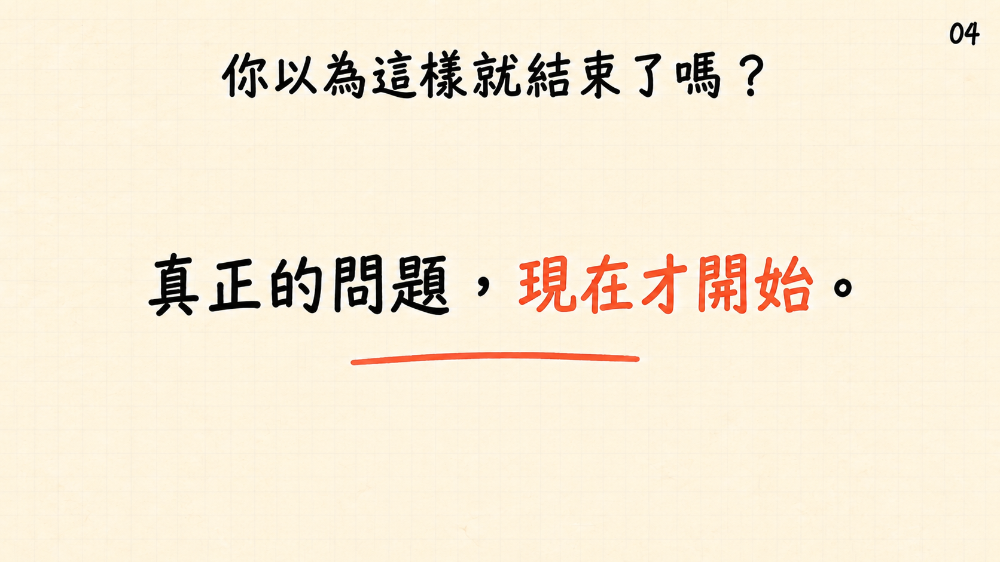
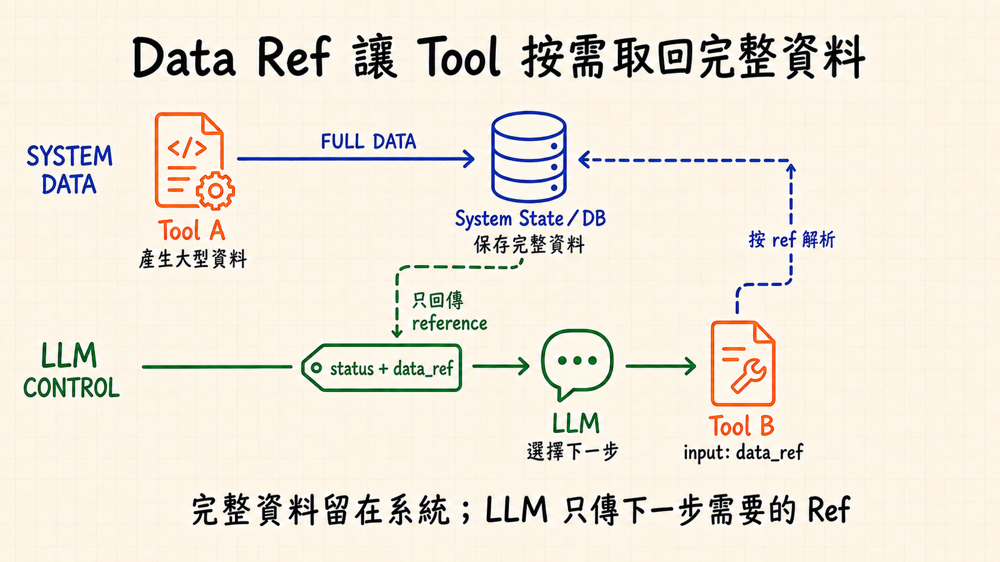
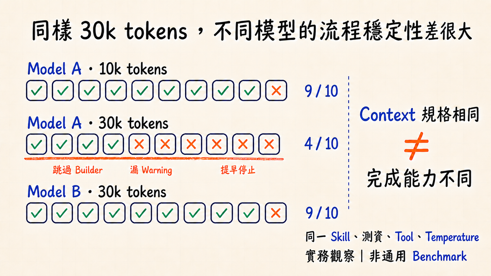
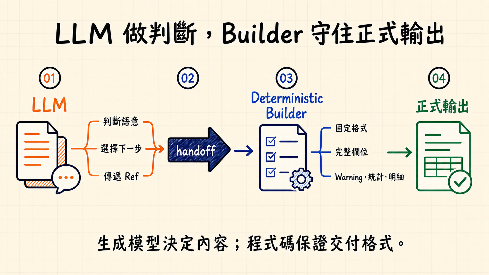
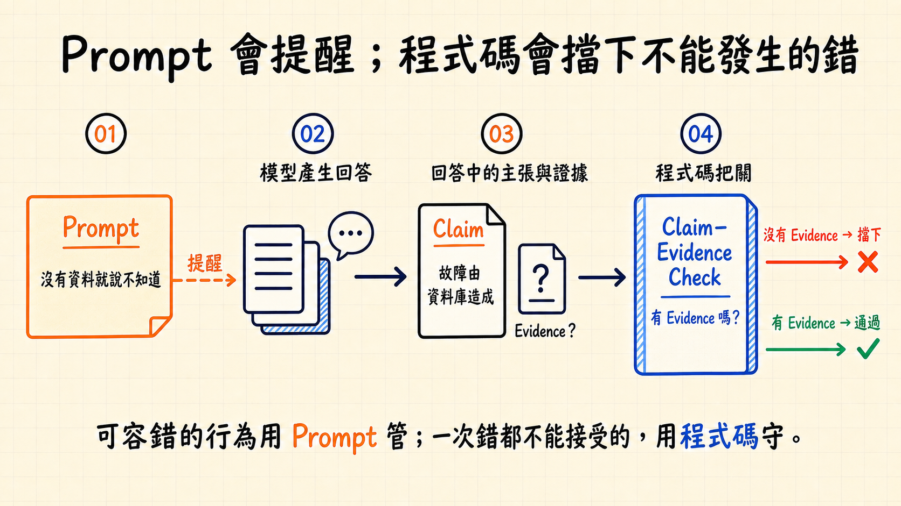
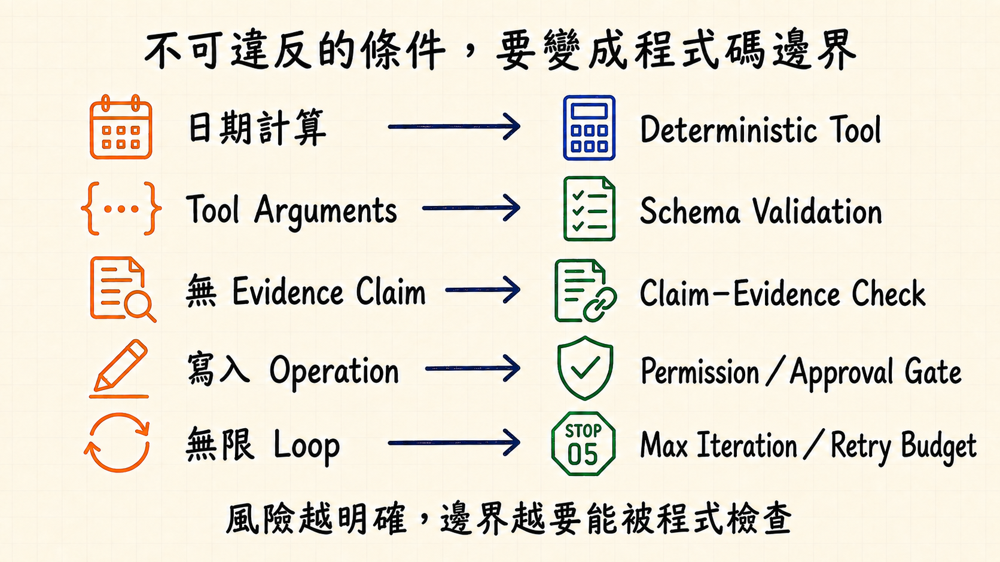
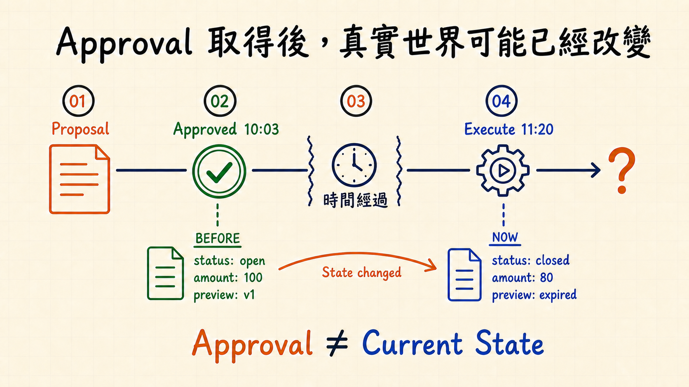
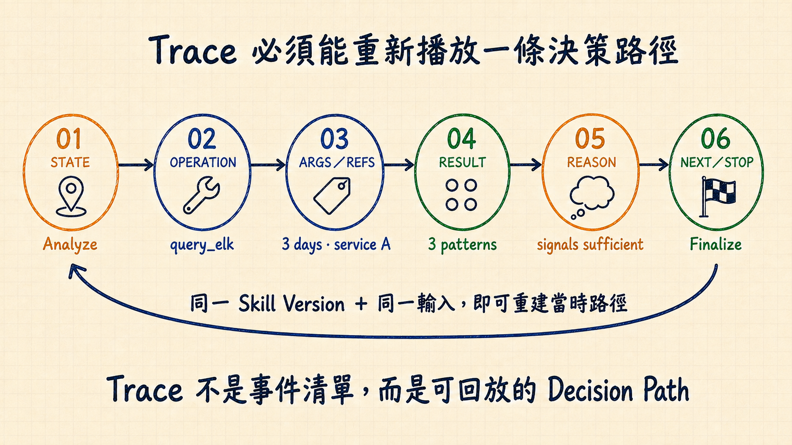
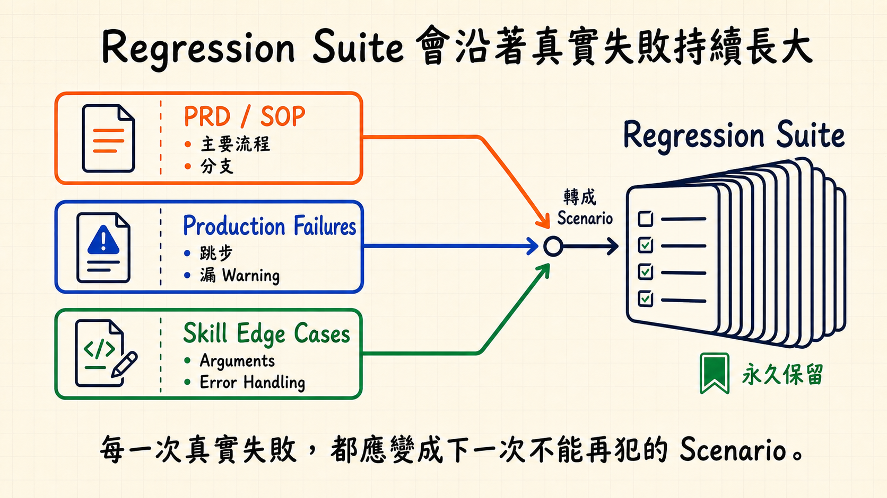
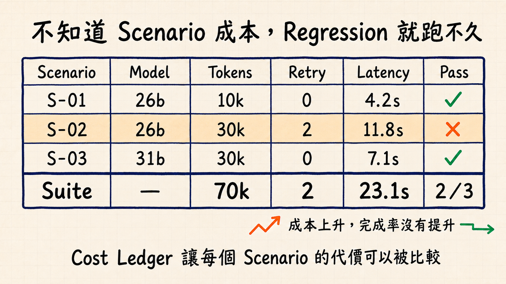

# 圖片式樣本｜完整確認紀錄已補正

重查原始對話後已補回 S01、S02、S03、S10、S12。原先排除 Image-first State Machine／Cost Chain 是整理錯誤；它們在 9/2 已明確通過。現在有 15 張歷史保留 PNG：12 張有使用者明確肯定紀錄，3 張沿用既有保留狀態。

- [完整圖片總覽](gallery.html)
- [逐張確認證據與更正說明](confirmation-index-2026-09-07.md)

## 補回的五張已確認樣本

- [S01｜Claim–Evidence](sample-S01-claim-evidence.png)
- [S02｜Agent 成本執行鏈](sample-S02-cost-chain.png)
- [S03｜狀態機與 Runtime](sample-S03-state-machine.png)
- [S10｜Context Shaping v4](sample-S10-context-shaping-v4.png)
- [S12｜Three Record Layers v4](sample-S12-three-record-layers-v4.png)

## 以下為先前 GitHub 十張集合（不是完整確認集合）

| Slide 04 | Slide 14 |
| --- | --- |
|  |  |

| Slide 17 | Slide 24 |
| --- | --- |
|  |  |

| Slide 30 | Slide 31 |
| --- | --- |
|  |  |

| Slide 33 | Slide 42 |
| --- | --- |
|  |  |

| Slide 46 | Slide 54 |
| --- | --- |
|  |  |

## 對照

| Slide | 核心訊息 |
| --- | --- |
| 04 | Tool Loop 跑起來後，真正的工程問題才開始。 |
| 14 | 完整資料留在系統，LLM 只收到下一步需要的 reference。 |
| 17 | 相同 Context 規格不代表模型在長流程的完成能力相同。 |
| 24 | LLM 做判斷，Deterministic Builder 守住正式輸出。 |
| 30 | Prompt 管可容錯行為；不可接受的錯誤交由程式碼攔下。 |
| 31 | 不可違反的條件必須變成可檢查的程式碼邊界。 |
| 33 | Approval 取得後，真實世界仍可能已經改變。 |
| 42 | Trace 必須能重播一條決策路徑。 |
| 46 | 真實失敗會持續成長為 Regression Scenario。 |
| 54 | Cost Ledger 讓每個 Scenario 的代價可比較。 |
