# 01–15 頁圖片｜v2 重點標記樣本

依圖片生成約束 v2 重製 13 張：01、02、03、05、06、07、08、09、10、11、12、13、15。

狀態：待使用者確認。04、14 沿用既有圖片。本批使用內建 image_gen；字形為生成圖形，以指定圖片作參考。

03 使用程式碼行色彩強調；06 使用雙欄色彩層級；其餘各有一組關鍵詞與底線。07 修正重複標籤；08 移除多餘 icon、對齊位置標籤；15 移除容易被誤讀為定量比較的橫線。

[逐頁圖片預覽](gallery.html)

## 01

## 02

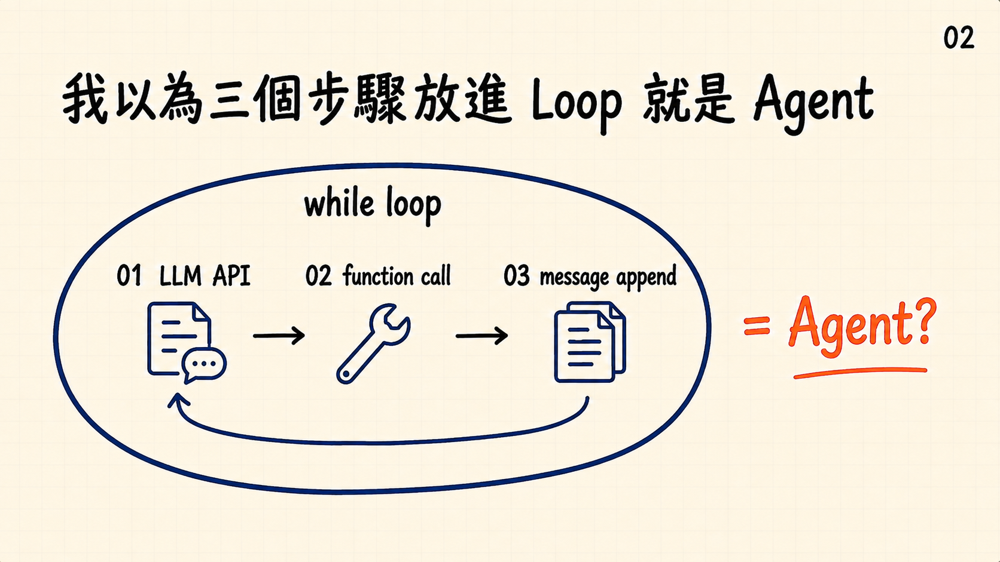

## 03

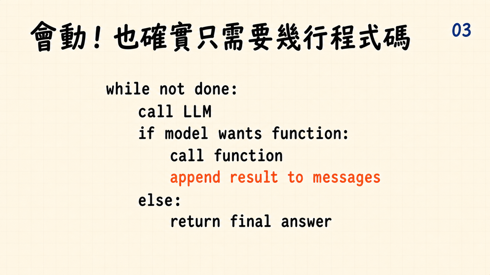

## 05

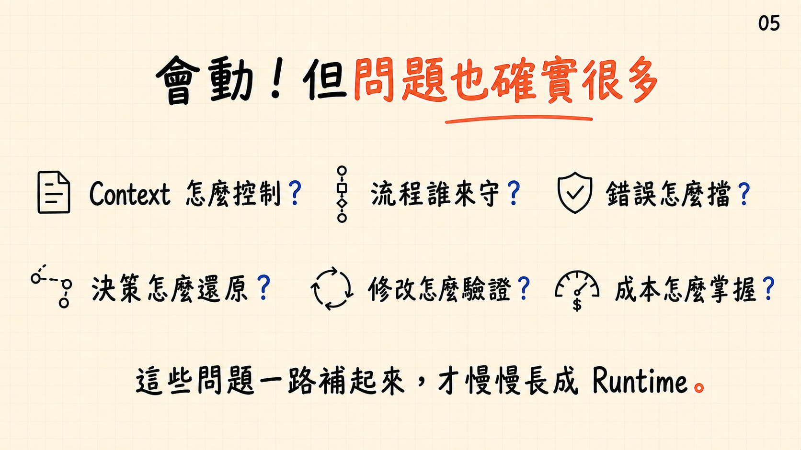

## 06

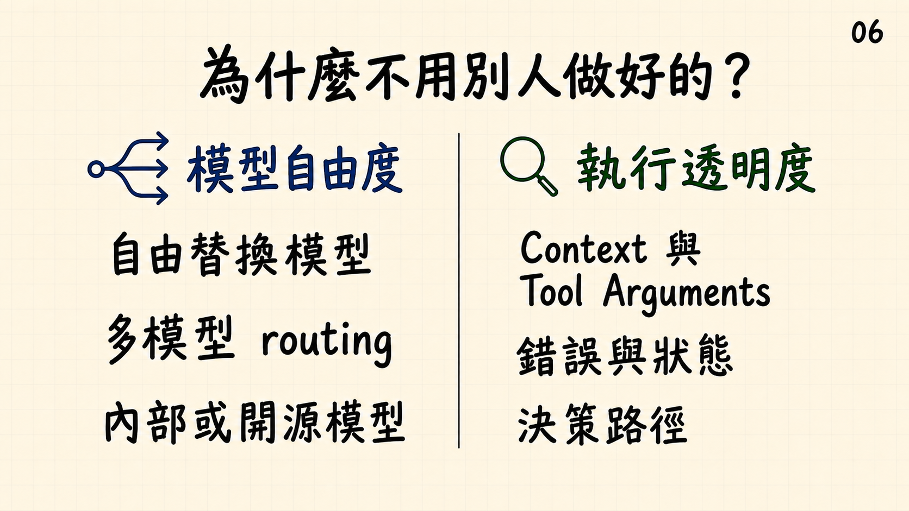

## 07

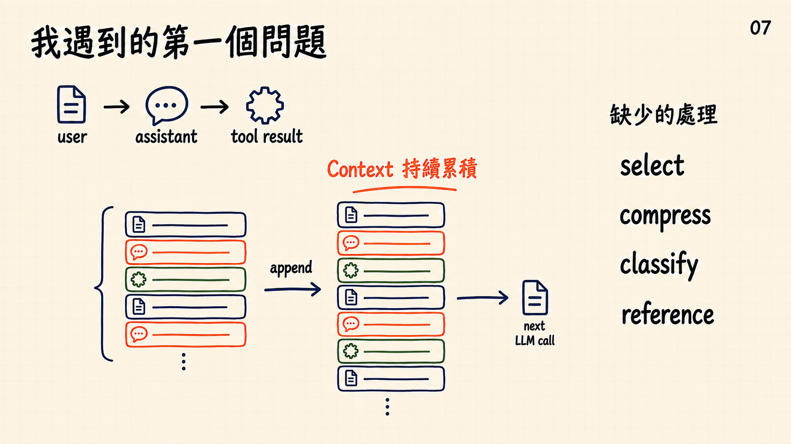

## 08

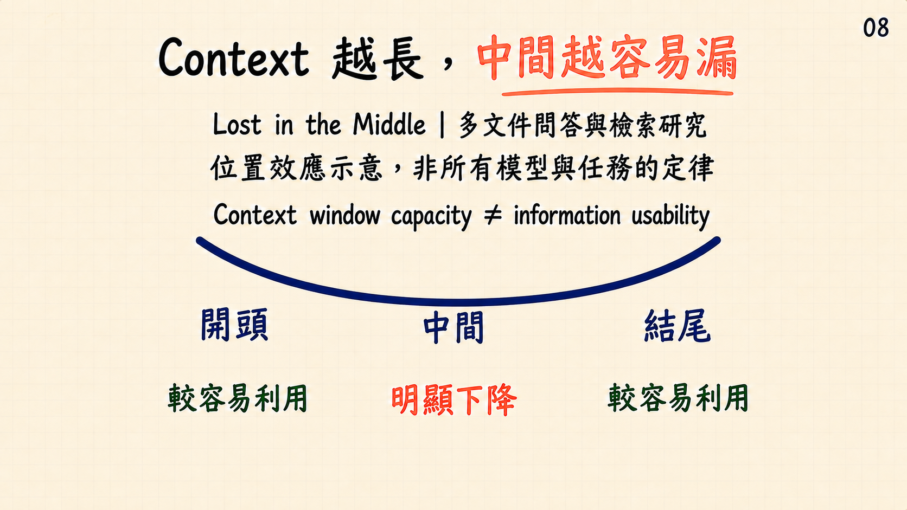

## 09

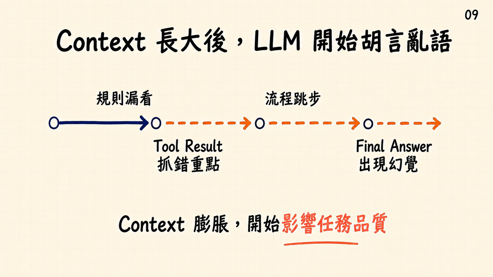

## 10

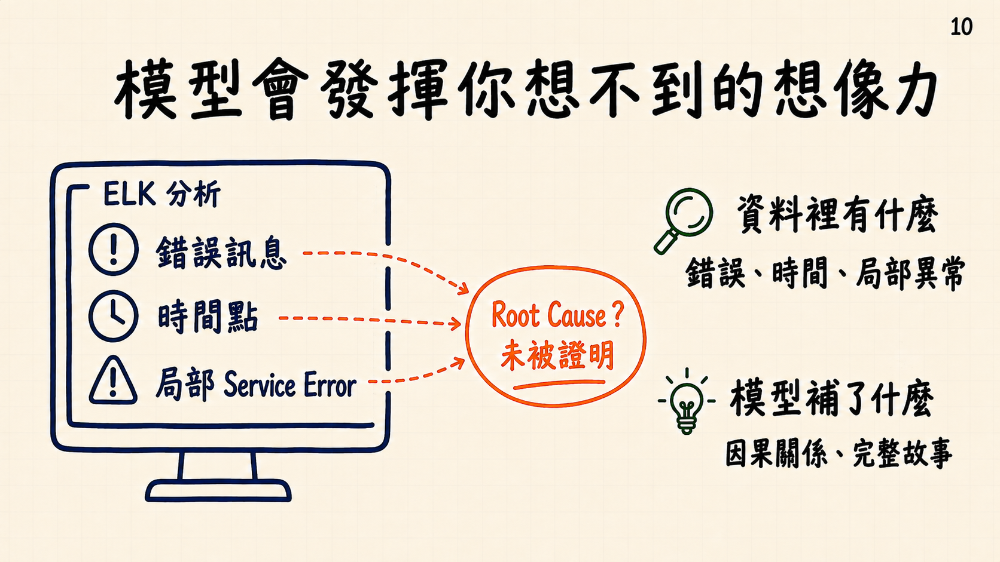

## 11

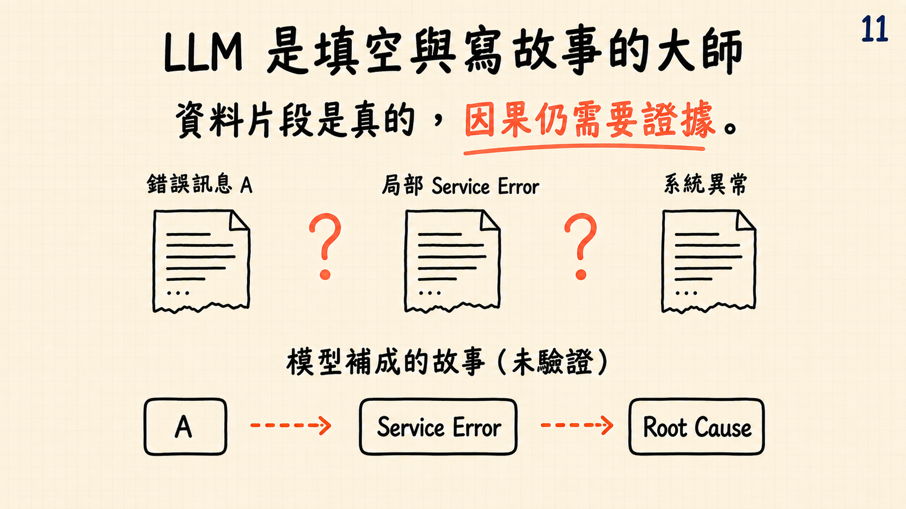

## 12

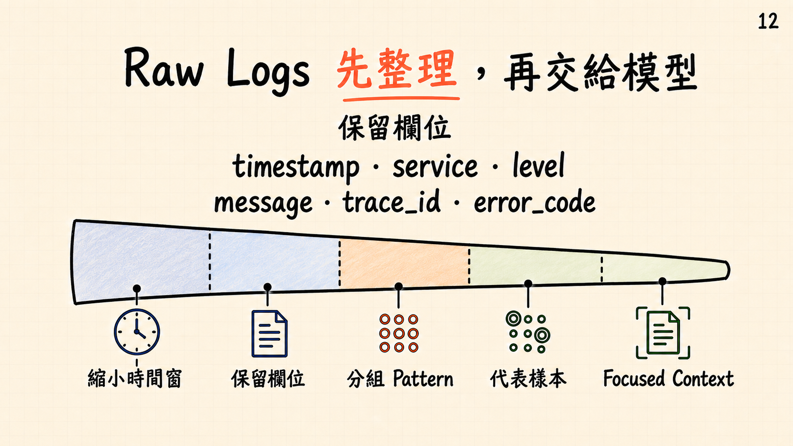

## 13

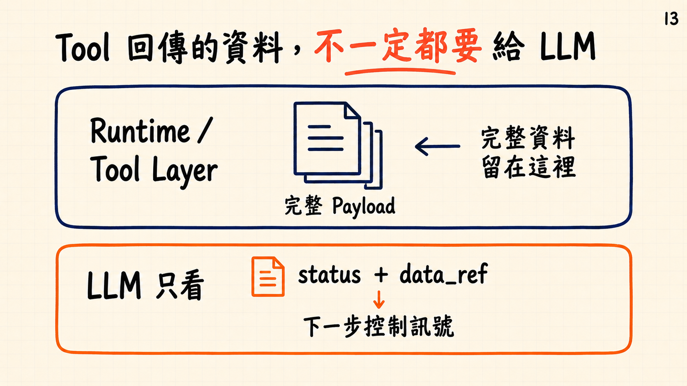

## 15

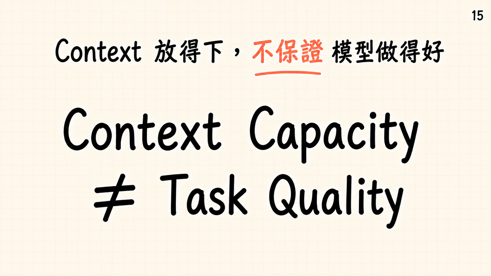

