# 自己刻 Agent 框架｜56頁完整整合 v30

整合使用者確認的第5頁：「模型選擇／Model Choice、執行可控／Controllability、治理整合／Governance」。總數56頁、頁序不變，其餘55張圖片與v29位元組相同；歷史版本保留。第5頁已確認，不代表整份圖集或會場投影已驗收。未commit／push。

[只看56頁圖片](gallery-images-only.html) · [圖片、重點與講稿](gallery.html) · [56頁分頁稿](../../../storyboard/56-slide-storyboard-v30-integrated.md) · [生成紀錄](GENERATION.json) · [檢查紀錄](verification.json)

精確字型、實際pt與會場投影未驗收。Trace回看指保存的歷史紀錄，不保證重新執行得到相同答案，也不表示讀取模型內心。

## 全頁索引

|頁碼|標題|
|---|---|
|[01](#slide-01)|自己刻 Agent 框架，最難的不是呼叫 LLM|
|[02](#slide-02)|這個 Tool Loop，幾行程式碼就能跑起來|
|[03](#slide-03)|你以為這樣就結束了嗎？|
|[04](#slide-04)|會動之後，六個問題攤開了|
|[05](#slide-05)|為什麼選擇自己刻？|
|[06](#slide-06)|第一個問題：工具結果，怎麼交回模型？|
|[07](#slide-07)|每輪都 append，Context 越堆越多|
|[08](#slide-08)|工具結果留完整，給模型的內容按需準備|
|[09](#slide-09)|模型傳 Ref，工具取完整資料|
|[10](#slide-10)|要分析 Log，卻查回一大包原始紀錄|
|[11](#slide-11)|分析 Log，先挑出這次需要的內容|
|[12](#slide-12)|控制 Context，不只是為了省 Token|
|[13](#slide-13)|30k Context，迫使我換成更大的模型|
|[14](#slide-14)|Context 管理會影響需要多大的模型|
|[15](#slide-15)|分析完 Log，任務就完成了嗎？|
|[16](#slide-16)|正式報告，需要由 Builder 產生|
|[17](#slide-17)|我已在 Skill 寫明：分析後呼叫 Builder|
|[18](#slide-18)|模型卻跳過 Builder，自己寫了摘要|
|[19](#slide-19)|自行摘要後，格式不符、分類漏掉|
|[20](#slide-20)|有回答，不代表流程正確完成。|
|[21](#slide-21)|怎麼知道 Agent 真的完成任務？|
|[22](#slide-22)|結果完成了，流程也做對了嗎？|
|[23](#slide-23)|這些要求，要怎麼評估？|
|[24](#slide-24)|回到案例：報告交了，Builder 也做了嗎？|
|[25](#slide-25)|固定條件重跑，觀察流程是否穩定|
|[26](#slide-26)|這批測試全過，不代表下次一定照做|
|[27](#slide-27)|不能接受的錯，就不能只靠模型遵守|
|[28](#slide-28)|把不可接受的錯，變成可檢查的條件|
|[29](#slide-29)|同一份 Log 報告，還可能多出沒有依據的內容|
|[30](#slide-30)|每一項結論，都要對回 Tool Result|
|[31](#slide-31)|沒有對應證據的結論，不能進正式報告|
|[32](#slide-32)|有些決定，不能讓 Agent 自己確認|
|[33](#slide-33)|先確認理解，避免做完錯誤的任務|
|[34](#slide-34)|寫入、扣款或對外通知，執行前要先批准|
|[35](#slide-35)|批准後，執行前仍要重新檢查條件|
|[36](#slide-36)|有人審核，任務仍可能出錯|
|[37](#slide-37)|回到 Builder 案例：漏掉的步驟，怎麼追查？|
|[38](#slide-38)|完整 Trace，讓當時的執行過程可以回放|
|[39](#slide-39)|停止之前，Agent 看到了什麼？|
|[40](#slide-40)|追查舊 Run，不能拿新版 Skill 解釋|
|[41](#slide-41)|找到追查線索，再提出修改|
|[42](#slide-42)|改完 Skill，整次任務都要重新測|
|[43](#slide-43)|改完之後，報告符合要求了嗎？|
|[44](#slide-44)|漏掉的 Builder，這次有呼叫嗎？|
|[45](#slide-45)|呼叫了 Builder，傳入的資料也對嗎？|
|[46](#slide-46)|驗收修改：哪些用程式，哪些用 Judge？|
|[47](#slide-47)|踩過的坑，留進回歸測試|
|[48](#slide-48)|通過幾次，才接受這版修改？|
|[49](#slide-49)|修好一個問題，也可能弄壞其他情境。|
|[50](#slide-50)|從第一版 Skill 到功能完成，我沒有手寫過一行 Prompt。|
|[51](#slide-51)|Eval 的價值不是分數，而是讓 Skill 能被持續修正。|
|[52](#slide-52)|人定義成功標準，修改用測試結果驗收|
|[53](#slide-53)|每輪產生、測試與修正，都要留下成本紀錄|
|[54](#slide-54)|寫出一個 Loop 很簡單，讓一個 Loop 能夠正確地完成任務，才是困難的工程問題。|
|[55](#slide-55)|解決這個問題，不能只靠最新的模型。|
|[56](#slide-56)|模型會越來越聰明，但是你的口袋沒有越來越深。|

<a id="slide-01"></a>

## 01｜自己刻 Agent 框架，最難的不是呼叫 LLM

章節：開場：Tool Loop 與六個問題；圖內編號01。

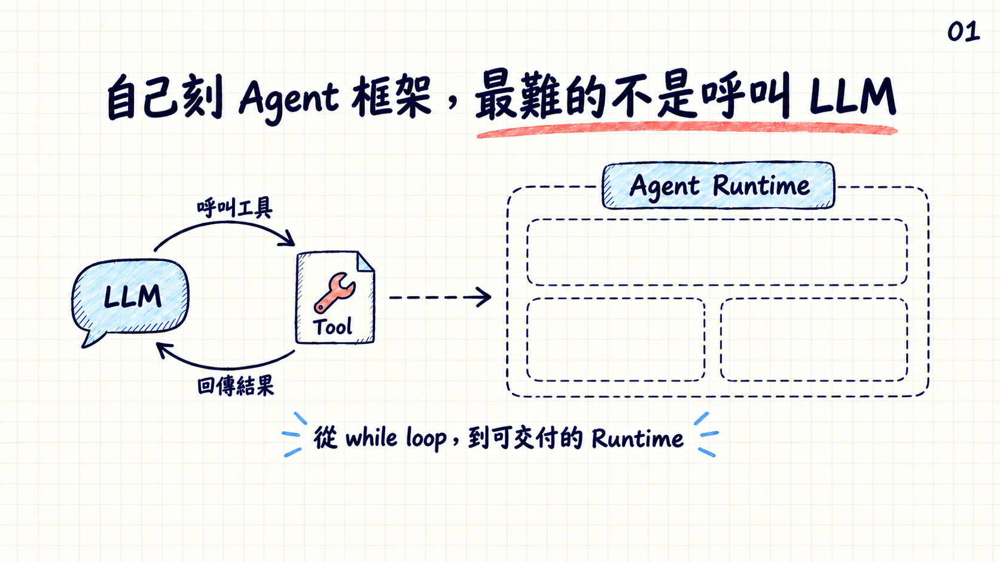

### 核心訊息

用親身失敗與修正經驗，說明從 Tool Loop 到可交付 Runtime 的過程。

### 畫面文字

從 while loop，到可交付的 Runtime

### 畫面設計

大字題名置中，下方一個小循環連向一個尚未展開的系統輪廓。副句靠近主題，不放底緣。底線：最難的不是呼叫 LLM。

畫風統一：原v28第43頁（本版第44頁）為字形母版；中文、英文與彩色重點字保留同一手寫字形家族、相對字重、自然筆壓、起收筆與墨紋，搭配深藍鋼筆外輪廓、稀疏斜排線、淡色鉛筆筆跡、米白淡格紙。實際字型及會場投影仍待使用者確認。

### 搭配講稿

我一開始只想讓模型反覆呼叫工具。真的接上企業流程後，才陸續遇到漏步驟、錯誤結論與難以追查的問題。今天用這些經驗，說明循環之外需要哪些執行責任。

### 接下一頁

先看我一開始以為的 Agent 長什麼樣。

### 本頁重點

- Tool Loop 能讓模型呼叫工具，但還不足以承接真實任務。
- 今天沿著實作遇到的問題，說明如何走到可交付的 Runtime。

<a id="slide-02"></a>

## 02｜這個 Tool Loop，幾行程式碼就能跑起來

章節：開場：Tool Loop 與六個問題；圖內編號02。

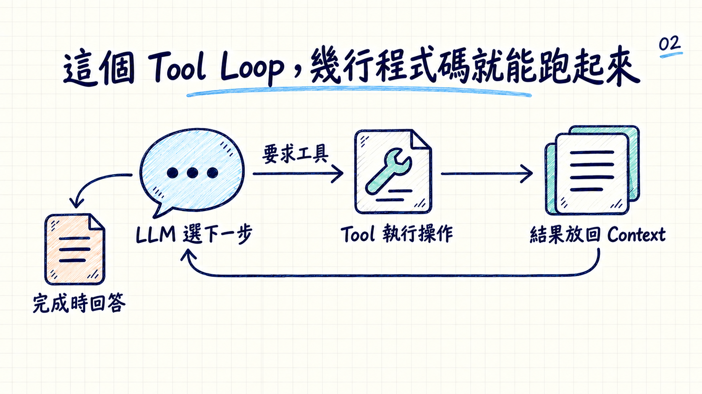

### 核心訊息

LLM 選動作、Tool 執行、結果交回 Context，形成最小可運作循環；能跑起來仍不是可交付。

### 畫面文字

LLM 選下一步｜要求工具｜Tool 執行操作｜結果放回 Context｜完成時回答

### 畫面設計

恢復三個大型語意 icon 的循環。Context 結果回到 LLM；回答出口由 LLM 分出，不直接從 Context 回答。

畫風統一：原v28第43頁（本版第44頁）為字形母版；中文、英文與彩色重點字保留同一手寫字形家族、相對字重、自然筆壓、起收筆與墨紋，搭配深藍鋼筆外輪廓、稀疏斜排線、淡色鉛筆筆跡、米白淡格紙。實際字型及會場投影仍待使用者確認。

### 搭配講稿

LLM 是理解文字、判斷下一步的模型；Tool 是查資料或執行操作的程式。我最初的做法很簡單：呼叫模型，模型要求工具就執行，把結果 append 回 Context，再問一次；模型交出答案就結束。這幾行概念碼真的可以跑起來，所以當時我以為主要工作完成了。但這只是最小循環，還沒處理真實任務需要的可靠性。

### 接下一頁

直到它開始碰到真實任務：工具會動、模型會答，就代表可以交付嗎？

### 本頁重點

- 模型要求工具時才執行；結果交回 Context，繼續問模型。
- 最小循環確實能跑，但還沒承接真實任務的責任。

<a id="slide-03"></a>

## 03｜你以為這樣就結束了嗎？

章節：開場：Tool Loop 與六個問題；圖內編號03。


### 核心訊息

從 Demo 成功，轉入真實任務帶來的責任。

### 畫面文字

真正的問題，現在才開始。

### 畫面設計

暖米色留白，大句放中央偏上。「現在才開始」珊瑚色，只有這一處手畫底線。無 icon。

畫風統一：原v28第43頁（本版第44頁）為字形母版；中文、英文與彩色重點字保留同一手寫字形家族、相對字重、自然筆壓、起收筆與墨紋，搭配深藍鋼筆外輪廓、稀疏斜排線、淡色鉛筆筆跡、米白淡格紙。實際字型及會場投影仍待使用者確認。

### 搭配講稿

工具會動、模型會回答，很快就能看到。但一進企業流程，我開始遇到那些不會直接報 exception，卻會交出錯誤結果的問題。

### 接下一頁

這些問題，慢慢長成六項必須承接的責任。

### 本頁重點

- 工具會動、模型會回答，只是 Demo 成功。
- 企業任務可能沒有 exception，卻仍交出錯誤結果。

<a id="slide-04"></a>

## 04｜會動之後，六個問題攤開了

章節：開場：Tool Loop 與六個問題；圖內編號04。

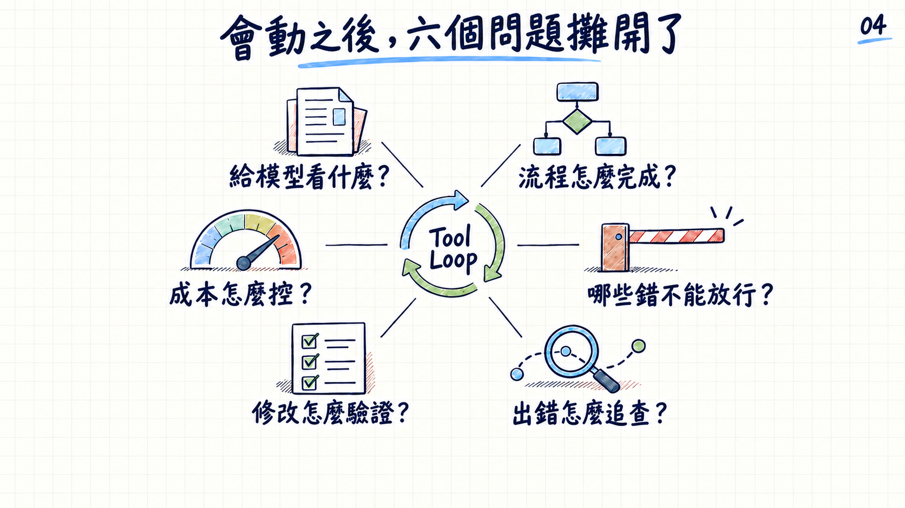

### 核心訊息

建立全場問題地圖，讓結尾能逐一回扣。

### 畫面文字

Tool Loop｜給模型看什麼？｜流程怎麼完成？｜哪些錯必須擋？｜出錯怎麼追查？｜修改怎麼驗證？｜成本能否負擔？

### 畫面設計

中央小循環，六個問題攤成六角，依序搭配文件、流程、閘門、路徑放大鏡、清單、計量表。無箭頭短線表示責任關聯；新 51 沿用位置。底線：無。

畫風統一：原v28第43頁（本版第44頁）為字形母版；中文、英文與彩色重點字保留同一手寫字形家族、相對字重、自然筆壓、起收筆與墨紋，搭配深藍鋼筆外輪廓、稀疏斜排線、淡色鉛筆筆跡、米白淡格紙。實際字型及會場投影仍待使用者確認。

### 搭配講稿

從資訊與流程開始，接著是哪些錯不能通過。出了問題，要能追查、驗證修改，也要付得起反覆測試的成本。等一下會依這些問題一路往下走。

### 接下一頁

在展開之前，先交代我為什麼選擇自己刻。

### 本頁重點

- 六個問題：給什麼資訊、怎麼完成流程、哪些錯不能放行。
- 出錯如何追查、修改如何驗證、每次執行與測試的成本在哪裡。
- 這是全場的問題地圖，最後會回扣整套 Runtime。

<a id="slide-05"></a>

## 05｜為什麼選擇自己刻？

章節：開場：Tool Loop 與六個問題；圖內編號05。

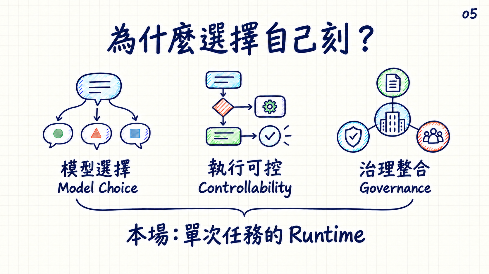

### 核心訊息

自己刻的動機，是掌握模型選擇、執行可控性與既有企業治理的整合。

### 畫面文字

為什麼選擇自己刻？｜模型選擇／Model Choice｜執行可控／Controllability｜治理整合／Governance｜本場：單次任務的 Runtime

### 畫面設計

沿用原三欄icon、置中主標、色彩、米白格紙與鋼筆手寫字形。三個中文短語為主要閱讀層，英文置於其下作為術語補充。模型選擇使用對話框，執行可控使用流程icon，治理整合使用企業／文件／盾牌icon；保留開放括號、範圍註記與頁碼05。不新增資料落地或合規作為獨立自研理由。

### 搭配講稿

現成框架與平台有價值，也能提供多模型與治理能力。我選擇自己刻，主要希望掌握三件事：模型選擇，讓模型可以依任務替換；執行可控，讓我能決定Context怎麼組、工具怎麼接，以及何時介入或停止；治理整合，把公司既有的權限、審核與稽核接進Runtime。不是只有自己刻才能做到，而是我希望掌握這些設計與整合的方式。今天集中在單次任務怎麼執行與驗證，模型介接細節和跨Session記憶另外再談。

### 接下一頁

所以我決定自己把這個 Runtime 接起來。最初就是前面那個循環：模型選工具、工具執行、結果交回模型。接著，第一個需要我做決定的地方出現了：工具回來的這一大包資料，該怎麼交回去？

### 本頁重點

- 自己刻的理由：模型選擇、執行可控，以及既有企業治理整合。
- 這場聚焦單次任務的執行與驗證，不展開模型介接及跨Session記憶。

<a id="slide-06"></a>

## 06｜第一個問題：工具結果，怎麼交回模型？

章節：Context：什麼資訊給模型看？；圖內編號06。

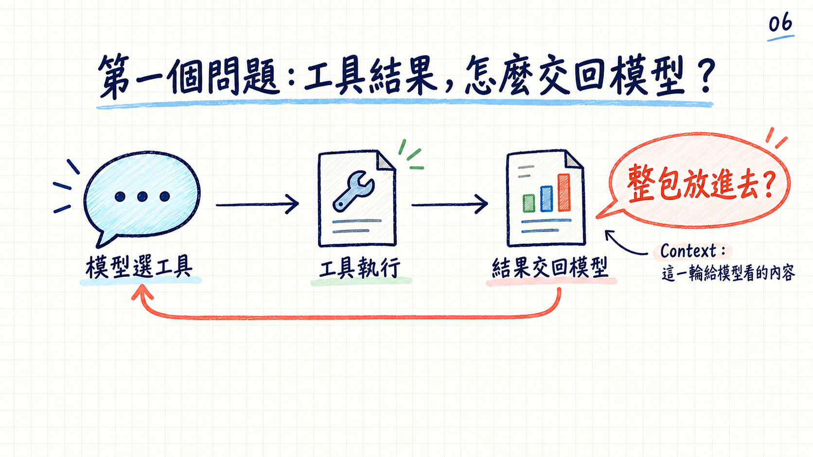

### 核心訊息

接回開場的 Tool Loop，指出「工具結果交回模型」是第一個要處理的決定，帶入 Context 的用途。

### 畫面文字

模型選工具｜工具執行｜結果交回模型｜Context：這一輪給模型看的內容｜整包放進去？

### 畫面設計

保留段落入口的留白與主問題，重新出現開場三步循環：模型選工具 → 工具執行 → 結果交回模型。模型用對話泡泡，工具用文件搭扳手，回傳結果用資料文件。前兩步用低彩度線條，「結果交回模型」這一步以重點色突出，旁邊標「整包放進去？」；Context 的短解釋緊鄰該步。三步標籤維持大字，不加模組或小型架構圖。底線：怎麼交回。

畫風統一：原v28第43頁（本版第44頁）為字形母版；中文、英文與彩色重點字保留同一手寫字形家族、相對字重、自然筆壓、起收筆與墨紋，搭配深藍鋼筆外輪廓、稀疏斜排線、淡色鉛筆筆跡、米白淡格紙。實際字型及會場投影仍待使用者確認。

### 搭配講稿

先停在這個位置：工具已經執行完，現在要把結果交回模型。這一輪交給模型看的內容，就是 Context；裡面也包含使用者要求與任務規則。那工具回來的一大包資料，要怎麼放進去？

### 接下一頁

當時我的做法很直覺：工具回什麼，我就全部加進去。下一頁就是我最初的接法。

### 本頁重點

- 回到 Tool Loop：工具已經執行完，結果要怎麼交回模型？
- Context 是這一輪給模型看的內容，包含使用者要求、規則與工具資料。

<a id="slide-07"></a>

## 07｜每輪都 append，Context 越堆越多

章節：Context：什麼資訊給模型看？；圖內編號07。

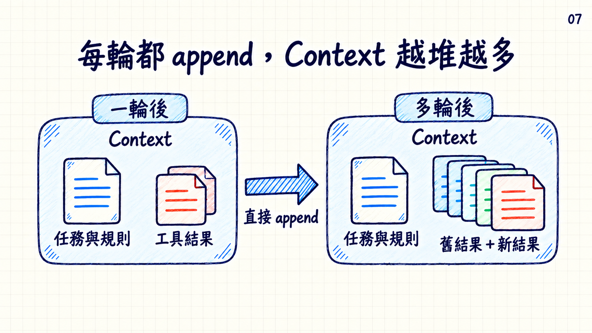

### 核心訊息

直接加入每輪工具結果，會累積舊結果、新結果與無關欄位；內容多不代表下一步更有用。

### 畫面文字

一輪後｜多輪後｜Context｜任務與規則｜工具結果｜舊結果＋新結果｜直接 append

### 畫面設計

同一 Context 從左側一輪到右側多輪逐步展開；兩邊任務與規則都保留，工具結果增加。以同樣語意文件與位置建立連續性，不畫容量爆炸或規則被證實遺忘。

畫風統一：原v28第43頁（本版第44頁）為字形母版；中文、英文與彩色重點字保留同一手寫字形家族、相對字重、自然筆壓、起收筆與墨紋，搭配深藍鋼筆外輪廓、稀疏斜排線、淡色鉛筆筆跡、米白淡格紙。實際字型及會場投影仍待使用者確認。

### 搭配講稿

第一版工具回什麼，我就把它全部 append。一次回傳看起來很自然，幾輪之後，舊結果還在、新結果又加入，每份結果裡還有大量欄位。任務要求和流程規則也一起帶給模型。這不是說模型一定會忘記規則，而是每次呼叫都帶上更多內容，卻還沒判斷它們對下一步是否有用。

### 接下一頁

不再每輪全部append後，完整工具結果要放哪裡？下一頁先交代資料如何保存，再決定這輪給模型什麼。

### 本頁重點

- 每輪直接 append，使舊結果、新結果與欄位持續累積。
- 累積更多資料，不等於每一項都對下一步有用。

<a id="slide-08"></a>

## 08｜工具結果留完整，給模型的內容按需準備

章節：Context：什麼資訊給模型看？；圖內編號08。

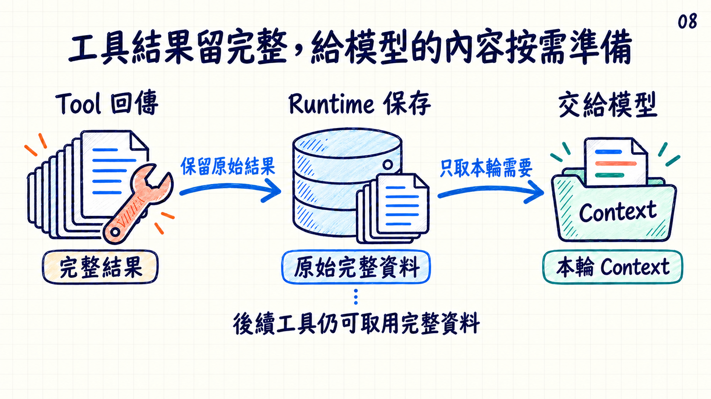

### 核心訊息

工具先回傳完整結果，Runtime保存原始完整資料，供後續工具使用；交給模型的本輪內容則按下一步需要準備。

### 畫面文字

Tool 回傳｜完整結果｜保留原始結果｜Runtime 保存｜原始完整資料｜只取本輪需要｜交給模型｜本輪 Context｜後續工具仍可取用完整資料

### 畫面設計

由左至右三組大型語意icon：工具文件與厚疊結果→系統儲存與原始資料→少量本輪Context。資料庫不再憑空出現；先畫出資料來源與保存動作，再對比完整保留與按需交付。下方一句交代保存理由，虛線是說明連結，不是新執行步驟。

畫風統一：原v28第43頁（本版第44頁）為字形母版；中文、英文與彩色重點字保留同一手寫字形家族、相對字重、自然筆壓、起收筆與墨紋，搭配深藍鋼筆外輪廓、稀疏斜排線、淡色鉛筆筆跡、米白淡格紙。實際字型及會場投影仍待使用者確認。

### 搭配講稿

工具回傳一大包結果時，我不會因為模型這一輪只需要其中一部分，就把其餘資料丟掉。這個 Runtime 會先保存原始完整結果，因為後續工具可能還需要取用完整資料；再依下一步用途，準備這一輪給模型看的內容。資料不是一開始就在資料庫裡，是工具回傳後，由 Runtime 刻意留下來的。完整保存和全部塞進 Context 是兩件不同的事；這是本案例的設計選擇，不是所有工具都會自動入庫。如果下一步只是把結果交給另一個工具，模型也不必讀完這一整包資料。

### 接下一頁

完整結果已經留下來了。如果模型不用讀整包資料，下一個工具怎麼找到它？下一頁看 status 與 data_ref 怎麼分工。

### 本頁重點

- 先保存工具的原始完整結果，後續工具仍可取用。
- 給模型的本輪Context按下一步需要準備，不等於把資料全部塞入。

<a id="slide-09"></a>

## 09｜模型傳 Ref，工具取完整資料

章節：Context：什麼資訊給模型看？；圖內編號09。

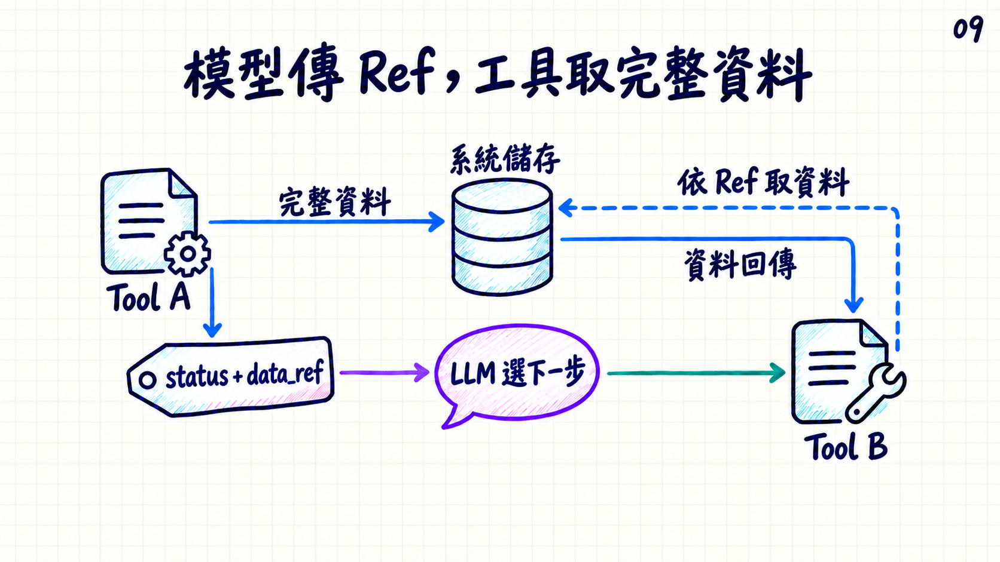

### 核心訊息

模型判斷只需 status 與 data_ref；完整 API 資料由系統保存，下一個工具在服務端依 Ref 取回。

### 畫面文字

Tool A｜完整資料｜系統儲存｜status + data_ref｜LLM 選下一步｜Tool B｜依 Ref 取資料｜資料回傳

### 畫面設計

保留原語意與構圖。請求為藍色虛線從 Tool B 指向系統儲存；回傳為藍色實線從系統儲存指向 Tool B。兩線分離、箭頭方向明確，不用紅色暗示錯誤。

畫風統一：原v28第43頁（本版第44頁）為字形母版；中文、英文與彩色重點字保留同一手寫字形家族、相對字重、自然筆壓、起收筆與墨紋，搭配深藍鋼筆外輪廓、稀疏斜排線、淡色鉛筆筆跡、米白淡格紙。實際字型及會場投影仍待使用者確認。

### 搭配講稿

接著剛剛保存完整工具結果的設計：如果下一步只需要判斷成功與否，再把資料交給另一個工具，Tool A 就把完整結果存進系統，交給模型的是 status 和 data_ref。模型選好下一步，把 Ref 傳給 Tool B；Tool B 在服務端依 Ref 取回完整資料。模型負責判斷，工具與系統負責搬運。Ref 是取件參照，不是權限，能不能讀、允許做什麼，仍由系統檢查。工具之間需要完整資料，不代表模型也需要讀完整資料。

### 接下一頁

資料搬運可以只傳 Ref；但如果下一步要模型分析 Log，就得給它相關內容。那該給多少？接下來用分析系統 Log 的案例說明。

### 本頁重點

- 模型接收狀態和 Ref，資料搬運由工具與系統處理。
- 取件請求與完整資料回傳分開；Ref 的使用權限仍由系統檢查。
- 只交付下一步需要的資訊，不只是省 Token，也是在減少模型執行負擔。

<a id="slide-10"></a>

## 10｜要分析 Log，卻查回一大包原始紀錄

章節：Context：什麼資訊給模型看？；圖內編號10。

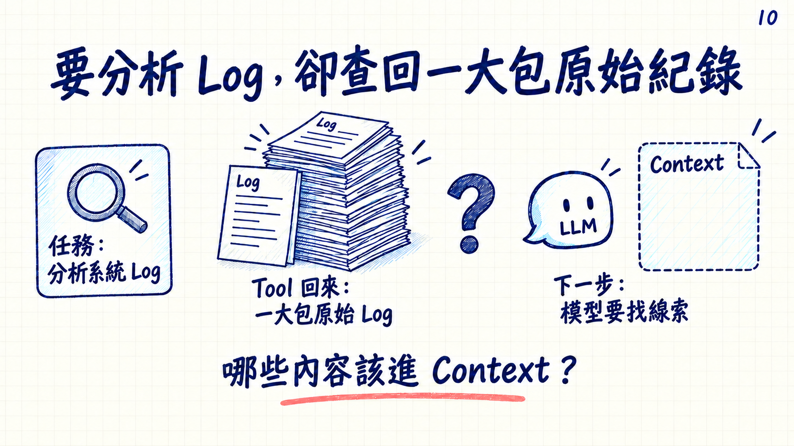

### 核心訊息

先建立一個需要模型閱讀 Log 的具體任務，讓觀眾看見「工具取得完整資料」與「本輪模型需要閱讀的內容」之間仍有選擇。

### 畫面文字

任務：分析系統 Log｜Tool 回來：一大包原始 Log｜下一步：模型要找線索｜哪些內容該進 Context？

### 畫面設計

左側是一張清楚的任務卡「分析系統 Log」，中央工具文件 icon 回來一大疊原始 Log，右側是模型對話泡泡與空白的 Context 區。用一段留白和問號隔開 Log 堆與 Context；不畫直接灌入模型的箭頭，也不先畫篩選方法。文字集中在上半部與圖旁，底部保持留白；只強調「一大包」與「哪些內容」。底線：哪些內容該進 Context？

畫風統一：原v28第43頁（本版第44頁）為字形母版；中文、英文與彩色重點字保留同一手寫字形家族、相對字重、自然筆壓、起收筆與墨紋，搭配深藍鋼筆外輪廓、稀疏斜排線、淡色鉛筆筆跡、米白淡格紙。實際字型及會場投影仍待使用者確認。

### 搭配講稿

現在換成模型確實需要閱讀資料的情況：我請 Agent 分析一段時間的系統 Log。工具查回來的可能是一大包原始紀錄。下一步要分析問題，模型需要讀到相關內容，不能只交給它一個 Ref、完全不給內容；但也不能只因為工具回來了，就把整包資料原封不動塞進 Context。延續前面的原則，完整紀錄可以留在系統，這一輪則先問：這次的問題，需要模型看哪些 Log？

### 接下一頁

先把這次的問題釐清，再決定原始 Log 要怎麼整理給模型。下一頁看有哪些可以按需選用的做法。

### 本頁重點

- 用分析系統 Log 當例子：工具查回一大包原始紀錄。
- 模型要讀相關 Log 才能找線索，但不必直接讀完整包。

<a id="slide-11"></a>

## 11｜分析 Log，先挑出這次需要的內容

章節：Context：什麼資訊給模型看？；圖內編號11。

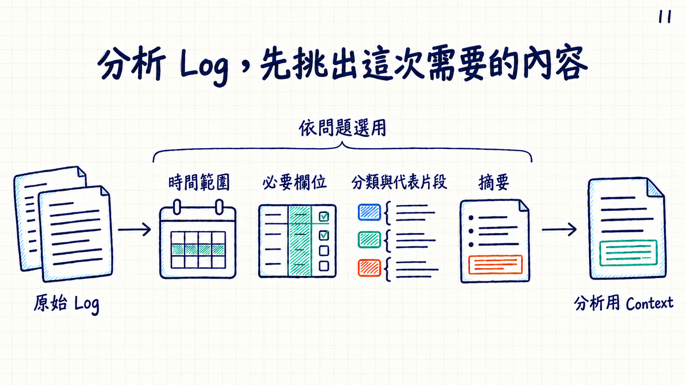

### 核心訊息

依問題選擇資料處理方式，減少不相關資訊。

### 畫面文字

原始 Log｜依問題選用｜時間範圍｜必要欄位｜分類與代表片段｜摘要｜分析用 Context

### 畫面設計

左側 Log 資料堆，中間四個可選處理方式平行排列，右側較小的 Context 文件。四者不串成固定四步。底線：依問題選用。

畫風統一：原v28第43頁（本版第44頁）為字形母版；中文、英文與彩色重點字保留同一手寫字形家族、相對字重、自然筆壓、起收筆與墨紋，搭配深藍鋼筆外輪廓、稀疏斜排線、淡色鉛筆筆跡、米白淡格紙。實際字型及會場投影仍待使用者確認。

### 搭配講稿

回到剛剛的 Log 分析任務：如果問題只涉及某段時間，就先縮小時間範圍；分析只用得到部分欄位，就保留那些欄位；有許多重複紀錄時，可以分類後取代表片段，需要時再做摘要。這些做法依問題選用，不是每次都必須做完四步。原始 Log 仍保留在系統，後續需要細節時能再查。這和剛剛傳 Ref 的做法是同一個原則：模型不需要閱讀的資料留在系統，模型需要閱讀的資料，就按問題準備。

### 接下一頁

不論是工具之間只傳 Ref，還是分析前先挑選 Log，都是在減少模型不必要的負擔。為什麼這不只是省 Token？

### 本頁重點

- 依問題縮小時間範圍、挑必要欄位，或分類取代表片段、做摘要。
- 這些是可選方法，不是固定四步；原始 Log 仍留在系統可供追查。

<a id="slide-12"></a>

## 12｜控制 Context，不只是為了省 Token

章節：Context：什麼資訊給模型看？；圖內編號12。

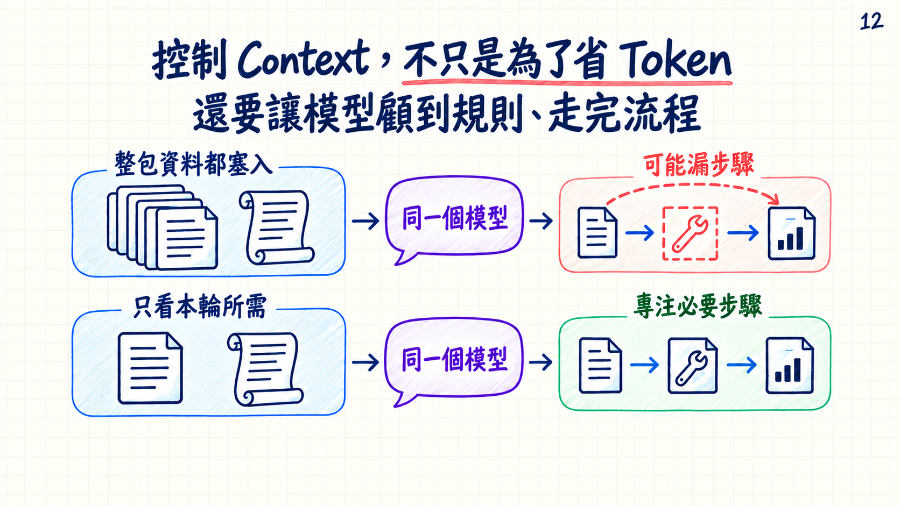

### 核心訊息

傳 Ref 與按需整理 Log，都是控制模型需要處理的資訊；目的不只是省 Token，也要減少模型同時顧資料與流程的負擔。

### 畫面文字

控制 Context，不只是為了省 Token｜還要讓模型顧到規則、走完流程｜整包資料都塞入｜同一個模型｜可能漏步驟｜只看本輪所需｜同一個模型｜專注必要步驟

### 畫面設計

兩排對照同一模型與同一條三步流程。上排為大量資料加必要規則，右側工具節點使用珊瑚色虛線，繞過該節點的弧形箭頭表示可能漏步驟。下排只給本輪所需資料，仍保留同一份必要規則，三個節點按順序連接，表達減少不必要負擔、專注必要步驟的設計目的，並非保證成功或實測完成率。主標與副句在上方，沿用米色極淡格線、手寫字體、鋼筆語意icon與少量排線，底部留白。本56頁順序中的圖內頁碼為12。

畫風統一：原v28第43頁（本版第44頁）為字形母版；中文、英文與彩色重點字保留同一手寫字形家族、相對字重、自然筆壓、起收筆與墨紋，搭配深藍鋼筆外輪廓、稀疏斜排線、淡色鉛筆筆跡、米白淡格紙。實際字型及會場投影仍待使用者確認。

### 搭配講稿

前面看了兩種情況：下一個工具要用完整資料時，模型只傳 Ref；模型要分析 Log 時，就準備這次需要閱讀的內容。它們都不是單純追求 Token 越少越好。模型不只要讀資料，還要顧到必要規則、判斷下一步，把整個流程走完。同一個模型要同時處理的資料、工具結果與流程狀態越多，就可能越難顧到這些要求。即使 Context 還沒有超過上限，原本能完成任務的模型，也可能開始漏步驟或提早停止。所以我們按下一步需要準備 Context，但保留完成任務所需的資訊與規則。圖的下排表達的是減少負擔的設計目的，不代表整理後就一定成功；下一頁看我實際遇到的例子。

### 接下一頁

接下來用同一個 Workflow 的實測來看：Context 從 10k 增加到 30k 後，原本模型的完成次數如何變化？為什麼最後必須換成更大的模型？

### 本頁重點

- Ref 與資料整理不只是省 Token，也是在減少模型同時處理的負擔。
- 模型還要顧到規則、判斷下一步；Context 沒滿也可能漏步驟。
- 按需提供資訊並保留必要規則；是否有效仍要用同一任務實測，不保證整理後一定成功。

<a id="slide-13"></a>

## 13｜30k Context，迫使我換成更大的模型

章節：Context：什麼資訊給模型看？；圖內編號13。

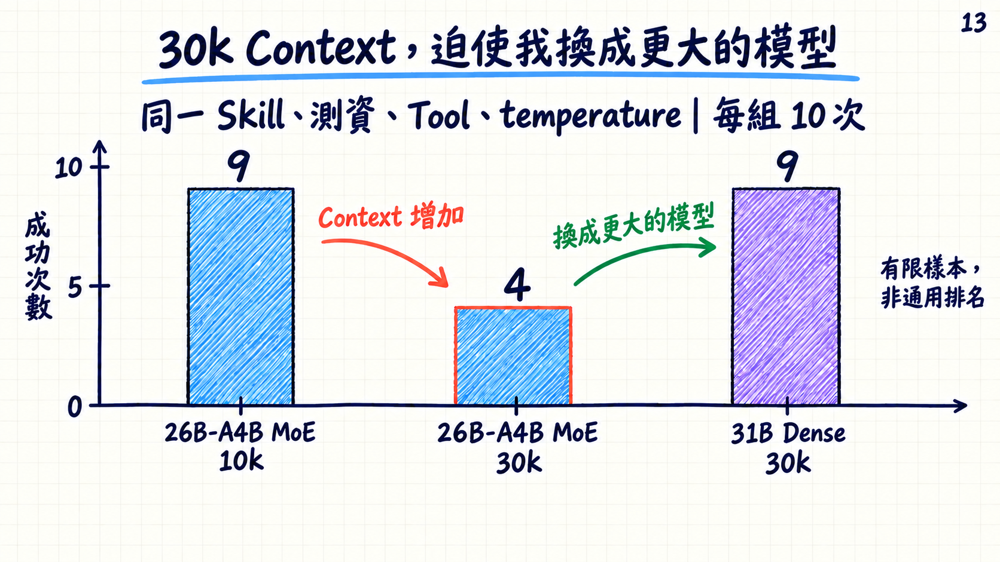

### 核心訊息

同一個 Workflow 在 Context 變重後，26B-A4B MoE 的完成率下降；換成 31B Dense 才恢復。這組觀察呈現的是 Context 負載如何推高模型需求，不是模型排行榜。

### 畫面文字

```text
同一 Skill、測資、Tool、temperature｜每組 10 次
成功次數
26B-A4B MoE・10k：9
26B-A4B MoE・30k：4
31B Dense・30k：9
仍是同一個 Workflow
有限樣本，非通用排名
```

### 畫面設計

正式直條圖：X軸為三組模型與Context條件，Y軸為十次執行中的成功次數，刻度0、5、10，柱頂9、4、9。用同色前兩柱與另一色第三柱表達Context增加後的觀察及換成更大的模型。有限樣本限制放在圖旁；不在這裡提前引入尚未說明的Builder。沿用原圖。

畫風統一：原v28第43頁（本版第44頁）為字形母版；中文、英文與彩色重點字保留同一手寫字形家族、相對字重、自然筆壓、起收筆與墨紋，搭配深藍鋼筆外輪廓、稀疏斜排線、淡色鉛筆筆跡、米白淡格紙。實際字型及會場投影仍待使用者確認。

### 搭配講稿

在同一Skill、測資、Tool與temperature下，gemma-4-26b-a4b-it-mlx在10k Context成功九次，增加到30k後只成功四次；同樣是30k，換成gemma-4-31b-it後又成功九次。失敗時會漏必要步驟、漏必要內容，或者提早停止。我要說的不是31B永遠比較好，而是模型需要同時處理的內容增加後，原本模型可能無法完成同一套Workflow，最後我換成更大的模型。這是每組十次的有限觀察，不作通用排名，也不能把所有失敗都單獨歸因於長度。

### 接下一頁

這讓我回頭思考：下一步真的需要模型讀完這麼多內容嗎？不能每次遇到問題，都只用更大的模型補上。

### 本頁重點

- 同一組測試：26B-A4B MoE 在 10k 成功 9/10，30k 降為 4/10。
- 30k 換成 31B Dense 後成功 9/10，呈現 Context 負載推高模型需求的觀察。
- 每組只有十次，不是通用模型排名，也不能把所有失敗都歸因於長度。

<a id="slide-14"></a>

## 14｜Context 管理會影響需要多大的模型

章節：Context：什麼資訊給模型看？；圖內編號14。

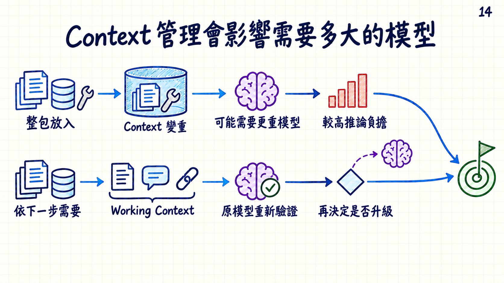

### 核心訊息

有效控制Context，是控制完成任務所需模型能力與推論負擔的一個重要設計選擇；不要不加區分地把所有資料交給模型，或只靠升級模型處理問題。

### 畫面文字

整包放入｜Context 變重｜可能需要更重模型｜較高推論負擔｜依下一步需要｜Working Context｜原模型重新驗證｜再決定是否升級

### 畫面設計

左右兩條清楚的決策路徑。上方路徑：完整資料與工具結果整包進 Context，容器變重，接著指向「可能需要更重模型」與較高推論負擔。下方路徑：完整資料留在 Runtime，summary、control signal 或 data_ref 進入 Working Context，接著回到原模型與同一個 Workflow，標示「重新驗證」。只有重跑仍不足時，箭頭才通往升級模型。兩條路徑共用同一個任務終點，避免讓人誤解成不同難度的任務；也不要畫成整理後 MoE 必然成功。底線：整理後再驗證。

畫風統一：原v28第43頁（本版第44頁）為字形母版；中文、英文與彩色重點字保留同一手寫字形家族、相對字重、自然筆壓、起收筆與墨紋，搭配深藍鋼筆外輪廓、稀疏斜排線、淡色鉛筆筆跡、米白淡格紙。實際字型及會場投影仍待使用者確認。

### 搭配講稿

這個經驗讓我更重視Context管理。我要的不是一味把Context壓到最短，而是把完整資料留在系統，只交給模型下一步需要的內容、狀態和必要規則。如果我們有效控制Workflow執行過程中的資訊負擔，就可能不必一開始選用更大的模型；是否能完成仍要依任務與執行結果判斷，這組數據沒有直接證明整理後一定成功。更大的模型也往往帶來更高推論負擔，實際速度還受到硬體、量化與框架影響。這一段的重點是：先管理模型要處理什麼，不要所有東西都塞進去，再只靠模型升級。

### 接下一頁

前面我們處理的是，Log要怎麼交給模型。接下來回到任務的交付目標：模型分析完之後，還要交付什麼？

### 本頁重點

- Context負載會影響完成任務所需的模型能力與推論負擔。
- 先判斷下一步需要什麼；完整資料留在系統，必要資訊和規則交給模型。
- 減少不必要負擔不保證成功，但不應每次都只靠升級模型。

<a id="slide-15"></a>

## 15｜分析完 Log，任務就完成了嗎？

章節：Skill：流程真的會照做嗎？；圖內編號15。

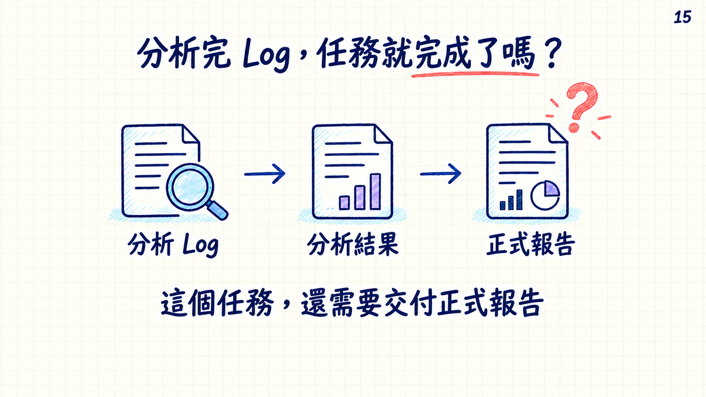

### 核心訊息

以Log分析場景建立後續流程章的交付目標：取得分析結果還不夠，任務另要求交付正式報告。這裡先建立需求，不提前宣告模型漏步驟。

### 畫面文字

分析完 Log，任務就完成了嗎？｜分析 Log｜分析結果｜正式報告｜這個任務，還需要交付正式報告

### 畫面設計

三個大型語意文件依序表示分析Log、分析結果、正式報告；最後一份正式報告旁放珊瑚問號，提示還有交付需求。箭頭只是任務目標的教學鋪陳，不表示已成功執行。標題問句畫重點，必要說明置於中央下方安全區，頁碼15。

畫風統一：原v28第43頁（本版第44頁）為字形母版；中文、英文與彩色重點字保留同一手寫字形家族、相對字重、自然筆壓、起收筆與墨紋，搭配深藍鋼筆外輪廓、稀疏斜排線、淡色鉛筆筆跡、米白淡格紙。實際字型及會場投影仍待使用者確認。

### 搭配講稿

前面用Log分析說明模型需要哪些資訊。接下來繼續用這個容易理解的場景，帶入另一個問題：分析完Log，就算任務完成了嗎？在我們接下來討論的報告交付要求中，使用者不只要一段分析文字，還要一份符合規格的正式報告。這是將主稿的分析差異與Summary Builder案例放進Log分析場景的教學串接，不是說前面的API、模型測試與這次報告全都是同一個實際Run。先把要交付的成果說清楚，才知道後面哪些操作不能省略。

### 接下一頁

正式報告有固定格式與必要內容，因此我準備了專門的Builder來產生它。

### 本頁重點

- 回到Log分析場景，先建立後續的報告交付需求。
- 分析結果與正式報告是不同的交付；這個任務不只要一段分析文字。

<a id="slide-16"></a>

## 16｜正式報告，需要由 Builder 產生

章節：Skill：流程真的會照做嗎？；圖內編號16。

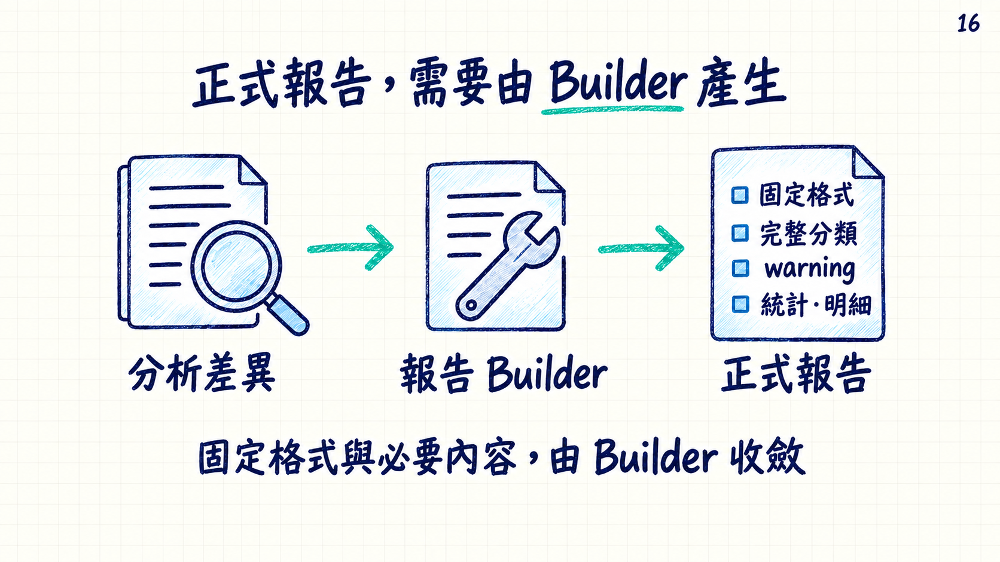

### 核心訊息

承接第15頁的正式報告交付需求，說明為什麼需要Builder，而不是任意一段LLM摘要。這是本案例的交付規格，不是所有Agent任務都必須用Builder。

### 畫面文字

正式報告，需要由 Builder 產生｜分析差異｜報告 Builder｜正式報告｜固定格式｜完整分類｜warning｜統計・明細｜固定格式與必要內容，由 Builder 收斂

### 畫面設計

保留原本分析文件、Builder扳手文件、正式報告三個大型語意icon與左右箭頭，只改標題。正式報告內四個大字欄位說明Builder用途；不是讓模型自行填完的示意。頁碼16，米色淡格線、手寫字與鋼筆排線。

畫風統一：原v28第43頁（本版第44頁）為字形母版；中文、英文與彩色重點字保留同一手寫字形家族、相對字重、自然筆壓、起收筆與墨紋，搭配深藍鋼筆外輪廓、稀疏斜排線、淡色鉛筆筆跡、米白淡格紙。實際字型及會場投影仍待使用者確認。

### 搭配講稿

前面說這個任務不只要分析結果，還要正式報告。正式報告有固定格式，必須帶上完整分類、必要warning、統計與明細，所以我準備了專門的Builder。模型負責分析、判斷下一步並呼叫工具；Builder則把交付格式和必要內容收斂成報告。不是任何一段流暢摘要，都能替代這份指定交付。這是這個任務的需求，並不是所有Agent都只能使用這種流程。

### 接下一頁

工具已經準備好了，我也把分析後要呼叫Builder的要求，寫進Skill。

### 本頁重點

- 這個任務要交付固定格式、完整分類、warning、統計與明細。
- 分析結果交給報告Builder，指定格式與必要內容由程式收斂。

<a id="slide-17"></a>

## 17｜我已在 Skill 寫明：分析後呼叫 Builder

章節：Skill：流程真的會照做嗎？；圖內編號17。

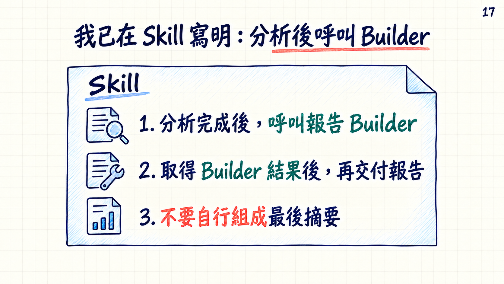

### 核心訊息

必要工具與交付步驟已用自然語言寫明。以具體Skill說明建立期待，下一頁立刻對照實際漏Builder的失敗，不再多放一張抽象疑問。

### 畫面文字

我已在 Skill 寫明：分析後呼叫 Builder｜Skill｜1. 分析完成後，呼叫報告 Builder｜2. 取得 Builder 結果後，再交付報告｜3. 不要自行組成最後摘要

### 畫面設計

保留單張大型Skill文件與三句自然語言指示，分析、工具、報告icon分別對齊各句；只更新主標。指示沒有完成勾章，也沒有系統閘門。頁碼17。

畫風統一：原v28第43頁（本版第44頁）為字形母版；中文、英文與彩色重點字保留同一手寫字形家族、相對字重、自然筆壓、起收筆與墨紋，搭配深藍鋼筆外輪廓、稀疏斜排線、淡色鉛筆筆跡、米白淡格紙。實際字型及會場投影仍待使用者確認。

### 搭配講稿

我不只是心裡希望模型呼叫Builder，也已經把要求寫進Skill。把主稿案例濃縮成大家看得懂的示意，就是分析後呼叫報告Builder，取得Builder結果再交付，不要自行組成最後摘要。這不是逐字貼上正式Skill，而是呈現已經寫明的指示。我的實務仍然是用自然語言說下一步要做什麼，讓LLM讀完後推論並呼叫工具，不是把流程改寫成硬編碼狀態機。我當時以為，寫清楚了應該就會照做。

### 接下一頁

但實際執行時，它卻跳過了Builder，直接交出自己寫的摘要。

### 本頁重點

- Skill以自然語言說明分析後呼叫Builder、取回結果再交付。
- 這些是模型收到的指示，不是程式強制執行的狀態機。

<a id="slide-18"></a>

## 18｜模型卻跳過 Builder，自己寫了摘要

章節：Skill：流程真的會照做嗎？；圖內編號18。

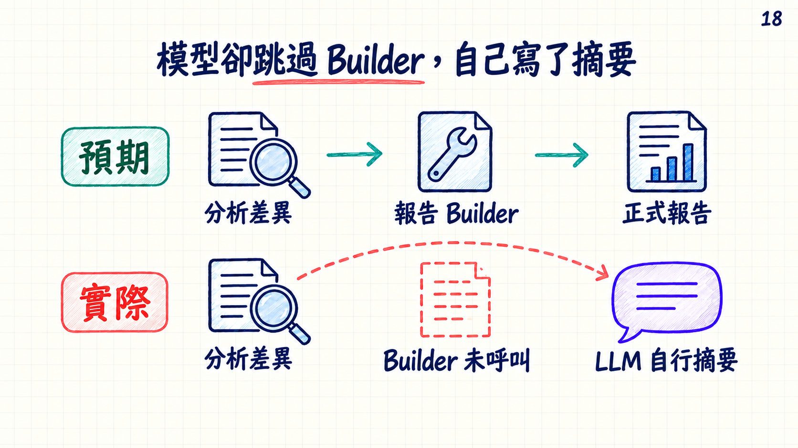

### 核心訊息

緊接Skill已寫明的要求，立刻揭示主稿的具體失敗：跳過build_execution_summary而自行摘要。先讓聽眾看見問題，再談Evaluation方法。

### 畫面文字

模型卻跳過 Builder，自己寫了摘要｜預期｜分析差異｜報告 Builder｜正式報告｜實際｜Builder 未呼叫｜LLM 自行摘要

### 畫面設計

沿用前版第21頁的上下預期／實際路徑，移到新第18頁並更新標題與圖內頁碼。下排用珊瑚虛線Builder缺口和繞過箭頭，連到紫色自行摘要泡泡。正式報告與摘要不是同一個icon；沒有Runtime閘門。

畫風統一：原v28第43頁（本版第44頁）為字形母版；中文、英文與彩色重點字保留同一手寫字形家族、相對字重、自然筆壓、起收筆與墨紋，搭配深藍鋼筆外輪廓、稀疏斜排線、淡色鉛筆筆跡、米白淡格紙。實際字型及會場投影仍待使用者確認。

### 搭配講稿

主稿的實際案例已要求先analyze_discrepancies，再呼叫build_execution_summary。但某些Run沒有呼叫Builder，而是LLM自己組出摘要。有答案、沒有exception，看起來像完成了，必要工具卻根本沒有執行。這正好對照上一頁：Skill已經寫明，模型仍不一定照做。前面的Log場景是幫大家理解報告交付的教學串接，不是宣稱API、模型實測與這次報告都是同一個實際Run。少了Builder，不只是換一條路徑，最後交付也出了具體問題。

### 接下一頁

它自己交出的摘要，格式不符合要求，而且有分類結果被漏掉。

### 本頁重點

- 要求先分析，再呼叫Builder；實際有些Run沒有呼叫Builder。
- 模型仍交出摘要、沒有exception，表面有答案不代表流程完成。

<a id="slide-19"></a>

## 19｜自行摘要後，格式不符、分類漏掉

章節：Skill：流程真的會照做嗎？；圖內編號19。

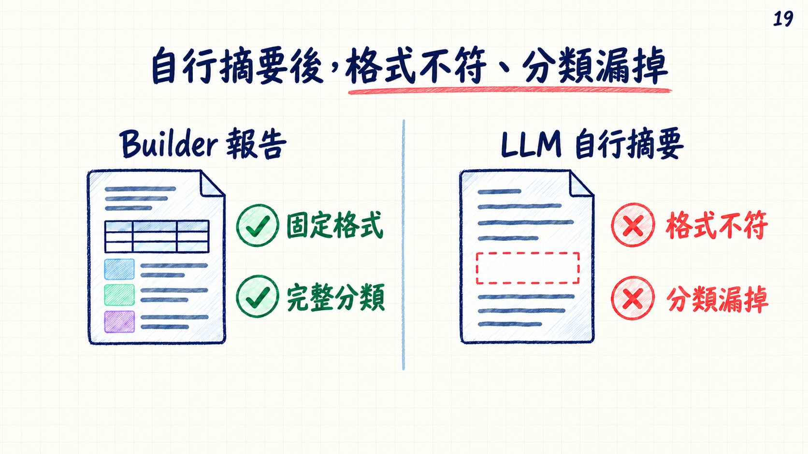

### 核心訊息

明確接續第18頁自行摘要的後果，用主稿的兩項觀察說明交付缺失，不直接跳到測試方法。

### 畫面文字

自行摘要後，格式不符、分類漏掉｜Builder 報告｜固定格式｜完整分類｜LLM 自行摘要｜格式不符｜分類漏掉

### 畫面設計

保留左右兩份大文件與格式／分類對照，只更新主標，重點底線標出格式不符、分類漏掉。左右各兩個大字標籤，沒有新增虛構報告數據；頁碼19。

畫風統一：原v28第43頁（本版第44頁）為字形母版；中文、英文與彩色重點字保留同一手寫字形家族、相對字重、自然筆壓、起收筆與墨紋，搭配深藍鋼筆外輪廓、稀疏斜排線、淡色鉛筆筆跡、米白淡格紙。實際字型及會場投影仍待使用者確認。

### 搭配講稿

上一頁模型跳過Builder，自己組成摘要。結果不是只少呼叫一個工具而已：格式不符合規格，還漏了分類結果。這段文字看起來完整，卻沒有完成指定交付。不同Run走不同合法分支不一定錯，但不能把必須交付的內容省掉。這裡不是要再讓LLM審查Builder本身，而是我們發現：Skill已經把要求寫明，模型實際交出的內容仍可能不符合要求。那麼，怎麼知道這份Skill交給模型後，它到底會不會照做？

### 接下一頁

這個失敗讓我知道，寫清楚Skill只是起點，還要測試模型實際執行時會不會照做。

### 本頁重點

- 承接跳過Builder的案例：自行摘要格式不符，也漏了分類結果。
- 錯在指定交付沒完成，不只是不同Run選了不同合法路徑。

<a id="slide-20"></a>

## 20｜有回答，不代表流程正確完成。

章節：Skill：流程真的會照做嗎？；圖內編號20。

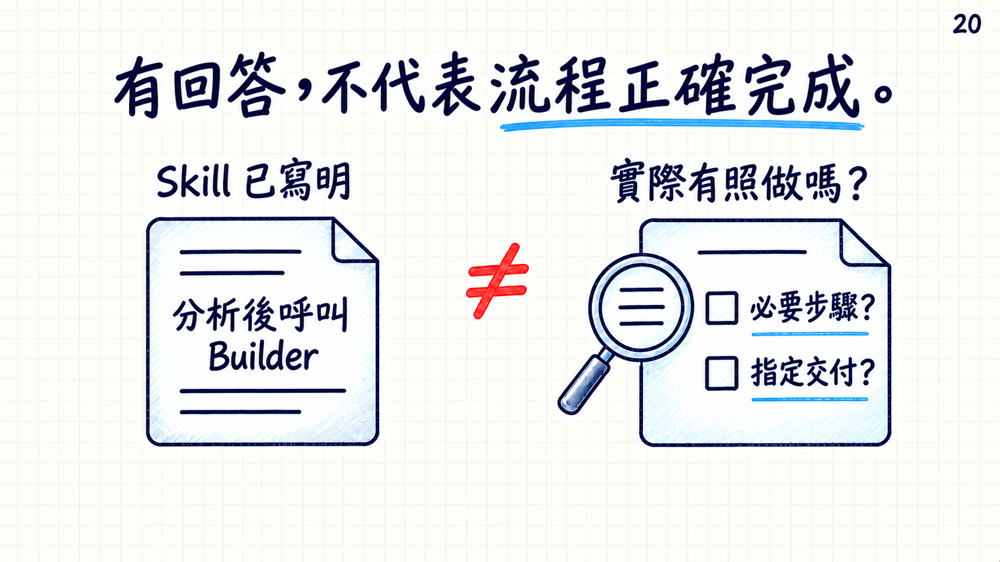

### 核心訊息

從漏Builder及交付缺失，收束成為什麼需要測試：Skill說明要求，不等於模型執行時一定達成；必須實際執行並檢查必要步驟與指定交付。這頁不介紹Trace診斷。

### 畫面文字

有回答，不代表流程正確完成。｜Skill 已寫明｜分析後呼叫 Builder｜實際有照做嗎？｜必要步驟？｜指定交付？

### 畫面設計

金句作為主標，淡藍手繪線強調流程正確完成；下方保留左側Skill文件、中央不等號、右側核對文件與放大鏡。大字提出必要步驟與指定交付兩個問題，不把回答流暢等同任務完成。頁碼20，保留底部空白。

畫風統一：原v28第43頁（本版第44頁）為字形母版；中文、英文與彩色重點字保留同一手寫字形家族、相對字重、自然筆壓、起收筆與墨紋，搭配深藍鋼筆外輪廓、稀疏斜排線、淡色鉛筆筆跡、米白淡格紙。實際字型及會場投影仍待使用者確認。

### 搭配講稿

有回答，不代表流程正確完成。剛才的案例，Skill已寫明分析後要呼叫Builder，模型卻跳過它，最後格式不符、分類也漏掉了。所以我不能只看它有沒有交出一段摘要，就認定任務完成。要把任務交給它實際執行，再檢查必要步驟有沒有做、指定成果有沒有交付。Skill說明要求是一件事，測試模型能不能做到是另一件事。

### 接下一頁

那這種測試要怎麼做？先定義什麼算完成，再讓Agent執行並檢查；下一頁把它整理成Evaluation的三個步驟。

### 本頁重點

- Skill寫明要求，不等於模型實際執行時一定照做。
- 實際跑任務，檢查必要步驟與指定交付；這就是接下來要介紹測試的原因。

<a id="slide-21"></a>

## 21｜怎麼知道 Agent 真的完成任務？

章節：Skill 與 Evaluation：說明如何變成測試；圖內編號21。

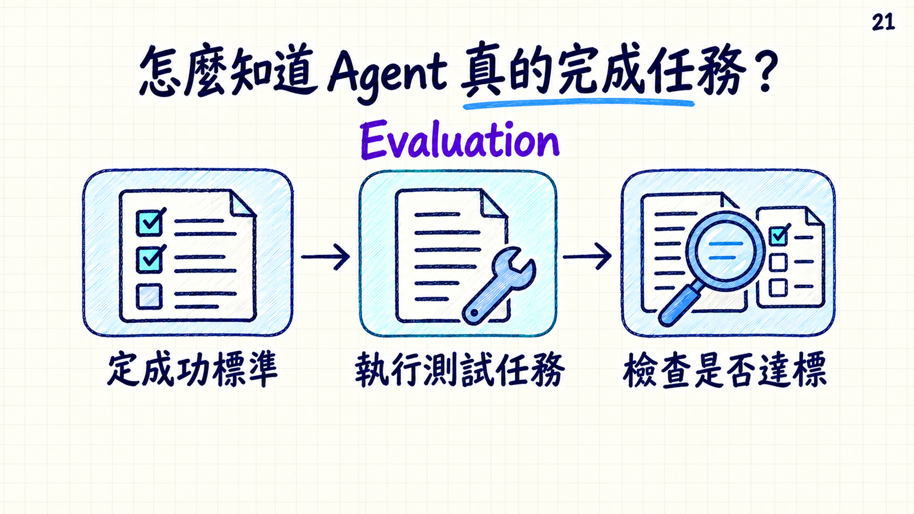

### 核心訊息

從剛才發現報告缺失與漏Builder的案例，正式介紹Evaluation：給定測試任務與成功標準，執行後對照實際交付與行為是否達標。

### 畫面文字

怎麼知道 Agent 真的完成任務？｜Evaluation｜定成功標準｜執行測試任務｜檢查是否達標

### 畫面設計

三個大型鋼筆語意icon水平排列：標準清單、帶工具的任務文件、放大鏡核對結果。三個步驟大字置於icon下方，箭頭只表示測試步驟；Evaluation放在主標下方。核對icon不是整體成功印章，頁碼21；底部保留安全空白。

畫風統一：原v28第43頁（本版第44頁）為字形母版；中文、英文與彩色重點字保留同一手寫字形家族、相對字重、自然筆壓、起收筆與墨紋，搭配深藍鋼筆外輪廓、稀疏斜排線、淡色鉛筆筆跡、米白淡格紙。實際字型及會場投影仍待使用者確認。

### 搭配講稿

上一頁說，Skill寫完之後，還要測試模型能不能按要求完成任務。這種測試在這裡叫Evaluation，可以先記住三個動作：定成功標準、執行測試任務、檢查是否達標。成功標準來自這個任務的要求，不是模型自己說了算；執行後，用實際交出的成果及發生的操作對照標準。以剛才的任務來說，不能只因為它交了一段流暢摘要，就當作完成正式報告交付。先說清楚怎樣才算完成，才有辦法判斷它有沒有做到。

### 接下一頁

成功標準訂好後，要從哪裡檢查？下一頁用正式名稱區分兩個評估對象：交付結果，以及實際執行軌跡。

### 本頁重點

- 先定義這個任務的成功標準，再用實際結果與執行紀錄檢查。
- Evaluation 是有案例、有標準的測試，不是讓 Agent 自己宣告成功。

<a id="slide-22"></a>

## 22｜結果完成了，流程也做對了嗎？

章節：Skill 與 Evaluation：說明如何變成測試；圖內編號22。

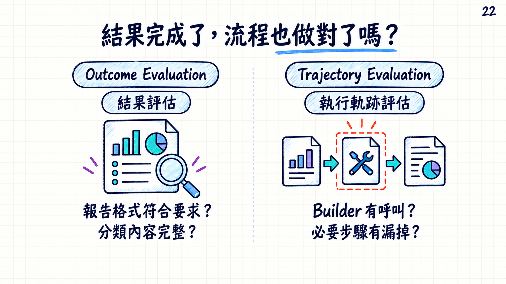

### 核心訊息

Outcome Evaluation檢查交付結果是否符合任務要求；Trajectory Evaluation檢查實際執行的訊息與操作，包括必要工具、順序與參數。兩者是評估對象，不是評分者或必須二選一的方案。

### 畫面文字

結果完成了，流程也做對了嗎？｜Outcome Evaluation｜結果評估｜報告格式符合要求？｜分類內容完整？｜Trajectory Evaluation｜執行軌跡評估｜Builder 有呼叫？｜必要步驟有漏掉？

### 畫面設計

左右等寬開放式圖解：左以報告文件與放大鏡代表Outcome，右以分析文件→Builder工具文件→報告的三節點代表Trajectory。正式英文詞與中文名稱同基線，大字呈現各兩個問題。主標居中、淡藍手繪重點線，右上22；鋼筆細線、米白淡格紙、稀疏排線，底部15%留白。沒有分數vs差距、Skill修改或根因診斷。只呈現可觀察執行，不把軌跡稱為模型隱藏思考。

畫風統一：原v28第43頁（本版第44頁）為字形母版；中文、英文與彩色重點字保留同一手寫字形家族、相對字重、自然筆壓、起收筆與墨紋，搭配深藍鋼筆外輪廓、稀疏斜排線、淡色鉛筆筆跡、米白淡格紙。實際字型及會場投影仍待使用者確認。

### 搭配講稿

前面介紹Evaluation，是先定成功標準，再執行任務、檢查是否達標。現在把檢查對象分成兩個常用名稱。Outcome Evaluation，也就是結果評估，看最後交出的報告：格式符合要求嗎？分類內容完整嗎？Trajectory Evaluation，也就是執行軌跡評估，看實際發生的步驟與工具操作：Builder有沒有呼叫，必要步驟有沒有漏掉。這不是讀取模型內心的推理，而是檢查可觀察的訊息與操作。報告看起來完整，仍可能跳過必要工具；工具有呼叫，也不代表指定成果已交付。對這個任務，我需要兩者一起看。接著才是：這些要求，要用什麼方法來判斷？

### 接下一頁

結果和軌跡是要檢查的對象；下一頁介紹判斷的方法：程式檢查，以及LLM-as-a-Judge。

### 本頁重點

- Outcome Evaluation：看最後的交付是否符合要求。
- Trajectory Evaluation：看實際執行的必要步驟、工具與參數。
- 結果與軌跡可一起評估；不是二選一，也不是讀取隱藏思考。

<a id="slide-23"></a>

## 23｜這些要求，要怎麼評估？

章節：Skill 與 Evaluation：說明如何變成測試；圖內編號23。

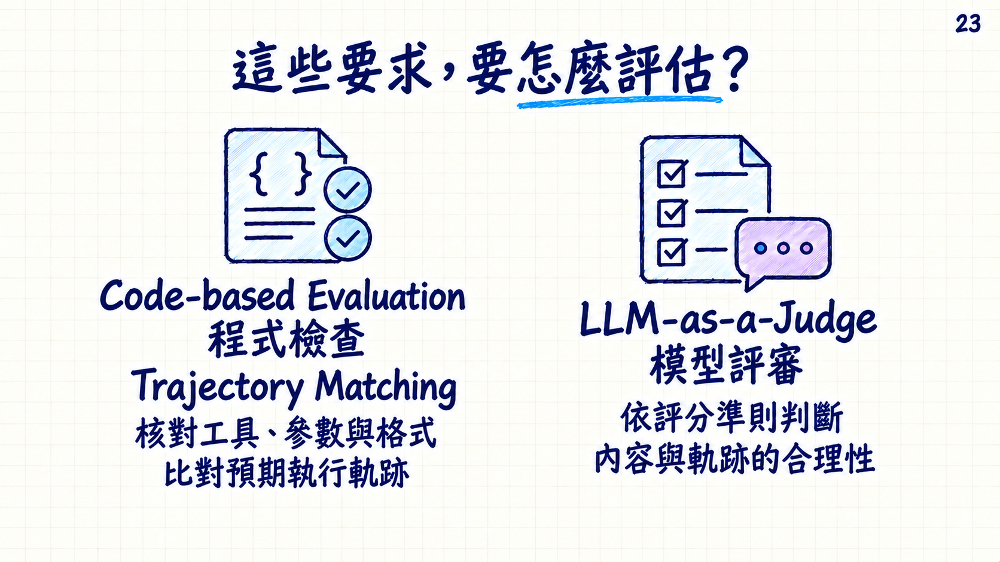

### 核心訊息

Code-based Evaluation與LLM-as-a-Judge是評估方法，均不固定綁定某一對象。Trajectory Matching是程式化比對預期軌跡的一種方式；Judge可評內容，也可評執行軌跡。評估不是執行時Guard，也不保證未來每次正確。

### 畫面文字

這些要求，要怎麼評估？｜Code-based Evaluation｜程式檢查｜Trajectory Matching｜核對工具、參數與格式｜比對預期執行軌跡｜LLM-as-a-Judge｜模型評審｜依評分準則判斷｜內容與軌跡的合理性

### 畫面設計

兩個等寬開放區域，左以{}程式文件與勾選符號代表Code-based Evaluation；右以準則清單與小型對話框代表LLM-as-a-Judge。不用機器人或法院icon。左標Trajectory Matching，配核對工具參數與格式／比對預期軌跡；右配依評分準則判斷／內容與軌跡合理性。兩欄標籤、icon、文字整齊對齊；英文專有名詞大字，底部15%留白、鋼筆手寫與米白淡格紙，頁碼23。沒有結果只能用Judge、軌跡只能用程式的對應箭頭。

畫風統一：原v28第43頁（本版第44頁）為字形母版；中文、英文與彩色重點字保留同一手寫字形家族、相對字重、自然筆壓、起收筆與墨紋，搭配深藍鋼筆外輪廓、稀疏斜排線、淡色鉛筆筆跡、米白淡格紙。實際字型及會場投影仍待使用者確認。

### 搭配講稿

上一頁的Outcome和Trajectory，是我們要評估什麼；這一頁是怎麼評估。Code-based Evaluation，是把明確的條件寫成程式檢查，例如Builder有沒有呼叫、參數是否正確、輸出格式是否符合規格。若把實際工具步驟與預期軌跡比對，常用名稱是Trajectory Matching；哪些步驟必須做、順序是否重要，要依任務要求決定，不是所有合法執行都必須完全一樣。LLM-as-a-Judge，則是請模型依照評分準則擔任評審，判斷內容或執行方式是否合理。它不是只看結果或只給分數，也能評軌跡。兩種方法可以搭配；Judge的判定仍需用人工樣本校準。這裡講的是測試與評估，不是靠另一個模型保證執行一定正確。接著回到Builder案例，將任務要求變成實際檢查項目。

### 接下一頁

評估對象與判斷方法已經分清楚，現在回到Builder案例：指定報告交了嗎？必要Builder做了嗎？

### 本頁重點

- Code-based Evaluation：以程式核對明確條件；Trajectory Matching可比對預期步驟。
- LLM-as-a-Judge：依評分準則評內容或軌跡，不等同於只看分數。
- 評估對象與方法是兩個維度，能搭配使用；測試通過不等於未來零風險。

<a id="slide-24"></a>

## 24｜回到案例：報告交了，Builder 也做了嗎？

章節：Skill 與 Evaluation：說明如何變成測試；圖內編號24。

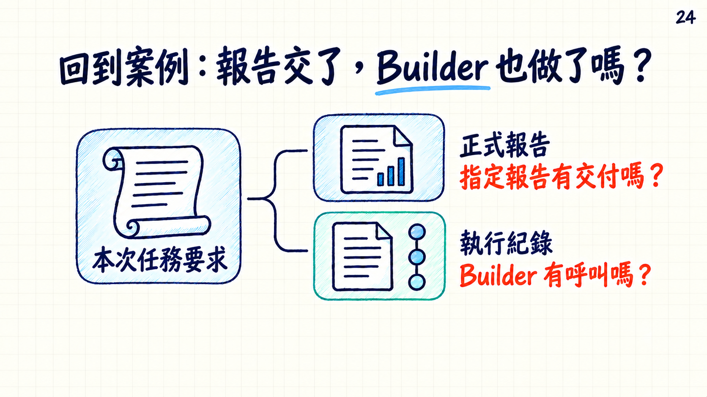

### 核心訊息

承接新增Evaluation地圖，套用主稿案例的兩項具體檢查，不再次定義Evaluation。Builder是指定交付工具，不要求再判定其底層程式內容是否正確。

### 畫面文字

回到案例：報告交了，Builder 也做了嗎？｜本次任務要求｜正式報告｜指定報告有交付嗎？｜執行紀錄｜Builder 有呼叫嗎？

### 畫面設計

保留卷軸要求分支對照報告與執行紀錄的語意icon，把原抽象問句改成Builder案例的具體要求。刪除重複Evaluation定義副句，不畫閘門或通過印章；頁碼24。

畫風統一：原v28第43頁（本版第44頁）為字形母版；中文、英文與彩色重點字保留同一手寫字形家族、相對字重、自然筆壓、起收筆與墨紋，搭配深藍鋼筆外輪廓、稀疏斜排線、淡色鉛筆筆跡、米白淡格紙。實際字型及會場投影仍待使用者確認。

### 搭配講稿

我們繼續用分析Log並交付正式報告的同一個任務，把前面介紹的評估對象與方法套進來。任務要求交付Builder產生的正式報告，所以我列出兩項檢查：最後是否交付指定報告，以及build_execution_summary是否真的被呼叫。前者是Outcome Evaluation，後者是Trajectory Evaluation；工具呼叫與交付來源等明確條件，可以用程式檢查，不必全部交給LLM-as-a-Judge。有任意摘要不算完成，只呼叫工具卻沒交付指定成果也不算完成。這裡不是再讓模型判斷Builder底層程式算得對不對，而是檢查Agent有沒有完成這次任務要求。這兩項成為之後每次重跑都採用的共同標準。

### 接下一頁

檢查項目已經訂好了。一次都做到，只能說這次完成；接下來固定條件重跑，觀察它是不是穩定照做。

### 本頁重點

- 此案例要求交付Builder產生的正式報告，不是任意文字摘要。
- 對照交付結果與執行紀錄，檢查指定報告與必要Builder是否確實發生。

<a id="slide-25"></a>

## 25｜固定條件重跑，觀察流程是否穩定

章節：Skill：流程真的會照做嗎？；圖內編號25。

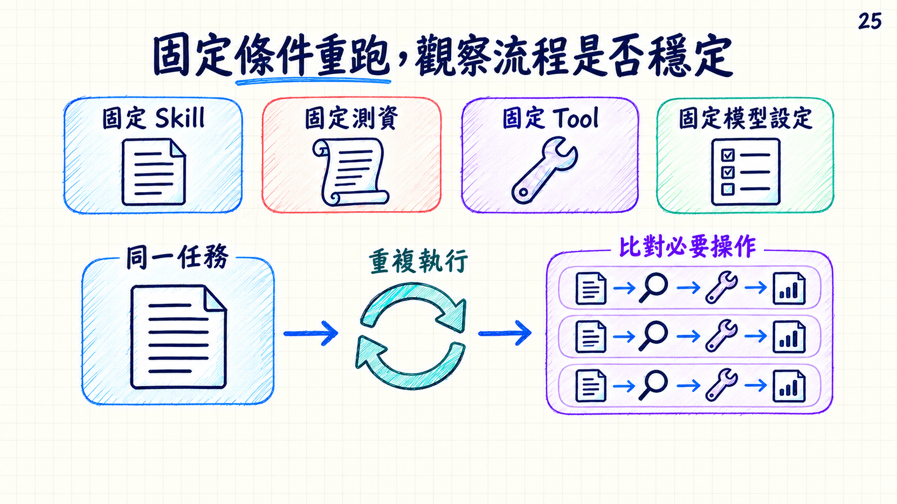

### 核心訊息

接續已介紹的Evaluation，說明怎麼觀察穩定度：固定條件、多次執行、按相同標準檢查。與下一頁的未來保證限制分工清楚。

### 畫面文字

固定條件重跑，觀察流程是否穩定｜固定 Skill｜固定測資｜固定 Tool｜固定模型設定｜同一任務｜重複執行｜比對必要操作

### 畫面設計

保留四個固定條件與重複執行的示意，只更新主標。多份操作紀錄代表比對方法，不是新增幾次成功的實測數據；頁碼25，必要文字維持大字與底部留白。

畫風統一：原v28第43頁（本版第44頁）為字形母版；中文、英文與彩色重點字保留同一手寫字形家族、相對字重、自然筆壓、起收筆與墨紋，搭配深藍鋼筆外輪廓、稀疏斜排線、淡色鉛筆筆跡、米白淡格紙。實際字型及會場投影仍待使用者確認。

### 搭配講稿

上一頁把這個案例的檢查訂清楚了：指定報告與必要Builder。一次照著Skill做，只能說這次成功。我固定同一版Skill、測資、Tool與模型設定，重跑同一個任務，每次都用同一套標準檢查。這樣才能觀察相同條件下是否仍會漏步驟。圖上的紀錄是方法示意，沒有新增通過率；不同情境的回歸與接受門檻，後面驗收修改時再談。

### 接下一頁

即使調整到目前這一批測試全部通過，能不能保證下一次也一定照做？

### 本頁重點

- 固定Skill、測資、Tool與模型設定，重跑同一任務。
- 每次都用相同交付要求檢查必要操作與結果，不以一次成功判定穩定。
- 示意圖不新增成功率；有限觀察不是未來保證。

<a id="slide-26"></a>

## 26｜這批測試全過，不代表下次一定照做

章節：Skill：流程真的會照做嗎？；圖內編號26。

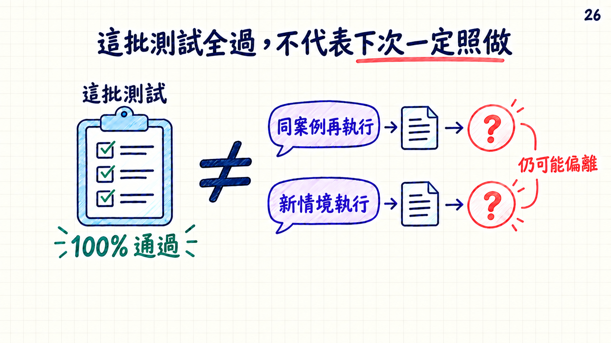

### 核心訊息

將上一頁的多次測試接到其限制：有限觀察提高信心，卻不保證下次執行。以風險容忍度轉入Guard，而不是跳入新名詞或流程硬鎖。

### 畫面文字

這批測試全過，不代表下次一定照做｜這批測試｜100% 通過｜≠｜同案例再執行｜新情境執行｜仍可能偏離

### 畫面設計

保留有限批次全過≠未來每次成功的概念圖，只更新主標，右方仍有同案例與新情境兩種可能偏離。100%為假設示意，不冒充新實測；頁碼26。

畫風統一：原v28第43頁（本版第44頁）為字形母版；中文、英文與彩色重點字保留同一手寫字形家族、相對字重、自然筆壓、起收筆與墨紋，搭配深藍鋼筆外輪廓、稀疏斜排線、淡色鉛筆筆跡、米白淡格紙。實際字型及會場投影仍待使用者確認。

### 搭配講稿

假設剛才那一批測試全部通過，我們也不能把它當成下一次一定照做的保證。這裡的100%是有限測試全過的概念示意，不是新增一組實測。Skill仍是自然語言說明，LLM仍有機率性；同一案例再執行，也可能偏離，新情境更不能直接推論。Evaluation提供改善依據與這批測試的觀察，不等於每次執行的承諾。這就帶出下一個問題：某種錯偶爾發生一次，我能不能接受？

### 接下一頁

能接受偶發錯誤，就持續用Skill與測試改善；一次都不能接受的條件，就不能只靠模型遵守。

### 本頁重點

- 全部通過描述的是目前有限測試，不是未來每次執行的承諾。
- Skill仍是自然語言說明，同案例再執行與新情境都可能偏離。
- 因此要回頭判斷哪些錯可以接受，哪些條件必須由系統守住。

<a id="slide-27"></a>

## 27｜不能接受的錯，就不能只靠模型遵守

章節：Guard、Evidence 與人工確認；圖內編號27。

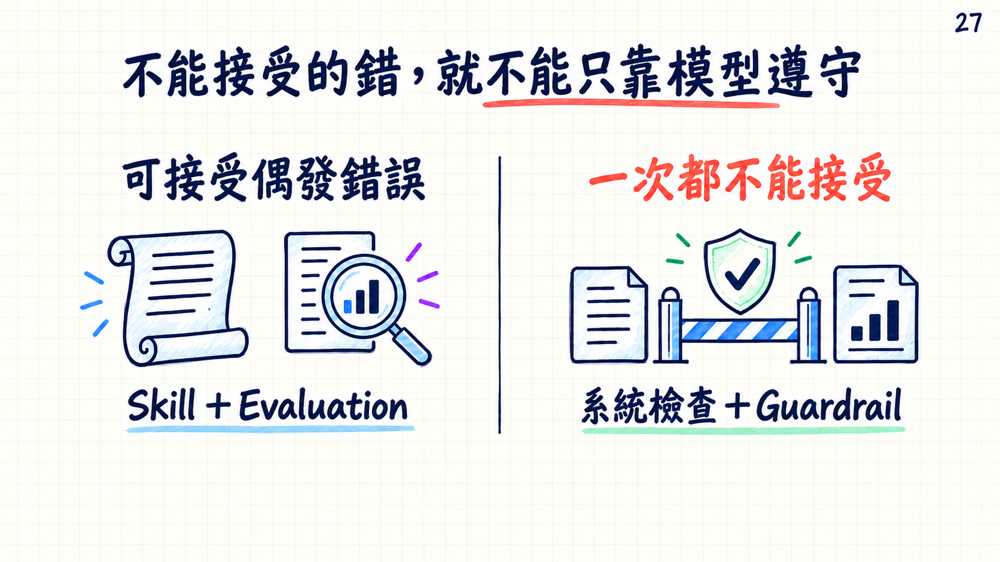

### 核心訊息

用風險容忍度劃分責任：自然語言與測試改善表現，系統承接不可只靠LLM遵守的條件。不是一個Guard就保證所有未知錯誤消失。

### 畫面文字

不能接受的錯，就不能只靠模型遵守｜可接受偶發錯誤｜Skill＋Evaluation｜一次都不能接受｜系統檢查＋Guardrail

### 畫面設計

保留左右兩種責任對照，只更換主標。左Skill與Evaluation，右系統條件檢查閘門；沒有從左到右升級階梯，也不把完整Workflow鎖成程式。頁碼27。

畫風統一：原v28第43頁（本版第44頁）為字形母版；中文、英文與彩色重點字保留同一手寫字形家族、相對字重、自然筆壓、起收筆與墨紋，搭配深藍鋼筆外輪廓、稀疏斜排線、淡色鉛筆筆跡、米白淡格紙。實際字型及會場投影仍待使用者確認。

### 搭配講稿

我會先問這項錯誤偶爾發生，業務能不能接受。如果能接受，就用Skill引導並透過Evaluation持續改善；如果某項條件一次都不能違反，就不能只期待LLM每次遵守。這時責任要落到系統能檢查的位置。後面仍會用同一個Log報告任務，但從流程是否照做，轉到報告結論是否有證據；同時以日期結果與修改權限說明其他系統檢查。這不是拿漏Builder的案例硬鎖整套流程。Guardrail守的是明確定義與實作的條件，不是消除所有未知風險。

### 接下一頁

用日期、報告證據和修改權限這三個例子，看看哪些責任要交給系統。

### 本頁重點

- 可接受偶發錯誤的行為，用Skill引導、Evaluation改善。
- 不可接受的條件，需要系統落實檢查與限制。
- 同一個Log報告任務，分開檢查流程遵循與結論依據。

<a id="slide-28"></a>

## 28｜把不可接受的錯，變成可檢查的條件

章節：Guard、Evidence 與人工確認；圖內編號28。

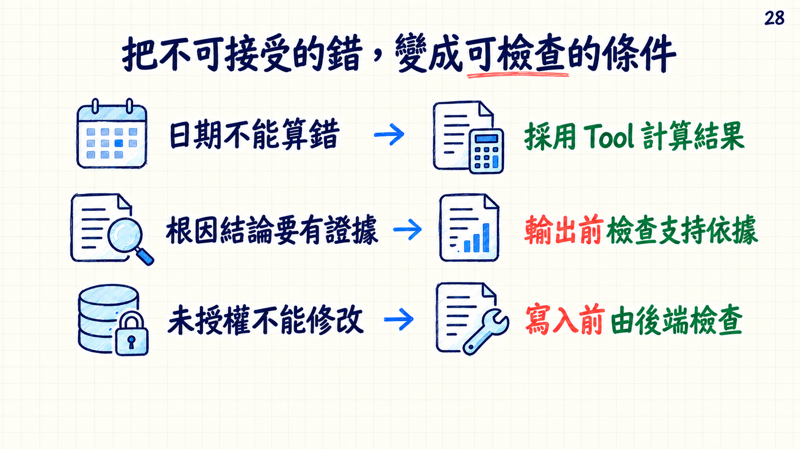

### 核心訊息

不可接受的條件需要落到系統：採用工具日期結果、輸出前對照報告證據、寫入前檢查權限。Evidence這裡守報告是否新增工具沒有回傳的內容，不改成重新判定工具資料本身真假。

### 畫面文字

把不可接受的錯，變成可檢查的條件｜日期不能算錯｜採用 Tool 計算結果｜根因結論要有證據｜輸出前檢查支持依據｜未授權不能修改｜寫入前由後端檢查

### 畫面設計

三排開放式條件→系統機制對照。日曆對工具計算結果、證據文件對輸出前支持依據、帶鎖資料庫對後端寫入前檢查。輸出前與寫入前用珊瑚色標出，其他文字短而大，頁碼28。不是三個必經順序，也不是只要求模型用工具。

畫風統一：原v28第43頁（本版第44頁）為字形母版；中文、英文與彩色重點字保留同一手寫字形家族、相對字重、自然筆壓、起收筆與墨紋，搭配深藍鋼筆外輪廓、稀疏斜排線、淡色鉛筆筆跡、米白淡格紙。實際字型及會場投影仍待使用者確認。

### 搭配講稿

日期不能算錯，就由工具依明確的日期、時區與日曆規則計算，正式結果採用工具輸出，而不是只請模型用工具，最後還接受自行心算的值。報告結論需要證據，就在正式輸出前對回相關工具結果；圖中的根因結論只是報告結論的一種例子，接下來的重點不是另上一堂因果判定課。未授權不能修改，就在寫入前由後端依使用者、資源與動作檢查，不讓LLM自行宣告有權。這三例不是必經順序，共同點是系統真的承接檢查責任。

### 接下一頁

剛才檢查的是「有沒有照流程做」。但流程做了，模型寫出的結論就一定有依據嗎？接著仍用同一個Log報告任務，看工具結果沒有回傳的內容怎麼混進報告。

### 本頁重點

- 日期由確定性工具計算，正式結果採用工具輸出。
- 報告中的結論在正式輸出前，要有對應且相關的工具結果支持。
- 資料修改前由後端檢查權限，不採信LLM自行宣告已授權。

<a id="slide-29"></a>

## 29｜同一份 Log 報告，還可能多出沒有依據的內容

章節：Guard、Evidence 與人工確認；圖內編號29。

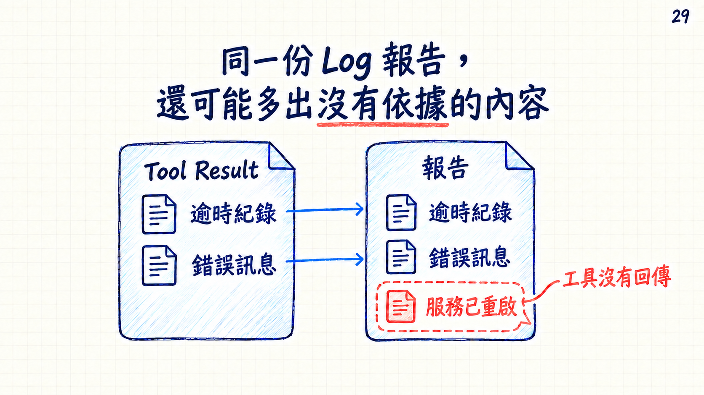

### 核心訊息

承接同一個Log報告任務，從流程檢查轉到結論依據：有查回資料，LLM仍可能在報告補出Tool Result沒有的內容。

### 畫面文字

同一份 Log 報告，還可能多出沒有依據的內容｜Tool Result｜報告｜逾時紀錄｜錯誤訊息｜服務已重啟｜工具沒有回傳

### 畫面設計

兩行置中主標以「同一份Log報告」延續前例，珊瑚底線標出「沒有依據」。左右兩個工具結果與報告文件，兩項已有結果以藍線逐項連到報告；第三項服務已重啟用珊瑚虛線泡泡表示LLM新增，沒有來源連線。頁碼29，已移除圖片上方的教學示意標示；不畫根因因果樹。

畫風統一：原v28第43頁（本版第44頁）為字形母版；中文、英文與彩色重點字保留同一手寫字形家族、相對字重、自然筆壓、起收筆與墨紋，搭配深藍鋼筆外輪廓、稀疏斜排線、淡色鉛筆筆跡、米白淡格紙。實際字型及會場投影仍待使用者確認。

### 搭配講稿

仍然是前面的Log分析與報告任務，但現在換一個檢查問題：報告中的結論是否都有工具結果支持。有沒有呼叫指定Builder，是前面的流程檢查；模型提出的結論有沒有Tool Result支持，是這裡的內容檢查。這不是說Builder本身在編造內容，而是不能讓LLM沒有依據的分析混進正式輸出。我在實務上遇過，LLM把工具結果裡沒有的內容寫進report。圖上用逾時紀錄和錯誤訊息做教學示意，工具只回這兩項，報告卻多寫服務已重啟；這句不是實際報告的逐字引文。我要擋的是模型自己補出的事實，不是再讓它判斷Tool Result本身是不是正確。所以正式報告的結論，每一項都要找得到相關工具結果的支持。

### 接下一頁

因此不是整份報告附一個引用就好，而是每一項結論，都要逐項對回Tool Result。

### 本頁重點

- 同一個Log報告任務，流程是否照做與結論是否有依據，是兩種檢查。
- 這次守的是輸出結論的工具依據，不是Context選材或重新驗證來源真假。
- 圖中的服務已重啟是教學示意，不是實際報告的逐字引文。

<a id="slide-30"></a>

## 30｜每一項結論，都要對回 Tool Result

章節：Guard、Evidence 與人工確認；圖內編號30。

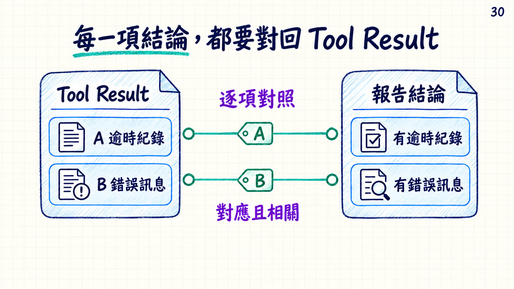

### 核心訊息

Evidence是報告結論與相關工具結果之間的支持關係。逐項對照來源與內容，不能只檢查有無Ref欄位，也不能把模型自行生成的敘述當工具證據。

### 畫面文字

每一項結論，都要對回 Tool Result｜Tool Result｜A 逾時紀錄｜B 錯誤訊息｜逐項對照｜A｜B｜報告結論｜有逾時紀錄｜有錯誤訊息｜對應且相關

### 畫面設計

兩份大文件的每個報告項目，分別以不交叉的連線與A/B標籤對回結果片段。連線沒有流程箭頭，不只連整份文件。圖是教學示意，不新增實測；頁碼30。

畫風統一：原v28第43頁（本版第44頁）為字形母版；中文、英文與彩色重點字保留同一手寫字形家族、相對字重、自然筆壓、起收筆與墨紋，搭配深藍鋼筆外輪廓、稀疏斜排線、淡色鉛筆筆跡、米白淡格紙。實際字型及會場投影仍待使用者確認。

### 搭配講稿

以剛才的教學示意來看，報告說有逾時紀錄，就要對回工具實際回傳的相關片段；說有錯誤訊息，也要有另一項對應結果。Ref讓我們找到來源，但有Ref還不夠：不能指到不相關資料，或者把來源沒有說的事塞進結論。我要驗證的是正式輸出有沒有對應且相關的Tool Result支持，不是重新判斷Tool Result本身真假，也不是LLM自己寫一段話再稱它為證據。系統具體怎麼對照與拒絕，仍需依工具回傳和輸出規格定義。

### 接下一頁

找不到對應支持的項目，就不能被當成已有證據的結論，放進正式報告。

### 本頁重點

- 每項結論都要有可對應的真實工具結果，而不是LLM自行編造的來源。
- Ref必須有效，對到的結果片段也要和結論相關、內容相符。
- 不是Ref存在就算支持，也不是重新驗證Tool Result本身真假。

<a id="slide-31"></a>

## 31｜沒有對應證據的結論，不能進正式報告

章節：Guard、Evidence 與人工確認；圖內編號31。

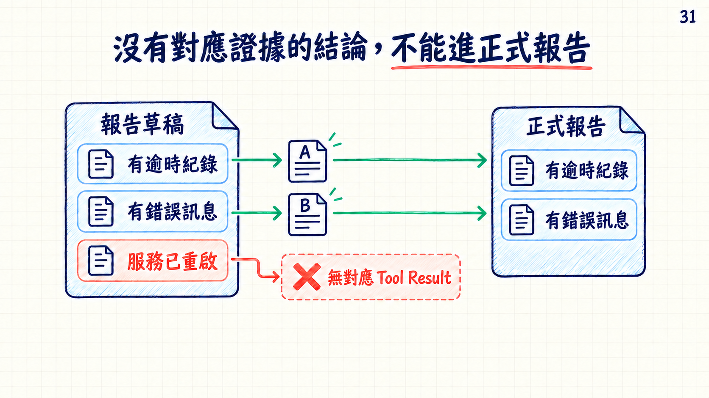

### 核心訊息

把Evidence要求落到正式輸出：不讓未被工具結果支持的新增結論混進報告。允許說明缺資料，不把缺少證據誤當來源事實已被證偽。

### 畫面文字

沒有對應證據的結論，不能進正式報告｜報告草稿｜有逾時紀錄｜有錯誤訊息｜服務已重啟｜A｜B｜正式報告｜無對應 Tool Result

### 畫面設計

報告草稿三項分流：兩項有來源A/B的內容，以綠箭頭進正式報告；第三項服務已重啟以紅箭頭停在無對應Tool Result的叉號區，不與輸出綠線合流。不是來源真偽審判，也不是根因判定；頁碼31。已移除主標下方的教學示意標示，其餘排版保留。

畫風統一：原v28第43頁（本版第44頁）為字形母版；中文、英文與彩色重點字保留同一手寫字形家族、相對字重、自然筆壓、起收筆與墨紋，搭配深藍鋼筆外輪廓、稀疏斜排線、淡色鉛筆筆跡、米白淡格紙。實際字型及會場投影仍待使用者確認。

### 搭配講稿

正式輸出前，這些結論要有對應且相關的Tool Result支持。圖上的前兩項能對回結果，所以進正式報告；服務已重啟沒有工具支持，就不能混成已確認的結果。這不代表我們證明服務一定沒有重啟，而是目前沒有這個依據。可以清楚說缺了哪份資料，或再安排查詢，不能由LLM自行補造。這裡守的是報告有沒有依據，不是重新審判Tool Result真假；Guardrail也不是只因掛了名字，就自動能辨識所有語意錯誤。

### 接下一頁

證據有沒有支持，是系統要檢查的責任。另一種問題是任務是不是使用者真正要的、操作是否允許，有些決定要交回給人；不是請人批准無證據的內容成為事實。

### 本頁重點

- 有對應且相關Tool Result支持的結論，才進正式報告。
- 工具沒有回傳的內容，不讓LLM自行補成已確認結果。
- 缺資料可以說明限制或補查，不是讓人替無證據結論蓋章。

<a id="slide-32"></a>

## 32｜有些決定，不能讓 Agent 自己確認

章節：Guard、Evidence 與人工確認；圖內編號32。

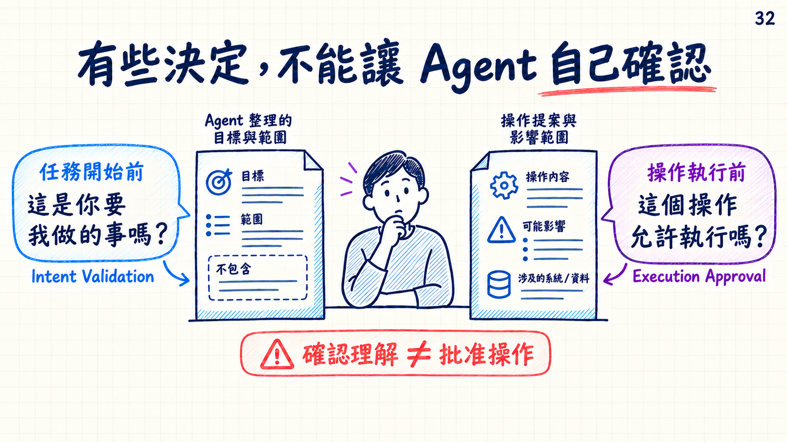

### 核心訊息

把系統檢查轉接到人的意圖確認與操作批准；不是請人把不足的證據蓋章變成事實。

### 畫面文字

任務開始前｜這是你要我做的事嗎？｜Intent Validation
操作執行前｜這個操作允許執行嗎？｜Execution Approval
確認理解 ≠ 批准操作

### 畫面設計

同一位簡單人形線稿居中，左右兩份不同文件：左為 Agent 整理的目標與範圍，右為操作提案與影響範圍。各用一個大型問題顯示人要確認什麼。畫面不是兩個依序通過的機械門，不畫證據不足經人確認變事實。底線只畫在標題的自己確認。

畫風統一：原v28第43頁（本版第44頁）為字形母版；中文、英文與彩色重點字保留同一手寫字形家族、相對字重、自然筆壓、起收筆與墨紋，搭配深藍鋼筆外輪廓、稀疏斜排線、淡色鉛筆筆跡、米白淡格紙。實際字型及會場投影仍待使用者確認。

### 搭配講稿

前面談系統如何檢查規則和證據，但任務是不是使用者真正要的、某次操作是否允許，有些情況需要把決定交回給人。確認理解和批准操作是兩種不同責任，不是讓人為缺乏證據的結論背書。

### 接下一頁

先看任務開始前：讓使用者確認 Agent 理解的目標與範圍。

### 本頁重點

- 系統查規則與證據；有些決定需要人確認意圖或批准操作。
- 兩種人工責任不同，也不是請人替缺乏證據的結論背書。

<a id="slide-33"></a>

## 33｜先確認理解，避免做完錯誤的任務

章節：Guard、Evidence 與人工確認；圖內編號33。

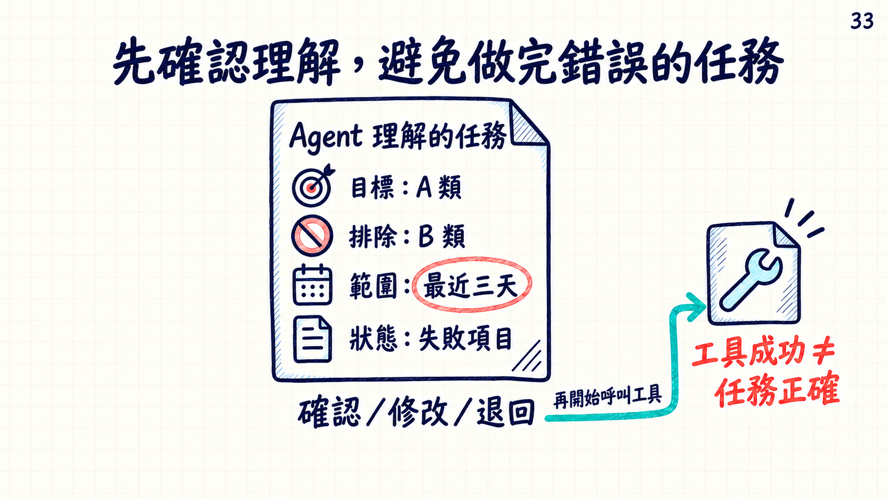

### 核心訊息

先讓使用者確認 Agent 理解的目標、排除、範圍與狀態；工具全部成功仍可能執行錯誤任務。

### 畫面文字

Agent 理解的任務｜目標：A 類｜排除：B 類｜範圍：最近三天｜狀態：失敗項目｜確認／修改／退回｜再開始呼叫工具｜工具成功 ≠ 任務正確

### 畫面設計

以中央大型任務確認文件為焦點，列出四個具體條件；右側短線交接到工具。關鍵範圍只有一處圈選，旁邊一句工具成功不等於任務正確。沒有小人物、按鈕牆或兩條完整流程。

畫風統一：原v28第43頁（本版第44頁）為字形母版；中文、英文與彩色重點字保留同一手寫字形家族、相對字重、自然筆壓、起收筆與墨紋，搭配深藍鋼筆外輪廓、稀疏斜排線、淡色鉛筆筆跡、米白淡格紙。實際字型及會場投影仍待使用者確認。

### 搭配講稿

像「找 A 類、排除 B，只處理最近三天失敗項目」，同時包含目標、排除條件、時間範圍與狀態。先把 Agent 理解的內容整理成可閱讀的確認摘要，讓使用者確認、修改或退回，再依確認後版本開始。這裡是在確認有沒有理解對，不是在批准扣款或寫入。如果範圍一開始錯了，後面每個 Tool Call 都成功，仍可能完成錯誤任務。

### 接下一頁

確認理解以外，寫入、扣款或對外通知還需要另一種確認：批准這次操作。

### 本頁重點

- 執行前先確認目標、排除與範圍，避免後面成功完成錯任務。
- 意圖確認不是操作批准；兩者解決不同問題。

<a id="slide-34"></a>

## 34｜寫入、扣款或對外通知，執行前要先批准

章節：Guard、Evidence 與人工確認；圖內編號34。

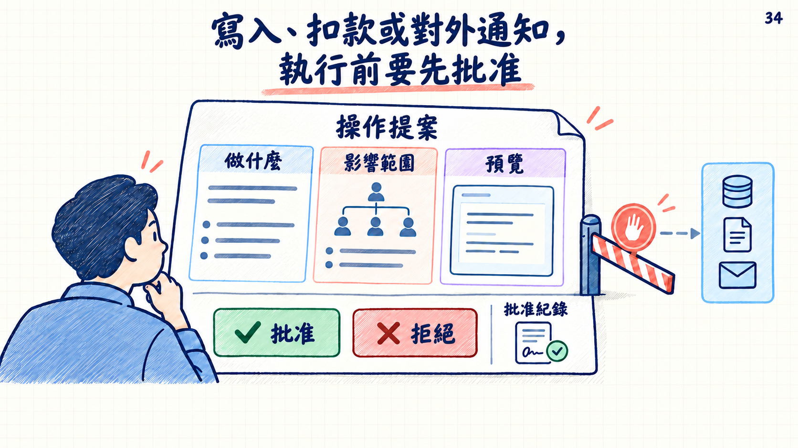

### 核心訊息

Execution Approval 必須讓人先看懂要做什麼、影響範圍與預覽結果，再決定是否允許執行。

### 畫面文字

操作提案｜做什麼｜影響範圍｜預覽｜批准｜拒絕｜批准紀錄

### 畫面設計

放大一份操作提案文件，文件內只保留「做什麼」「影響範圍」「預覽」三個大區塊。批准與拒絕放在文件下方同一安全區，右側執行工具停在人工閘門後。批准紀錄以小型簽章 icon 表示，不塞入姓名或時間細節。底線：先看懂再批准。

畫風統一：原v28第43頁（本版第44頁）為字形母版；中文、英文與彩色重點字保留同一手寫字形家族、相對字重、自然筆壓、起收筆與墨紋，搭配深藍鋼筆外輪廓、稀疏斜排線、淡色鉛筆筆跡、米白淡格紙。實際字型及會場投影仍待使用者確認。

### 搭配講稿

寫入、開單、扣款或對外通知等高風險操作，不能只靠 Skill 裡一句「請先取得批准」。系統要停在人工 Gate 前，讓人看懂提案與影響範圍，再批准或拒絕。紀錄還要保留誰批准、何時批准，以及當時看到哪一份預覽。

### 接下一頁

即使人已經批准，真正執行前仍然不能直接沿用舊狀態。

### 本頁重點

- 寫入、扣款、開單或對外通知，系統要在執行前停下等批准。
- 讓人先看懂提案、影響範圍與預覽，留下批准者、時間和批准版本。

<a id="slide-35"></a>

## 35｜批准後，執行前仍要重新檢查條件

章節：Guard、Evidence 與人工確認；圖內編號35。

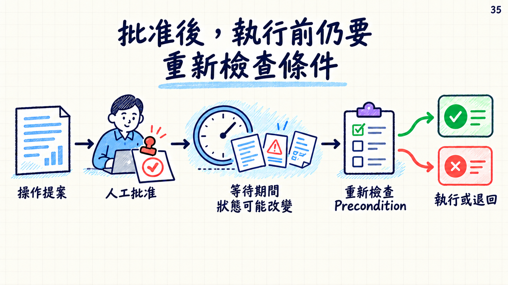

### 核心訊息

批准與執行之間可能出現狀態變化；Runtime 必須在真正執行前重新檢查前置條件。

### 畫面文字

操作提案｜人工批准｜等待期間｜狀態可能改變｜重新檢查 Precondition｜執行或退回

### 畫面設計

主畫面是一條清楚的水平時間線。左側為操作提案與人工批准，中間以大型時鐘與變動中的狀態文件製造時間間隔，右側在執行工具前放第二道「Precondition」閘門。閘門分向執行與退回兩條路，批准印章停留在左側，不可直接跨越右側閘門。底線：執行前重新檢查。

畫風統一：原v28第43頁（本版第44頁）為字形母版；中文、英文與彩色重點字保留同一手寫字形家族、相對字重、自然筆壓、起收筆與墨紋，搭配深藍鋼筆外輪廓、稀疏斜排線、淡色鉛筆筆跡、米白淡格紙。實際字型及會場投影仍待使用者確認。

### 搭配講稿

Approval會把一次Agent Run切成提案與執行兩段，中間可能隔幾分鐘或幾小時。資料可能已被別人處理，任務可能已關閉，帳務或權限狀態也可能改變。因此批准不是永久通行證。Runtime在真正執行前仍要重新檢查Precondition，並留下批准內容與檢查結果。系統與人各自承接特定條件的檢查；但有了批准與重新檢查，並不代表整次任務永遠不會出錯。

### 接下一頁

人已經介入審核，任務仍然可能出錯；如果真的出了問題，我們該怎麼處理？

### 本頁重點

- 批准到執行可能相隔一段時間，資料、任務或權限狀態可能已變。
- 執行前重新檢查 Precondition，將批准內容與檢查結果留在 Trace。

<a id="slide-36"></a>

## 36｜有人審核，任務仍可能出錯

章節：從人工審核，轉向出錯後的追查；圖內編號36。


### 核心訊息

人工審核不是整次任務零錯誤的保證；從防錯自然轉向出錯後的追查需求。

### 畫面文字

有人審核，任務仍可能出錯｜人工審核｜執行結果｜出了錯，我們要怎麼追查？

### 畫面設計

兩行大字置中，珊瑚色底線強調仍可能出錯。中段兩個小icon：帶勾的審核清單，以及帶警示符號的結果文件；兩者沒有因果箭頭。下方大字提出追查問題，底部12%留白。不是新增實測失敗，也不暗示先前Builder漏步案例曾經獲人工批准。頁碼36。

畫風統一：原v28第43頁（本版第44頁）為字形母版；中文、英文與彩色重點字保留同一手寫字形家族、相對字重、自然筆壓、起收筆與墨紋，搭配深藍鋼筆外輪廓、稀疏斜排線、淡色鉛筆筆跡、米白淡格紙。實際字型及會場投影仍待使用者確認。

### 搭配講稿

前面透過系統檢查、意圖確認與操作批准，守住不同責任。但人工審核的是特定內容或操作，不是替整次Agent執行保證零錯誤。任務仍可能沒有完成要求，或後續出現執行問題。此時除了當下依情境處理，還要能追查：當時交給模型什麼、它做了哪些操作、怎麼結束任務。接下來用前面漏Builder的既有案例示範追查方法；這不是新增一個經過人工批准後仍失敗的實測案例。

### 接下一頁

接著回到前面漏Builder的案例，看看發現問題之後，如何回頭追查當時的執行。

### 本頁重點

- 人工審核確認特定事項，不等於整次任務永遠不出錯。
- 發現問題後，需要保存並回看當時執行，而不是只看最後結果。

<a id="slide-37"></a>

## 37｜回到 Builder 案例：漏掉的步驟，怎麼追查？

章節：Trace：從發現錯誤，到找到修改線索；圖內編號37。

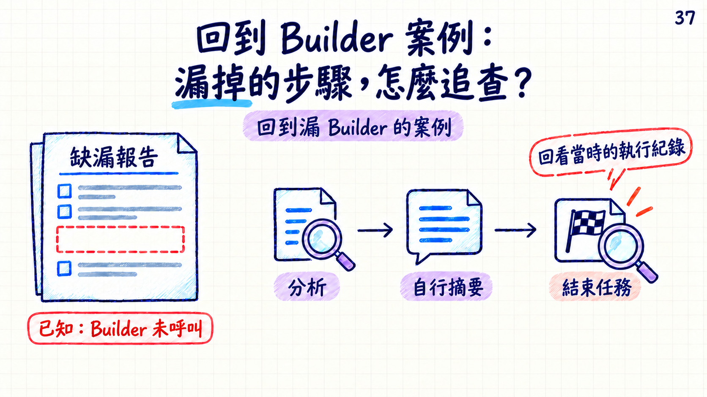

### 核心訊息

Evaluation讓我們發現Builder未呼叫；接著用Trace回看當時實際發生的訊息與操作，取得追查線索。結束任務不等於程式卡住；Trace也不是讀取模型內心或保證查明根因。

### 畫面文字

回到 Builder 案例：漏掉的步驟，怎麼追查？｜回到漏 Builder 的案例｜缺漏報告｜已知：Builder 未呼叫｜分析→自行摘要→結束任務｜回看當時的執行紀錄

### 畫面設計

兩行置中主標明確回扣前面漏Builder的案例；左側缺漏報告指出Builder未呼叫，右側歷史路徑是分析→自行摘要→結束任務。文件內終點旗幟與放大鏡表示回看已記錄的任務結束，不表示程式卡住。Builder不放進已執行路徑，也不加入人工批准符號。沿用原icon與排線，頁碼37，底部留白。

畫風統一：原v28第43頁（本版第44頁）為字形母版；中文、英文與彩色重點字保留同一手寫字形家族、相對字重、自然筆壓、起收筆與墨紋，搭配深藍鋼筆外輪廓、稀疏斜排線、淡色鉛筆筆跡、米白淡格紙。實際字型及會場投影仍待使用者確認。

### 搭配講稿

用先前的Builder案例示範追查：模型跳過Builder，自行交出摘要。Evaluation讓我們知道這次任務沒達到要求：Builder沒有被呼叫。圖中的結束任務，是模型交出摘要後就結束這次執行，不是在說程式卡住。下一步不是請模型事後猜理由，而是打開同一次執行保存的Trace，回看當時給了哪些Context、模型回了什麼、呼叫了哪些工具，以及如何結束。這裡查的是Agent自己的執行紀錄，不是拿來分析的業務Log。Trace提供可核對的追查線索，不等於讀到模型內心，也不保證只看紀錄就能判定根因。這不是新增一個經過人工批准後仍失敗的Builder實測案例。

### 接下一頁

要能這樣回看，就要把同一次Run當時的資料、動作與結果串起來；這正是Trace的用途。

### 本頁重點

- Evaluation發現這次任務漏了Builder。
- 用同一次Run的Trace回看實際訊息、工具操作與結束位置。
- 結束任務不是程式卡住；紀錄提供線索，不替模型編理由。

<a id="slide-38"></a>

## 38｜完整 Trace，讓當時的執行過程可以回放

章節：Trace：從發現錯誤，到找到修改線索；圖內編號38。

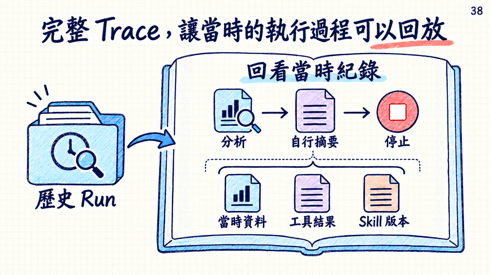

### 核心訊息

從歷史Run打開當時保存的執行路徑與資料，正面說明Trace的回看用途；不再對比Tool Calling紀錄，不宣稱知道模型內部思考或保證重跑相同。

### 畫面文字

完整 Trace，讓當時的執行過程可以回放｜歷史 Run｜回看當時紀錄｜分析｜自行摘要｜停止｜當時資料｜工具結果｜Skill 版本

### 畫面設計

左側歷史Run資料夾以時鐘與放大鏡表示查閱歷史，單一展開箭頭連到右側大型紀錄本。紀錄內保存分析→自行摘要→停止的歷史路徑，下方以群組連結當時資料、工具結果與Skill版本。不是重新執行的箭頭，也不是工具紀錄對比。手寫大字、米色格紙與鋼筆icon；頁碼38。六組詳細Trace欄位留在講稿，不把圖片塞滿。

畫風統一：原v28第43頁（本版第44頁）為字形母版；中文、英文與彩色重點字保留同一手寫字形家族、相對字重、自然筆壓、起收筆與墨紋，搭配深藍鋼筆外輪廓、稀疏斜排線、淡色鉛筆筆跡、米白淡格紙。實際字型及會場投影仍待使用者確認。

### 搭配講稿

一個好的Trace，是把同一次Run保存成可以回看的執行紀錄，而不是讓模型事後編一個理由。我會留下六組資訊：任務ID與每一步的順序、時間和關聯；每輪實際送入模型的Context與模型回應；當時的Skill、Prompt、模型及執行設定；工具參數、結果與錯誤；Guard、人工批准等實際檢查結果與停止原因；以及Token、耗時和可計算的成本。有發生的項目才記錄，沒有收集的部分明確標示缺漏。這裡的回放是回看保存的歷史，不是重跑模型就保證得到同樣答案。完整欄位補在主稿，畫面不需要塞滿六組細節；下一頁用漏Builder的案例，回看停止前那一輪到底留下了什麼。

### 接下一頁

打開歷史Run後，下一頁放大停止前那一輪，核對當時的Context、模型回應與停止原因。

### 本頁重點

- Trace讓同一次Run的歷史路徑與當時保存的資訊可以回看，缺漏的紀錄不能事後補成事實。
- 回放是查閱已保存的執行紀錄，不是重跑模型，也不保證能確定模型內部的真正原因。

<a id="slide-39"></a>

## 39｜停止之前，Agent 看到了什麼？

章節：Trace：從發現錯誤，到找到修改線索；圖內編號39。

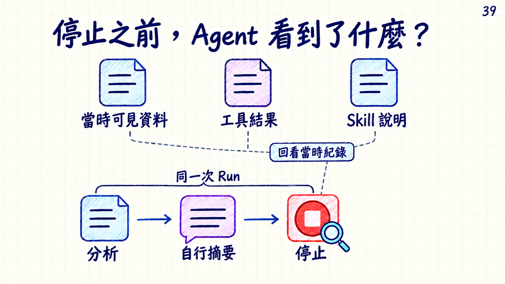

### 核心訊息

Trace不只把事件畫成箭頭，還要連回當時可保存與核對的依據。從漏Builder案例的停止位置回看資料、結果與規則，支持提出解釋而非宣稱因果已證明。

### 畫面文字

停止之前，Agent 看到了什麼？｜同一次 Run｜分析→自行摘要→停止｜當時可見資料｜工具結果｜Skill 說明｜回看當時紀錄

### 畫面設計

下排一條實際歷史路徑，停止節點以珊瑚色標示並放大鏡圈選。上方三個可閱讀的文件icon標當時可見資料、工具結果、Skill說明，與停止節點用虛線查閱連線相連，不畫成再次執行工具。三個文件不填微小文字，沒有腦／思考泡泡；頁碼39。下排已微調上移，但其標籤位置仍需實際投影確認。

畫風統一：原v28第43頁（本版第44頁）為字形母版；中文、英文與彩色重點字保留同一手寫字形家族、相對字重、自然筆壓、起收筆與墨紋，搭配深藍鋼筆外輪廓、稀疏斜排線、淡色鉛筆筆跡、米白淡格紙。實際字型及會場投影仍待使用者確認。

### 搭配講稿

回到漏Builder那次Run，我會打開停止前那一輪實際送入模型的Context、模型回應，以及與它連結的工具輸入和結果。不是只看系統裡有什麼資料，而是確認當時真的交給模型什麼、模型接著產生什麼動作。完整結果可以留在系統，以Ref連回Trace；但必須能取回當時那份資料快照，不能只連到後來已修改的資料。我也會核對停止原因：是模型要求結束、系統確認完成，還是錯誤、逾時或步數與預算限制？模型說完成，不等於任務已符合要求。這些可觀察的紀錄提供追查線索，不是模型內部思考，也不能直接證明根因；如果資料沒有保存，就承認缺漏。接著還要確認，那一輪用的規則是哪一版。

### 接下一頁

如果Skill後來改過，追查那次停止就不能拿現在的版本來解釋。

### 本頁重點

- 連回同次Run，回看停止前的可見資料、工具結果與Skill說明。
- 這些紀錄提供追查線索，不是模型內部思考，也不能直接宣稱已找到根因。

<a id="slide-40"></a>

## 40｜追查舊 Run，不能拿新版 Skill 解釋

章節：Trace：從發現錯誤，到找到修改線索；圖內編號40。

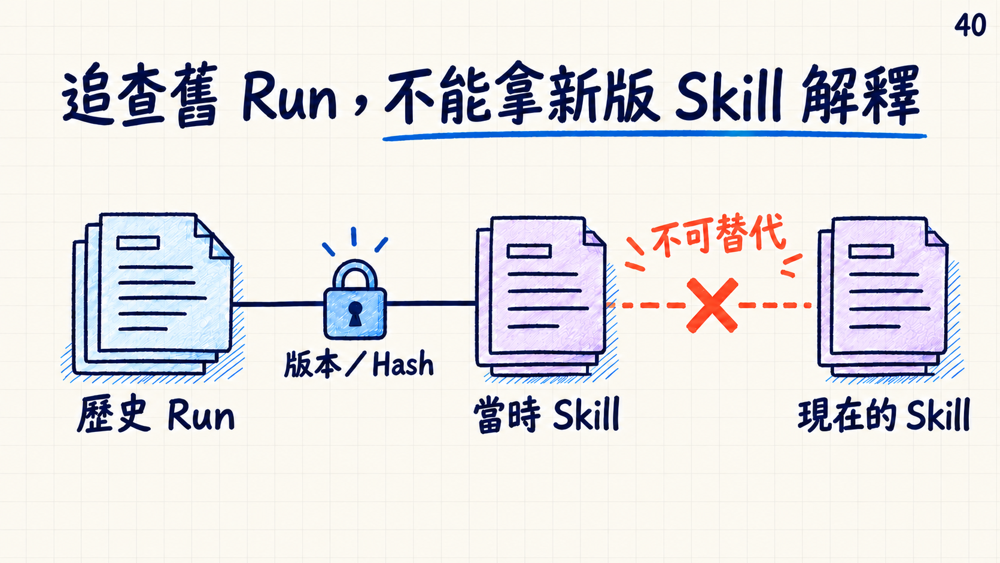

### 核心訊息

沿著停止時的規則往下追查，說明為何必須保存當時Skill版本。新版規則不是舊Run的依據，版本綁定也不是機率模型完全重現的保證。

### 畫面文字

追查舊 Run，不能拿新版 Skill 解釋｜歷史 Run｜當時 Skill｜版本／Hash｜現在的 Skill｜不可替代

### 畫面設計

歷史Run的藍色紀錄文件與當時Skill的紫色規則文件用一條鎖定連線相連，版本／Hash靠近連線。現在Skill放另一側，以珊瑚色不可替代標示阻斷取代關係，不畫工具呼叫方向。Skill是文件icon，不是腦icon；頁碼40。文字置中、不加左上標籤。

畫風統一：原v28第43頁（本版第44頁）為字形母版；中文、英文與彩色重點字保留同一手寫字形家族、相對字重、自然筆壓、起收筆與墨紋，搭配深藍鋼筆外輪廓、稀疏斜排線、淡色鉛筆筆跡、米白淡格紙。實際字型及會場投影仍待使用者確認。

### 搭配講稿

Skill可能一直被人或AI修改。追查舊Run時，要綁定當時的skill_version或skill_hash，而且必須能取回那一版的內容，不能拿今天的新版規則解釋過去的行為。Prompt、模型、模型設定與影響執行的Runtime或工具版本也應保留，才能核對當時條件。版本綁定只是必要依據之一；還要有每輪Context、模型回應、工具結果與資料快照。保存內容時，敏感資料需遮罩、權限控管和保留期限，未收集或被遮罩的部分也要說明回看限制。這樣能重建歷史脈絡，不保證機率模型重跑會完全相同。找對當時的資料與規則，才有依據提出待驗證的修改。

### 接下一頁

有了當時的資料與Skill，可以提出具體修改；但那仍然只是待驗證的候選解法。

### 本頁重點

- Run要綁定當時Skill版本或Hash，避免用後來改過的說明解釋歷史行為。
- 版本是追查必要依據之一；工具結果、資料與環境等也要保留，不能保證重跑完全相同。

<a id="slide-41"></a>

## 41｜找到追查線索，再提出修改

章節：Trace：從發現錯誤，到找到修改線索；圖內編號41。

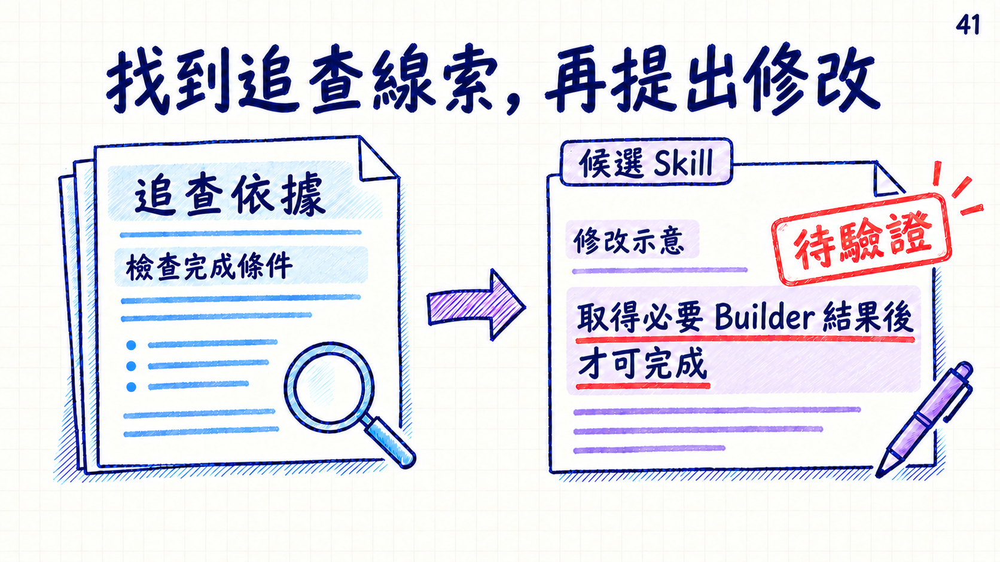

### 核心訊息

從Trace追查進入候選Skill修改，再交棒給Evaluation驗收。保留原稿以自然語言修改Skill的實務，不把流程變成執行期硬契約。

### 畫面文字

找到追查線索，再提出修改｜追查依據｜檢查完成條件｜候選 Skill｜修改示意｜取得必要 Builder 結果後｜才可完成｜待驗證

### 畫面設計

左側帶放大鏡的歷史紀錄文件，右側帶修訂筆的候選Skill文件。修改示意在文件內，完成條件分成兩行大字，只畫一處珊瑚色底線。中間單一箭頭表示提出候選修改而非自動修好；待驗證放文件上半部，不使用PASS或成功勾，頁碼41。

畫風統一：原v28第43頁（本版第44頁）為字形母版；中文、英文與彩色重點字保留同一手寫字形家族、相對字重、自然筆壓、起收筆與墨紋，搭配深藍鋼筆外輪廓、稀疏斜排線、淡色鉛筆筆跡、米白淡格紙。實際字型及會場投影仍待使用者確認。

### 搭配講稿

如果回看當時的資料與Skill後，發現完成條件的說明可能不夠清楚，我會提出一個候選修改，例如補充『取得必要Builder結果後，才可完成』。這是修改示意，不宣稱原案例一定由這句話缺漏造成。我實務上仍然是用自然語言寫Skill，讓模型閱讀後判斷下一步；不是把它改成系統強制執行的流程。因此，Trace讓我有依據提出修改，但修改是否真的有效，要交給Evaluation重新測試。

### 接下一頁

找到修改方向，不代表問題已解決；接下來要驗收新版Skill的整次任務表現。

### 本頁重點

- Trace提供修改依據；例如補清楚Builder結果與完成條件，是候選修改而非已證明根因。
- Skill仍以自然語言說明；改完必須交給Evaluation測試，不能直接宣稱改善成功。

<a id="slide-42"></a>

## 42｜改完 Skill，整次任務都要重新測

章節：Evaluation：修改如何驗證？；圖內編號42。

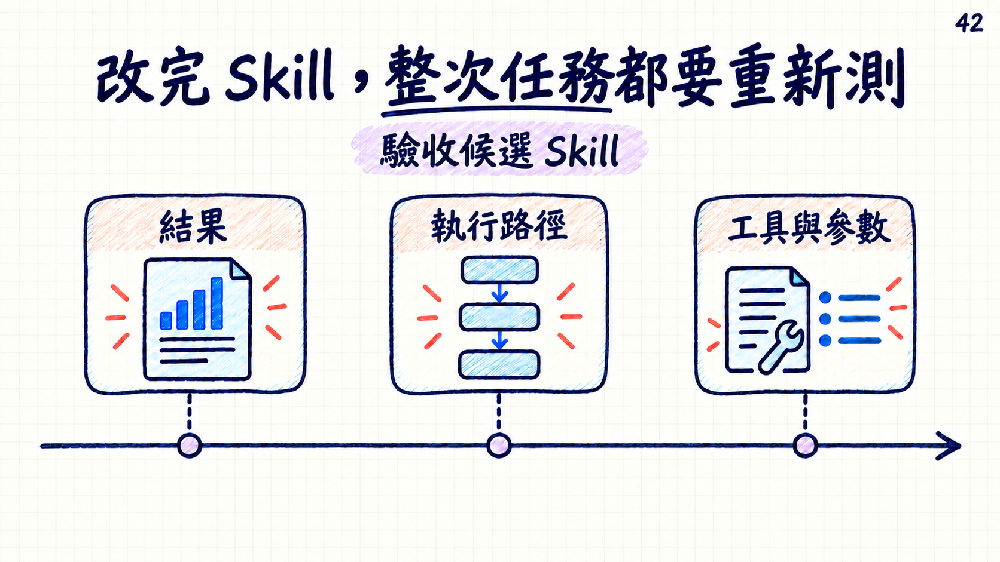

### 核心訊息

從Trace提出候選修改，轉入修改驗收；用整次任務的結果、路徑與工具參數判定是否符合既定成功標準。

### 畫面文字

改完 Skill，整次任務都要重新測｜驗收候選 Skill｜結果｜執行路徑｜工具與參數

### 畫面設計

保留三個任務檢查窗口與任務水平線，主標改為修改後整次任務重測，副標改驗收候選Skill而不重複定義Eval。移除底緣重複說明；頁碼42。

畫風統一：原v28第43頁（本版第44頁）為字形母版；中文、英文與彩色重點字保留同一手寫字形家族、相對字重、自然筆壓、起收筆與墨紋，搭配深藍鋼筆外輪廓、稀疏斜排線、淡色鉛筆筆跡、米白淡格紙。實際字型及會場投影仍待使用者確認。

### 搭配講稿

剛才我們用Trace回看漏Builder那次的事件、當時可見資料與Skill版本，提出了候選修改。現在換成驗收視角：這版Skill改完後，在原本的要求和測試條件下，整次任務是否真的改善？不能只確認新加的句子存在，也不能只測那一句；還要看最後交付、必要操作，以及工具使用。接下來沿用報告案例，一項一項檢查。

### 接下一頁

先看使用者拿到的成果：改完之後，報告符合原本要求了嗎？

### 本頁重點

- 承接追查後的候選修改，這裡開始驗收新版Skill，不重新介紹Evaluation。
- 結果、路徑、工具參數都要檢查，不能只看改動的那句說明。

<a id="slide-43"></a>

## 43｜改完之後，報告符合要求了嗎？

章節：Evaluation：修改如何驗證？；圖內編號43。

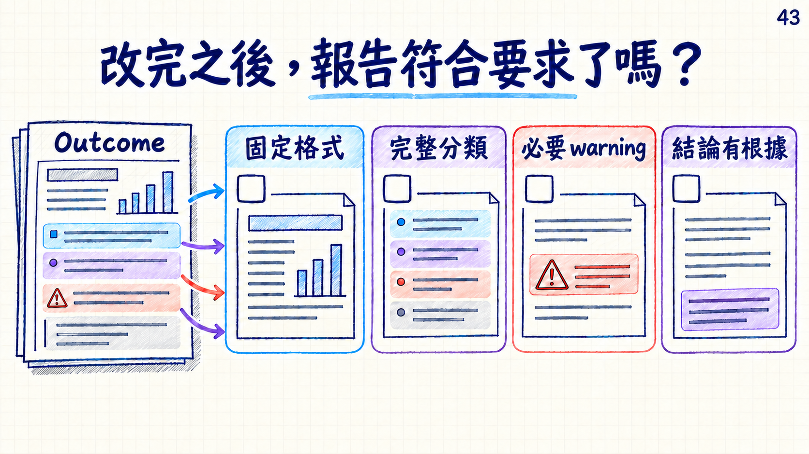

### 核心訊息

將Outcome Eval落到新版Skill的報告驗收，不重複一般定義，也不為讓修改通過而放寬既定標準。

### 畫面文字

改完之後，報告符合要求了嗎？｜Outcome｜固定格式｜完整分類｜必要 warning｜結論有根據

### 畫面設計

沿用報告文件與四個對應檢查區，主標換成修改後的成果問題。單項核對沒有全頁PASS章；頁碼43。

畫風統一：原v28第43頁（本版第44頁）為字形母版；中文、英文與彩色重點字保留同一手寫字形家族、相對字重、自然筆壓、起收筆與墨紋，搭配深藍鋼筆外輪廓、稀疏斜排線、淡色鉛筆筆跡、米白淡格紙。實際字型及會場投影仍待使用者確認。

### 搭配講稿

前面缺漏的報告，問題是格式不符與分類不完整。修改後先用同一套交付要求重查：固定格式、完整分類與必要warning有沒有交出來；結論是否有工具結果支持。不能因為新版看起來比較順，就說修改有效，也不能為了讓它通過而放寬標準。這是對正式交付的測試，不是請LLM重新判定Builder底層程式的正確性。

### 接下一頁

報告符合要求了，必要的Builder這次也真的執行了嗎？

### 本頁重點

- 修改後仍用既定交付要求，檢查格式、分類與必要warning。
- 檢查報告結論是否有對應支持，不以文字流暢代替交付驗收。

<a id="slide-44"></a>

## 44｜漏掉的 Builder，這次有呼叫嗎？

章節：Evaluation：修改如何驗證？；圖內編號44。

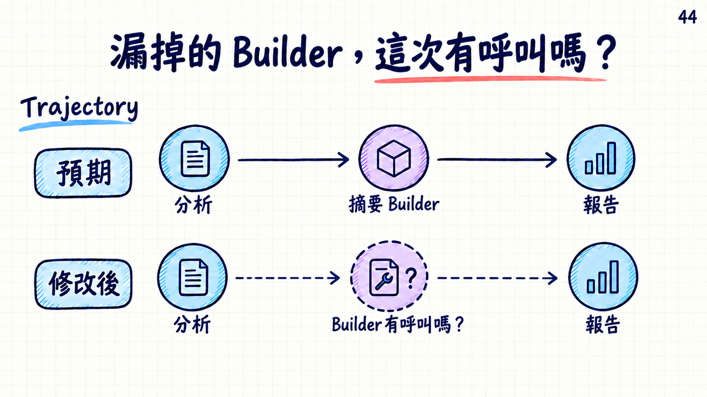

### 核心訊息

用Trajectory Eval驗收已知漏Builder問題是否仍發生，不再重講看答案不夠的一般概念。

### 畫面文字

漏掉的 Builder，這次有呼叫嗎？｜Trajectory｜預期｜分析→摘要 Builder→報告｜修改後｜Builder 有呼叫嗎？

### 畫面設計

上排保留預期分析→Builder→報告；下排標修改後實際紀錄，Builder位置用空白待查節點與問號，不畫成已證實修好或仍然失敗。頁碼44，底部留白。

畫風統一：原v28第43頁（本版第44頁）為字形母版；中文、英文與彩色重點字保留同一手寫字形家族、相對字重、自然筆壓、起收筆與墨紋，搭配深藍鋼筆外輪廓、稀疏斜排線、淡色鉛筆筆跡、米白淡格紙。實際字型及會場投影仍待使用者確認。

### 搭配講稿

這次修改是為了改善漏Builder，就要回看修改後的實際工具紀錄，確認build_execution_summary確實出現，而且在這個情境要求的位置發生。圖是驗收方法示意，沒有宣稱某個候選版本已通過。不同情境可以有合法分支，我們檢查的是各自的必要操作、順序與停止條件，不是把每一個Run硬套成完全一樣的路徑。

### 接下一頁

即使這次有呼叫Builder，傳給它的Ref和參數也可能不對。

### 本頁重點

- 驗收這次候選修改，確認本情境要求的Builder確實被呼叫。
- 各情境可以有合法分支，但必要步驟、順序與停止條件仍要符合要求。

<a id="slide-45"></a>

## 45｜呼叫了 Builder，傳入的資料也對嗎？

章節：Evaluation：修改如何驗證？；圖內編號45。

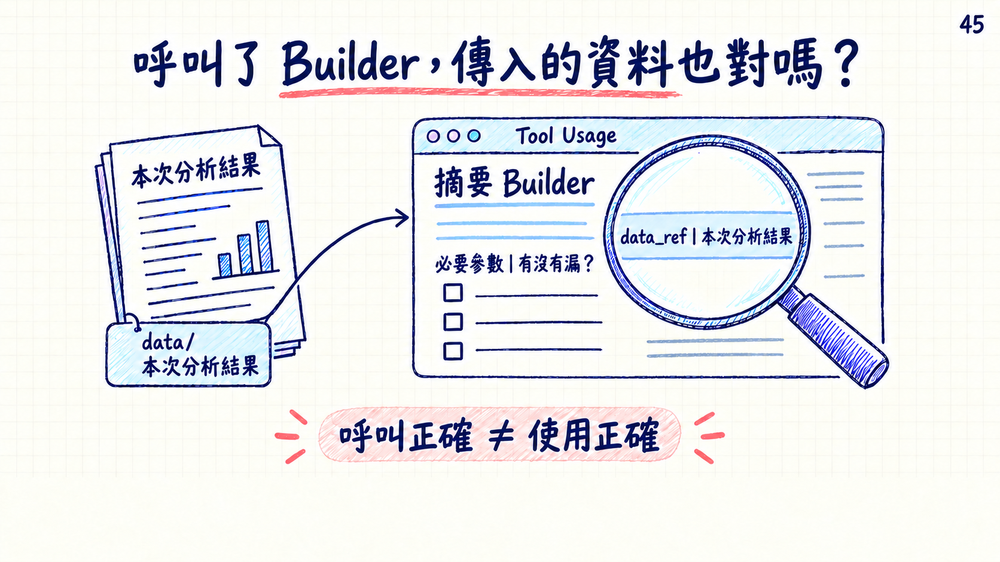

### 核心訊息

延續同一摘要案例，必要工具被呼叫不代表參數與資料引用正確。

### 畫面文字

Tool Usage
摘要 Builder
data_ref｜本次分析結果
必要參數｜有沒有漏？
呼叫正確 ≠ 使用正確

### 畫面設計

左側是本次分析結果文件及取件標籤，右側大型摘要 Builder 工具文件，將輸入的 data_ref 用放大鏡放大，比對是否指向本次分析結果。必要參數用未勾選檢查欄。不要新增 get_order、日期或新業務案例，不把正確參數臆造為已證實。

畫風統一：原v28第43頁（本版第44頁）為字形母版；中文、英文與彩色重點字保留同一手寫字形家族、相對字重、自然筆壓、起收筆與墨紋，搭配深藍鋼筆外輪廓、稀疏斜排線、淡色鉛筆筆跡、米白淡格紙。實際字型及會場投影仍待使用者確認。

### 搭配講稿

上一頁驗收必要Builder是否被呼叫，這一頁再看這版Skill如何使用它。傳入的Ref要對應本次分析結果，必要參數不能漏，也不能把Tool error當成正常資料繼續處理。工具名稱正確只是第一步。修改後用實際的工具輸入紀錄核對，才能知道Agent有沒有正確把資料交給Builder。

### 接下一頁

這些驗收項目該怎麼判斷？前面介紹過程式與Judge，現在選用適合各項目的方法。

### 本頁重點

- 叫對 Builder 還不夠，要檢查參數和資料引用。
- Ref 是否對應本次分析結果？必要參數與使用條件是否正確？

<a id="slide-46"></a>

## 46｜驗收修改：哪些用程式，哪些用 Judge？

章節：Evaluation：修改如何驗證？；圖內編號46。

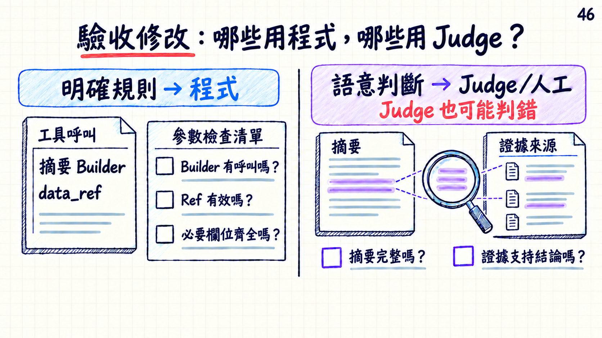

### 核心訊息

將入門頁介紹的評分方式落到這次修改的具體驗收項目；不要重複LLM Judge名詞定義，不把Judge當保證器。

### 畫面文字

驗收修改：哪些用程式，哪些用 Judge？｜明確規則→程式｜Builder有呼叫嗎？｜Ref有效嗎？｜必要欄位齊全嗎？｜語意判斷→Judge／人工｜摘要完整嗎？｜證據支持結論嗎？｜Judge也可能判錯

### 畫面設計

保留左右程式核對與語意判斷文件，主標改為驗收修改。Judge也可能判錯納入右上標頭第二行，文件下移留出間距，底部不放警示文字；頁碼46。

畫風統一：原v28第43頁（本版第44頁）為字形母版；中文、英文與彩色重點字保留同一手寫字形家族、相對字重、自然筆壓、起收筆與墨紋，搭配深藍鋼筆外輪廓、稀疏斜排線、淡色鉛筆筆跡、米白淡格紙。實際字型及會場投影仍待使用者確認。

### 搭配講稿

前面介紹程式、LLM Judge與人工，現在把方法對應到這份驗收清單。Builder有沒有呼叫、Ref是否有效、必要欄位是否齊全，能明確判定就寫程式檢查。摘要是否完整、引用內容是否支持結論等語意，再依明確評分規則由Judge或人工輔助。Judge也可能判錯，要用人工判定的樣本核對與校準，不能只相信它給出的通過分數。這些是在測試時評估候選修改，不是取代執行時的Guard。

### 接下一頁

有了驗收方式，還要把真的踩過的坑留下來，讓每次修改都能重新檢查。

### 本頁重點

- Builder呼叫、有效Ref、必要欄位等明確條件，驗收時用程式檢查。
- 摘要完整或證據支持程度等語意，依明確判準由Judge／人工輔助，並核對Judge是否可靠。

<a id="slide-47"></a>

## 47｜踩過的坑，留進回歸測試

章節：Evaluation：修改如何驗證？；圖內編號47。

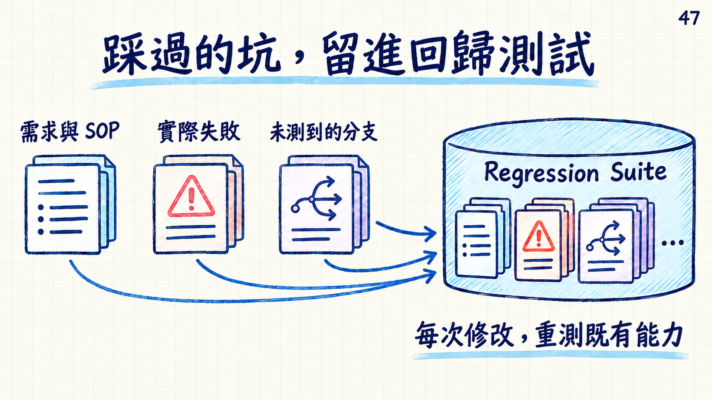

### 核心訊息

測試集由需求、真實失敗與補充邊界情境持續累積。

### 畫面文字

需求與 SOP｜實際失敗｜未測到的分支｜Regression Suite｜每次修改，重測既有能力

### 畫面設計

三份來源文件匯入測試集合。實際失敗文件帶珊瑚標記，入庫後保留同一標記，讓人看見「留下來」。底線：留進。

畫風統一：原v28第43頁（本版第44頁）為字形母版；中文、英文與彩色重點字保留同一手寫字形家族、相對字重、自然筆壓、起收筆與墨紋，搭配深藍鋼筆外輪廓、稀疏斜排線、淡色鉛筆筆跡、米白淡格紙。實際字型及會場投影仍待使用者確認。

### 搭配講稿

回歸測試就是修改後重查原本的能力。第一版情境可從需求與 SOP 拆出來；遇到真實失敗就補進去，也可讓 AI 找未測分支。昨天踩過的坑，明天應該能自動檢查。

### 接下一頁

回歸測試也要有接受標準：同一情境要通過幾次，我們才接受這版修改？

### 本頁重點

- 測試集從需求與 SOP 起步，持續加入真實失敗和邊界情境。
- 昨天踩過的坑要留在回歸測試，讓後續修改能自動檢查。

<a id="slide-48"></a>

## 48｜通過幾次，才接受這版修改？

章節：Evaluation：修改如何驗證？；圖內編號48。

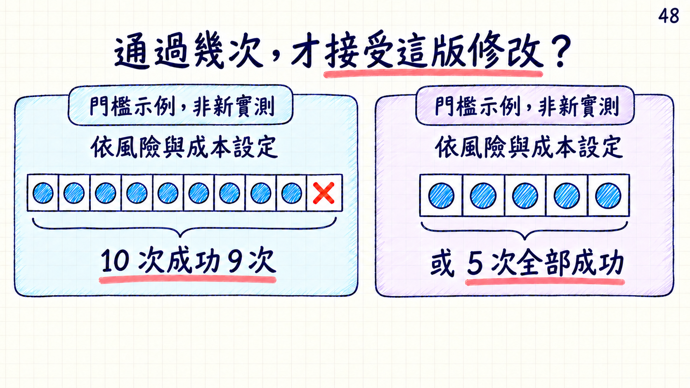

### 核心訊息

前段已理解重跑的必要；這頁專講如何為候選Skill設定可接受門檻，並權衡風險與測試成本。

### 畫面文字

通過幾次，才接受這版修改？｜門檻示例，非新實測｜10 次成功 9 次｜或 5 次全部成功｜依風險與成本設定

### 畫面設計

保留十格與五格門檻例子及非新實測標示，更換主標；將依風險與成本設定放進各示例區內，不縮字。刪除底部說明框與連線；頁碼48。

畫風統一：原v28第43頁（本版第44頁）為字形母版；中文、英文與彩色重點字保留同一手寫字形家族、相對字重、自然筆壓、起收筆與墨紋，搭配深藍鋼筆外輪廓、稀疏斜排線、淡色鉛筆筆跡、米白淡格紙。實際字型及會場投影仍待使用者確認。

### 搭配講稿

前面已說過不能只跑一次；現在是要訂接受這版修改的門檻。例如某個情境要求十次成功九次，或者另一種要求五次全部通過。這些是主稿的門檻示例，不是新增實測，也不能直接比較五次全過一定比十次九次可靠。實際門檻要看這個情境的風險、成本與可接受錯誤程度。高風險不能只靠加大測試次數來保證安全，仍要有相應Guard。

### 接下一頁

這個失敗案例達到門檻了，其他原本會過的情境有沒有退步？

### 本頁重點

- 這裡進一步訂驗收門檻，不重複前段為什麼要重跑。
- 10次成功9次或5次全過只是不同示例，需依風險、情境與成本訂定；不能直接拿不同次數排名可靠性。
- 有限測試門檻不是執行保證，也不取代Guard。

<a id="slide-49"></a>

## 49｜修好一個問題，也可能弄壞其他情境。

章節：Evaluation：修改如何驗證？；圖內編號49。

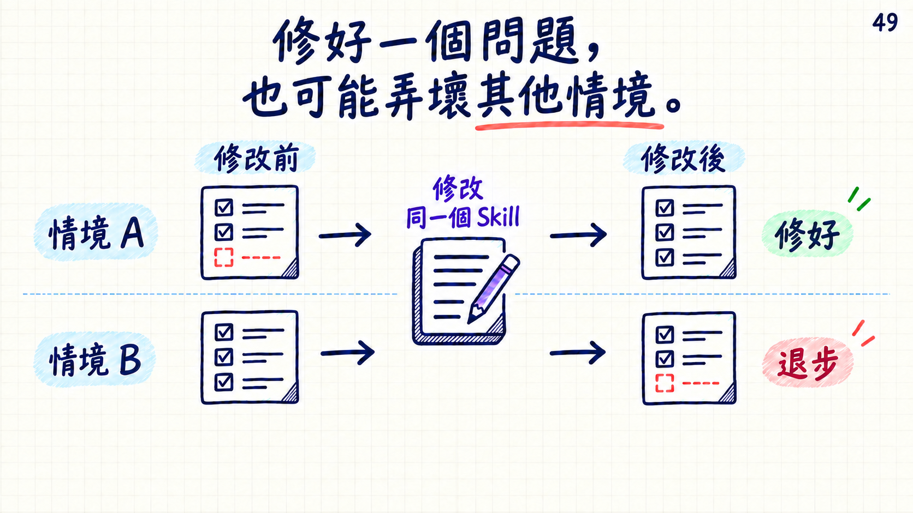

### 核心訊息

Skill 修改可能影響原本通過的情境，接受修改不能只看原本的失敗是否修好。

### 畫面文字

修好一個問題，也可能弄壞其他情境。｜修改前｜修改後｜情境 A｜情境 B｜修改同一個 Skill｜修好｜退步

### 畫面設計

兩行金句作主標，以紅色底線強調弄壞其他情境。下方A、B兩条案例軌道上下對齊，中間是同一份Skill與修訂筆：A由缺口變成完整，B由完整變成缺口。綠色修好與紅色退步同時顯示，不能只看被修好的案例；不新增圖片上沒有的標示。頁碼49。

畫風統一：原v28第43頁（本版第44頁）為字形母版；中文、英文與彩色重點字保留同一手寫字形家族、相對字重、自然筆壓、起收筆與墨紋，搭配深藍鋼筆外輪廓、稀疏斜排線、淡色鉛筆筆跡、米白淡格紙。實際字型及會場投影仍待使用者確認。

### 搭配講稿

修好一個問題，也可能弄壞其他情境。這張圖用兩個情境說明同一次Skill修改的影響：A原本失敗，修改後修好了；B原本通過，卻可能因此退步。這不是實測統計，而是為什麼要重跑其他情境的示意。接受修改不能只看這一次有沒有修好，還要回歸測試。既然我們能驗證修改是否值得接受，Skill還需要全部由人逐句手寫嗎？

### 接下一頁

有了驗證標準，就可以讓 AI 產生 Skill，再用測試判斷差距。

### 本頁重點

- 修好一個失敗，其他原本通過的場景可能退步，要重跑回歸。
- 既然能驗證修改是否有效，就可以考慮讓 AI 協助寫與改 Skill。

<a id="slide-50"></a>

## 50｜從第一版 Skill 到功能完成，我沒有手寫過一行 Prompt。

章節：AI 協助撰寫與修正 Skill；圖內編號50。

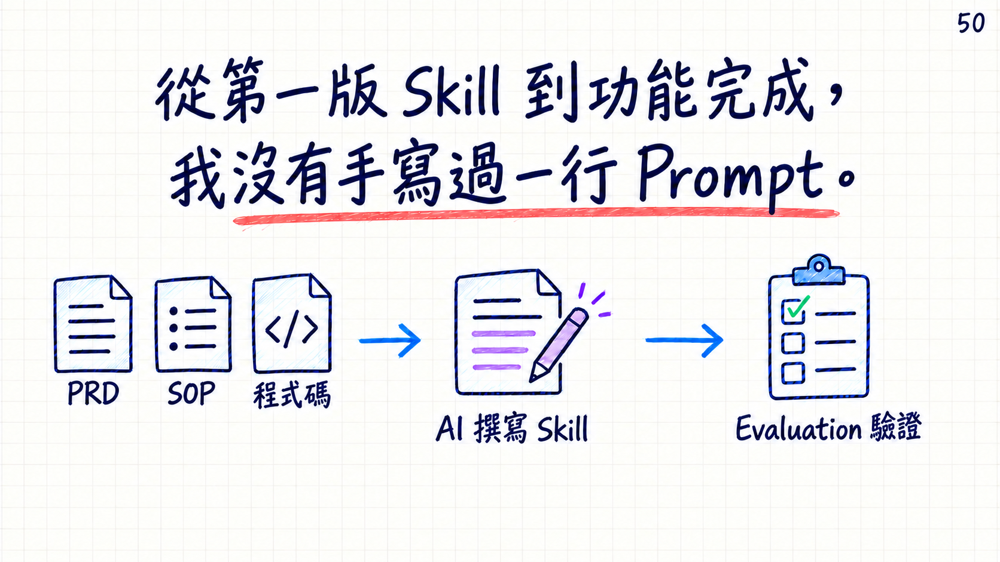

### 核心訊息

人不必逐句手寫；開發用 AI 依需求產生候選 Skill，再依既定目標測試。

### 畫面文字

從第一版 Skill 到功能完成，我沒有手寫過一行 Prompt。｜PRD｜SOP｜程式碼｜AI 撰寫 Skill｜Evaluation 驗證

### 畫面設計

兩行大金句是視覺主體，紅色手繪底線強調沒有手寫過一行Prompt。下方保留PRD、SOP、程式碼三份來源文件，連到AI撰寫Skill的文件加修訂筆，再連到Evaluation驗證清單。不畫機器人、不畫AI自行修改標準或自動發布。頁碼50。

畫風統一：原v28第43頁（本版第44頁）為字形母版；中文、英文與彩色重點字保留同一手寫字形家族、相對字重、自然筆壓、起收筆與墨紋，搭配深藍鋼筆外輪廓、稀疏斜排線、淡色鉛筆筆跡、米白淡格紙。實際字型及會場投影仍待使用者確認。

### 搭配講稿

在我的系統裡，從第一版Skill到功能完成，我沒有手寫過一行Prompt。我讓協助開發的AI讀PRD、SOP和程式碼，產生第一版Skill，再跑Evaluation找出實際行為和目標的差距。這不是沒有人的要求，也不是AI自行定義成功；人仍然負責需求與接受標準。這裡的AI是協助開發的角色，不是正式執行任務的Agent。

### 接下一頁

測試沒有符合預期時，把執行紀錄交給 AI 分析並修改。

### 本頁重點

- 讓開發用 AI 讀 PRD、SOP 與程式碼，產生第一版 Skill。
- 用 Evaluation 找出實際行為與目標的差距；這個 AI 不是正式執行任務的 Agent。

<a id="slide-51"></a>

## 51｜Eval 的價值不是分數，而是讓 Skill 能被持續修正。

章節：AI 協助撰寫與修正 Skill；圖內編號51。

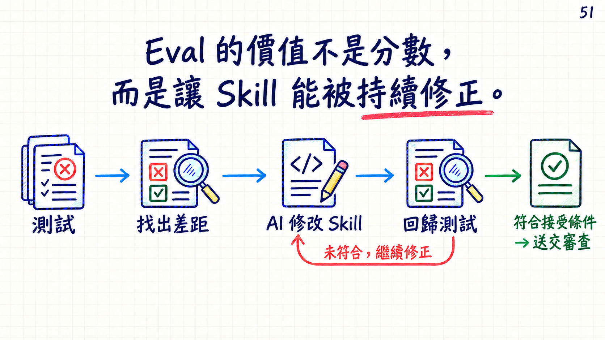

### 核心訊息

Evaluation 與執行紀錄提供可檢查回饋，驅動 AI 分析、修改 Skill、再驗證的循環。

### 畫面文字

Eval 的價值不是分數，而是讓 Skill 能被持續修正。｜測試｜找出差距｜AI 修改 Skill｜回歸測試｜未符合，繼續修正｜符合接受條件 → 送交審查

### 畫面設計

兩行金句作主標，红色手繪線強調持續修正。下方五個大文件icon表示測試、找出差距、AI修改Skill、回歸測試與送交審查。紅色回線從回歸測試返回修改Skill，綠色出口表示符合接受條件才送審，不代表自動發布。頁碼51。

畫風統一：原v28第43頁（本版第44頁）為字形母版；中文、英文與彩色重點字保留同一手寫字形家族、相對字重、自然筆壓、起收筆與墨紋，搭配深藍鋼筆外輪廓、稀疏斜排線、淡色鉛筆筆跡、米白淡格紙。實際字型及會場投影仍待使用者確認。

### 搭配講稿

Eval的價值不是分數，而是讓Skill能被持續修正。Evaluation指出實際行為與目標的差距，Log和Trace提供追查材料；AI據此分析並提出Skill修改，再跑回歸。尚未符合就繼續修正，符合接受條件才送審。重點不是追高分，也不是原封不動一直重跑，而是让回饋真正推動下一版修改。

### 接下一頁

人不再逐句撰寫，但仍然要定義成功與接受標準。

### 本頁重點

- Evaluation 指出差距，Log 與 Trace 提供材料，讓 AI 分析並修改 Skill。
- 修完再跑回歸，符合接受條件才送審；不是無限盲目重試或只追分數。

<a id="slide-52"></a>

## 52｜人定義成功標準，修改用測試結果驗收

章節：AI 協助撰寫與修正 Skill；圖內編號52。

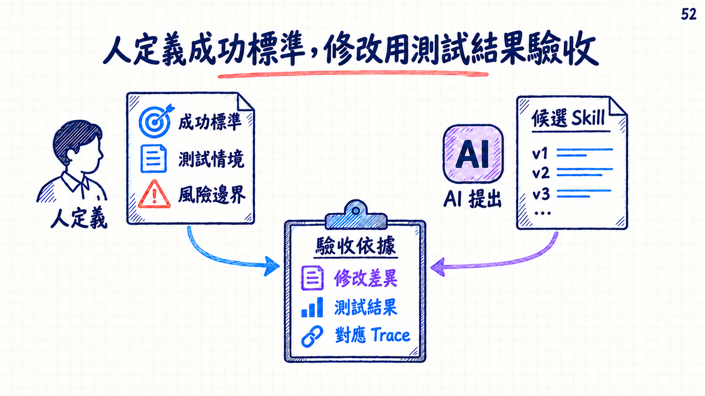

### 核心訊息

人掌握目標、情境與接受標準，AI 產生修改；候選版本用測試及紀錄驗收。

### 畫面文字

人定義｜成功標準｜測試情境｜風險邊界
AI 提出｜候選 Skill
驗收依據｜修改差異｜測試結果｜對應 Trace

### 畫面設計

左側人的標準文件，右側 AI 候選 Skill 文件，下方居中一份驗收依據夾。人的標準與候選成果以不同參照線進入驗收，不畫成雙方共同修改標準。沒有通過章，沒有 AI 自行批准。把版本與依據清楚連結，不做密集卡片牆。

畫風統一：原v28第43頁（本版第44頁）為字形母版；中文、英文與彩色重點字保留同一手寫字形家族、相對字重、自然筆壓、起收筆與墨紋，搭配深藍鋼筆外輪廓、稀疏斜排線、淡色鉛筆筆跡、米白淡格紙。實際字型及會場投影仍待使用者確認。

### 搭配講稿

人的重心轉為定義什麼算成功、該測哪些情境與哪些風險不能接受。AI 可以產生與修改 Skill，但不能為了過關任意放寬標準。接受候選修改時，要看修改差異、測試結果和對應紀錄。

### 接下一頁

這個循環會反覆進行，因此成本也要一起被觀察。

### 本頁重點

- 人定義成功標準、要測的場景與不可接受的風險；AI 產生候選修改。
- 不能為過關放寬標準，驗收要看修改差異、測試結果與對應紀錄。

<a id="slide-53"></a>

## 53｜每輪產生、測試與修正，都要留下成本紀錄

章節：每輪迭代的成本；圖內編號53。


### 核心訊息

成本觀測涵蓋開發改進循環與正式執行，不是暗示 AI 寫 Skill 一定省錢。

### 畫面文字

AI 產生與修改｜測試與回歸
Tokens｜工具次數｜重試｜延遲
知道成本在哪裡

### 畫面設計

上半部兩個清楚活動：AI 修訂文件與測試/回歸文件，分別用記錄線連到下方同一張成本紀錄表。表內僅四個大欄位名稱，無數字或長短條。使用計量表與時鐘小icon，珊瑚底線只強調留下成本紀錄。不要畫錢包付不起、性能已提升或 AI 節省成本。

畫風統一：原v28第43頁（本版第44頁）為字形母版；中文、英文與彩色重點字保留同一手寫字形家族、相對字重、自然筆壓、起收筆與墨紋，搭配深藍鋼筆外輪廓、稀疏斜排線、淡色鉛筆筆跡、米白淡格紙。實際字型及會場投影仍待使用者確認。

### 搭配講稿

這個循環不是免費的。AI 讀紀錄和修 Skill、測試和回歸都需要資源。重點不是先問付不付得起，而是記錄每輪 Tokens、工具次數、重試和延遲，知道成本在哪裡，才能比較修改的效果與代價。

### 接下一頁

回到一開始的 Tool Loop：讓它跑起來不難，讓它正確完成任務，才是我們一路處理的工程問題。

### 本頁重點

- 成本包含 AI 讀紀錄、改 Skill、測試與回歸，也包含正式執行。
- 每輪記錄 Tokens、工具次數、重試與延遲，才能比較效果與代價。

<a id="slide-54"></a>

## 54｜寫出一個 Loop 很簡單，讓一個 Loop 能夠正確地完成任務，才是困難的工程問題。

章節：收尾：把任務做對與資源限制；圖內編號54。


### 核心訊息

回扣開場：工程難點不是啟動Tool Loop，而是讓它正確完成任務。

### 畫面文字

寫出一個 Loop 很簡單，
讓一個 Loop 能夠正確地完成任務，
才是困難的工程問題。

### 畫面設計

三行金句置中，保留原v28第43頁（本版44）母版的手寫字形、相對字重、自然筆壓與墨紋；正確地完成任務只改為珊瑚紅並加底線，不另換字體。下方僅以循環箭頭、短向右箭頭與帶勾選的靶心構成小圖，整組置中縮小；沒有括號、分支、步驟方塊或報告圖示；細深藍鋼筆輪廓、米白淡格紙與稀疏淡藍排線，底部留白。不使用極細單線或空心描邊文字。

畫風統一：原v28第43頁（本版第44頁）為字形母版；中文、英文與彩色重點字保留同一手寫字形家族、相對字重、自然筆壓、起收筆與墨紋，搭配深藍鋼筆外輪廓、稀疏斜排線、淡色鉛筆筆跡、米白淡格紙。實際字型及會場投影仍待使用者確認。

### 搭配講稿

回到一開始，我們幾行程式碼就能讓這個Loop跑起來。但真的交給它任務後，才會遇到Context塞太多、Skill沒有照做、報告出現工具沒回傳的內容，以及出錯後難以追查。前面這些工程工作，不是為了堆模組，而是為了讓它在實際條件下把任務做對。寫出一個Loop很簡單，讓一個Loop能夠正確地完成任務，才是困難的工程問題。

### 接下一頁

模型會進步，也能幫忙解決其中一些問題；但能不能只等下一個更強的模型？

### 本頁重點

- 循環能運作，與任務能正確完成，是不同的事。
- Context、Skill、Evaluation、Guard與Trace，都是為了把任務做對。

<a id="slide-55"></a>

## 55｜解決這個問題，不能只靠最新的模型。

章節：收尾：把任務做對與資源限制；圖內編號55。


### 核心訊息

改善Agent不能只靠換模型；模型能力、任務設計與驗證需要一起考慮。

### 畫面文字

解決這個問題，
不能只靠最新的模型。

GPT-6 / Astra
Claude / Opus 5.5
Gemini / 4 Argon

### 畫面設計

兩行金句為主，字形、字重、自然筆壓與墨紋直接依原v28第43頁（本版44）母版，不以新54頁當參考。不能只靠僅改為珊瑚紅並加底線。下方三個小型模型品牌標記與兩行手寫名稱等距排列，不使用Bot或晶片；品牌標記保持清晰。底部留白，不使用極細單線或空心描邊文字。

畫風統一：原v28第43頁（本版第44頁）為字形母版；中文、英文與彩色重點字保留同一手寫字形家族、相對字重、自然筆壓、起收筆與墨紋，搭配深藍鋼筆外輪廓、稀疏斜排線、淡色鉛筆筆跡、米白淡格紙。實際字型及會場投影仍待使用者確認。

### 搭配講稿

更強的模型的確可能讓某些步驟更穩、讓原本難處理的任務做得更好。我不是說模型不重要，而是不能把所有問題都交給下一版模型。Context怎麼給、Skill寫了以後有多常照做、哪些結論需要Tool Result支持、出錯時能不能回看，都還是我們需要處理的事。圖中的模型名稱只是沿用選定示例，不代表性能比較或最新版本排名。解決這個問題，不能只靠最新的模型。

### 接下一頁

而且每次遇到問題都換更大的模型、塞更多Context、做更多重試，資源代價也會跟著增加。

### 本頁重點

- 更好的模型能幫忙，但不是省略工程工作的理由。
- 模型選擇仍要放回任務、驗證與成本的條件一起考慮。

<a id="slide-56"></a>

## 56｜模型會越來越聰明，但是你的口袋沒有越來越深。

章節：收尾：把任務做對與資源限制；圖內編號56。


### 核心訊息

以口袋金句結尾：工程工作的理由，是在有限資源內把任務做對，而非一味增加模型與重試成本。

### 畫面文字

模型會越來越聰明，
但是你的口袋沒有越來越深。

### 畫面設計

兩行金句置中，字形、相對字重、自然筆壓與墨紋直接沿用原v28第43頁（本版44）母版。沒有越來越深只改珊瑚紅並加底線，保持同一筆觸。下方只有小錢包與一枚硬幣，細深藍輪廓及稀疏淡藍鉛筆排線。沒有新口號、模組總結、章節標籤或Thank You；最下方留白。不使用極細單線或空心描邊文字。

畫風統一：原v28第43頁（本版第44頁）為字形母版；中文、英文與彩色重點字保留同一手寫字形家族、相對字重、自然筆壓、起收筆與墨紋，搭配深藍鋼筆外輪廓、稀疏斜排線、淡色鉛筆筆跡、米白淡格紙。實際字型及會場投影仍待使用者確認。

### 搭配講稿

所以我們才要管理Context、用Evaluation了解表現、守住不能接受的錯、留下Trace，並且觀察Tokens、工具呼叫、重試與延遲。不是為了把系統做得更複雜，而是在有限資源裡讓Agent把任務做對。模型會越來越聰明，但是你的口袋沒有越來越深。

### 接下一頁

分享結束，進入Q&A；不再追加另一句收尾金句。

### 本頁重點

- 模型會持續進步，但工程仍要面對有限的資源。
- 前面的工作，是為了在資源限制下讓Agent正確完成任務。
