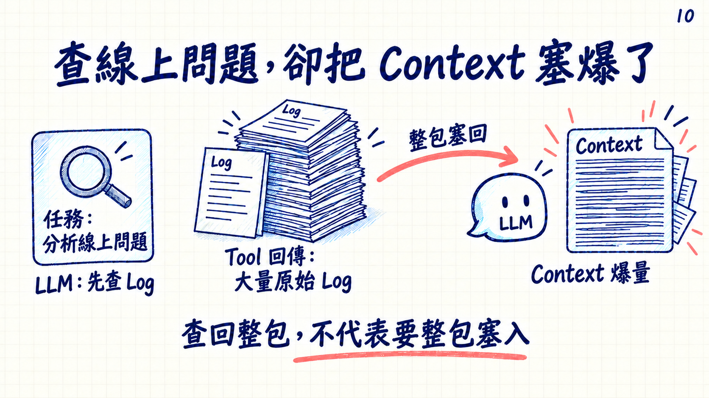
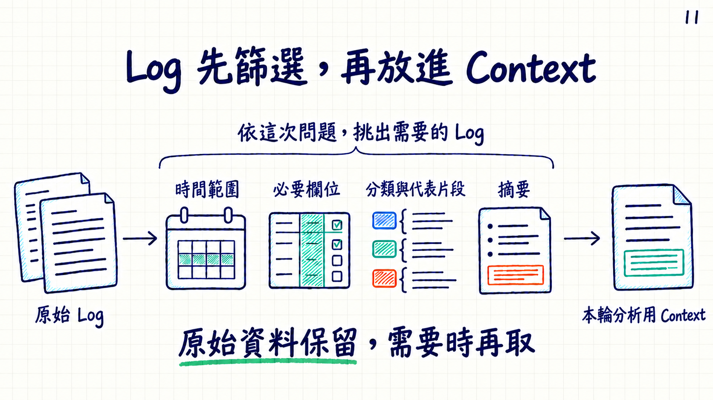

# 第10、11頁 Log 案例文字調整預覽

狀態：user_accepted。使用者已確認兩張圖片，整合至[最新56頁v32](../2026-10-08-v32-slides-01-56-log-context-integrated/README.md)。原v30及預覽來源保留。

## 10｜查線上問題，卻把 Context 塞爆了

實務案例：分析線上問題 → LLM判斷先查Log → Tool查回大量原始Log → 整包塞回Context，Context爆量。

## 11｜Log 先篩選，再放進 Context

依這次問題，挑出需要的Log。時間範圍、必要欄位、分類與代表片段、摘要是可選方法，不是固定四步。原始資料保留，需要時再取。

來源：v30同頁圖片，透過內建imagegen編輯。第10頁原始輸出為exec-67ad8949-03b5-4d62-83ed-ff509f06afda.png，第11頁為exec-5232b034-79b0-43aa-8973-dcc6569053ec.png。原圖保留。

已目視核對繁體中文、英文字、頁碼、圖示及無重疊／裁切；兩頁已獲使用者確認。精確字型與實際pt、實體投影仍未驗收。

[完整產圖提示詞](PROMPTS.md)
