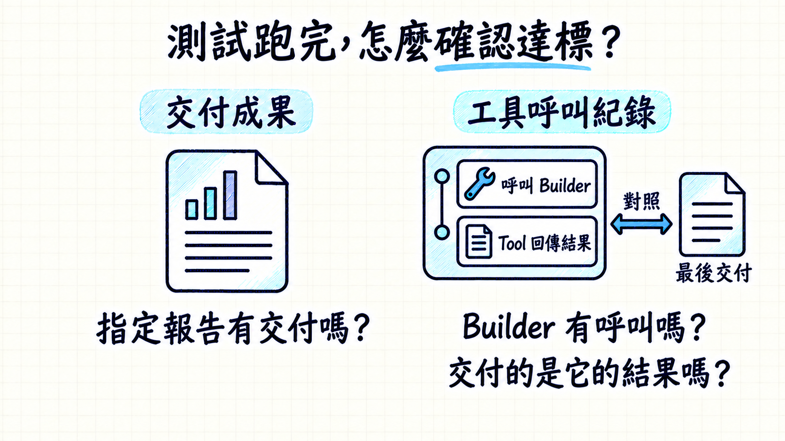
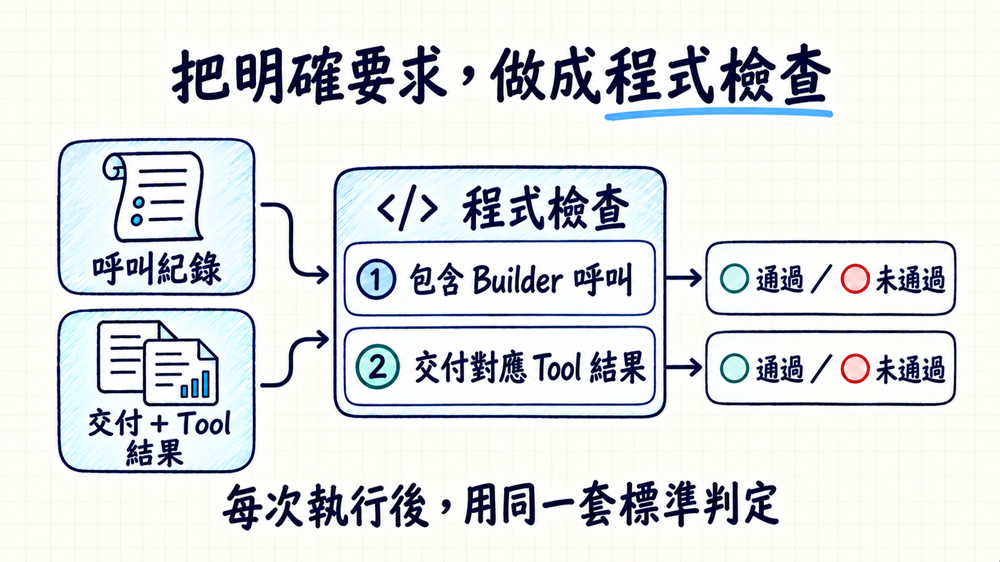

# Evaluation 驗收依據整合圖

第23頁v3經使用者確認；第26頁v2同步修正Tool回傳結果對照的文字。已整合至v38的58頁分頁稿及投影站台。

[58頁完整圖片與講稿](../2026-10-13-v38-slides-01-58-evaluation-intro/README.md) · [兩頁對照](gallery.html)

## 23｜測試跑完，怎麼確認達標？

先確認指定報告是否交付，再查Builder呼叫及Tool回傳結果，對照最後交付。報告外觀與呼叫存在都不能單獨證明交付來源。

## 26｜把明確要求，做成程式檢查

核對Builder呼叫與交付對應Tool結果的明確條件，於每次測試執行後判定通過或未通過。

使用內建imagegen；完整提示詞為[23頁](SLIDE-23-V3-PROMPT.json)與[26頁](SLIDE-26-V2-PROMPT.json)。歷史預覽不納入正式圖集。
