# 58頁分頁稿 v38｜Evaluation入門

58頁整合版：保留v37的56頁相對順序，新增第22、23頁Evaluation介紹。第21頁採任務驗收卡；本輪更新第13頁標題為「資訊放在中間，也容易被 LLM 忽略」，其他57張圖片與講稿內容不變。第20頁提出有回答不代表完成，第21頁定義完成標準，第22頁介紹Evaluation測試流程，第23頁示範如何從交付成果與操作紀錄找驗收依據。圖內不加頁碼。此版供投影站台使用，歷史PDF未更新。

## 01｜自己刻 Agent 框架，最難的不是呼叫 LLM

章節：開場：Tool Loop 與六個問題

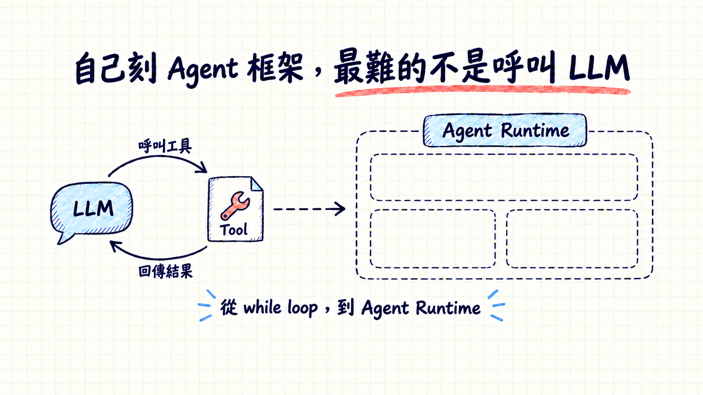

### 核心訊息

用親身失敗與修正經驗，說明從 Tool Loop 到可交付 Runtime 的過程。

### 搭配講稿

我一開始只想讓模型反覆呼叫工具。真的接上企業流程後，才陸續遇到漏步驟、錯誤結論與難以追查的問題。今天用這些經驗，說明循環之外需要哪些執行責任。

### 接下一頁

先看我一開始以為的 Agent 長什麼樣。

### 本頁重點

- Tool Loop 能讓模型呼叫工具，但還不足以承接真實任務。
- 今天沿著實作遇到的問題，說明如何走到可交付的 Runtime。

## 02｜這個 Tool Loop，幾行程式碼就能跑起來

章節：開場：Tool Loop 與六個問題

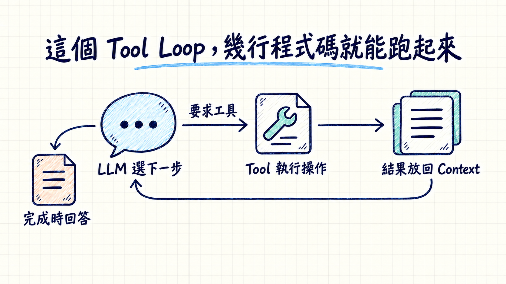

### 核心訊息

LLM 選動作、Tool 執行、結果交回 Context，形成最小可運作循環；能跑起來仍不是可交付。

### 搭配講稿

LLM 是理解文字、判斷下一步的模型；Tool 是查資料或執行操作的程式。我最初的做法很簡單：呼叫模型，模型要求工具就執行，把結果 append 回 Context，再問一次；模型交出答案就結束。這幾行概念碼真的可以跑起來，所以當時我以為主要工作完成了。但這只是最小循環，還沒處理真實任務需要的可靠性。

### 接下一頁

直到它開始碰到真實任務：工具會動、模型會答，就代表可以交付嗎？

### 本頁重點

- 模型要求工具時才執行；結果交回 Context，繼續問模型。
- 最小循環確實能跑，但還沒承接真實任務的責任。

## 03｜你以為這樣就結束了嗎？

章節：開場：Tool Loop 與六個問題

### 核心訊息

從 Demo 成功，轉入真實任務帶來的責任。

### 搭配講稿

工具會動、模型會回答，很快就能看到。但一進企業流程，我開始遇到那些不會直接報 exception，卻會交出錯誤結果的問題。

### 接下一頁

這些問題，慢慢長成六項必須承接的責任。

### 本頁重點

- 工具會動、模型會回答，只是 Demo 成功。
- 企業任務可能沒有 exception，卻仍交出錯誤結果。

## 04｜會動之後，六個問題攤開了

章節：開場：Tool Loop 與六個問題

### 核心訊息

建立全場問題地圖，讓結尾能逐一回扣。

### 搭配講稿

從資訊與流程開始，接著是哪些錯不能通過。出了問題，要能追查、驗證修改，也要付得起反覆測試的成本。等一下會依這些問題一路往下走。

### 接下一頁

在展開之前，先交代我為什麼選擇自己刻。

### 本頁重點

- 六個問題：給什麼資訊、怎麼完成流程、哪些錯不能放行。
- 出錯如何追查、修改如何驗證、每次執行與測試的成本在哪裡。
- 這是全場的問題地圖，最後會回扣整套 Runtime。

## 05｜為什麼選擇自己刻？

章節：開場：Tool Loop 與六個問題

### 核心訊息

自己刻的動機，是掌握模型選擇、執行可控性與既有企業治理的整合。

### 搭配講稿

現成框架與平台有價值，也能提供多模型與治理能力。我選擇自己刻，主要希望掌握三件事：模型選擇，讓模型可以依任務替換；執行可控，讓我能決定Context怎麼組、工具怎麼接，以及何時介入或停止；治理整合，把公司既有的權限、審核與稽核接進Runtime。不是只有自己刻才能做到，而是我希望掌握這些設計與整合的方式。今天集中在單次任務怎麼執行與驗證，模型介接細節和跨Session記憶另外再談。

### 接下一頁

所以我決定自己把這個 Runtime 接起來。最初就是前面那個循環：模型選工具、工具執行、結果交回模型。接著，第一個需要我做決定的地方出現了：工具回來的這一大包資料，該怎麼交回去？

### 本頁重點

- 自己刻的理由：模型選擇、執行可控，以及既有企業治理整合。
- 這場聚焦單次任務的執行與驗證，不展開模型介接及跨Session記憶。

## 06｜第一個問題：工具結果，怎麼交回模型？

章節：Context：什麼資訊給模型看？

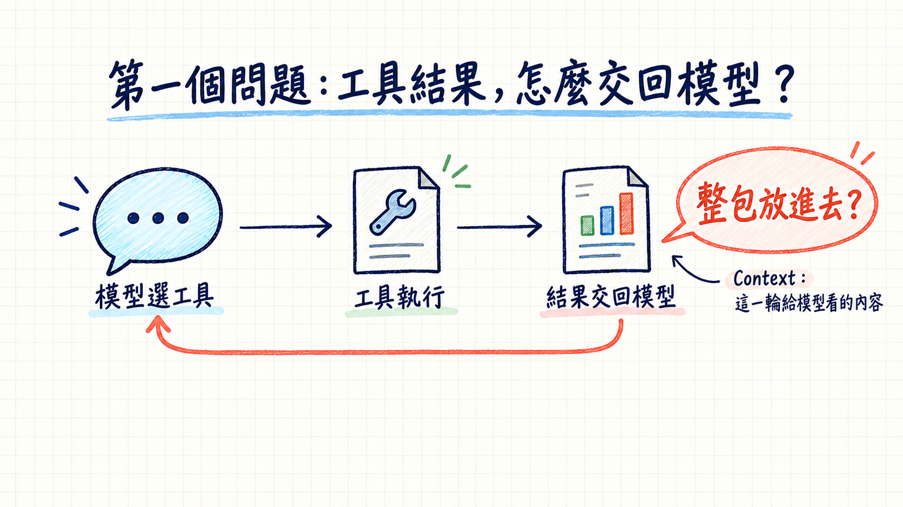

### 核心訊息

接回開場的 Tool Loop，指出「工具結果交回模型」是第一個要處理的決定，帶入 Context 的用途。

### 搭配講稿

先停在這個位置：工具已經執行完，現在要把結果交回模型。這一輪交給模型看的內容，就是 Context；裡面也包含使用者要求與任務規則。那工具回來的一大包資料，要怎麼放進去？

### 接下一頁

當時我的做法很直覺：工具回什麼，我就全部加進去。下一頁就是我最初的接法。

### 本頁重點

- 回到 Tool Loop：工具已經執行完，結果要怎麼交回模型？
- Context 是這一輪給模型看的內容，包含使用者要求、規則與工具資料。

## 07｜每輪都 append，Context 越堆越多

章節：Context：什麼資訊給模型看？

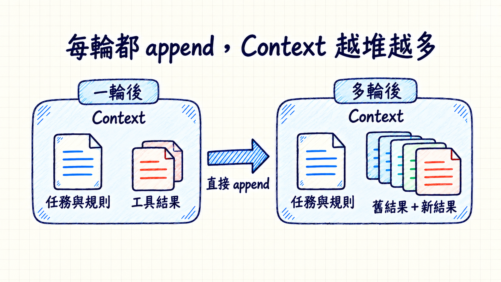

### 核心訊息

直接加入每輪工具結果，會累積舊結果、新結果與無關欄位；內容多不代表下一步更有用。

### 搭配講稿

第一版工具回什麼，我就把它全部 append。一次回傳看起來很自然，幾輪之後，舊結果還在、新結果又加入，每份結果裡還有大量欄位。任務要求和流程規則也一起帶給模型。這不是說模型一定會忘記規則，而是每次呼叫都帶上更多內容，卻還沒判斷它們對下一步是否有用。

### 接下一頁

不再每輪全部append後，完整工具結果要放哪裡？下一頁先交代資料如何保存，再決定這輪給模型什麼。

### 本頁重點

- 每輪直接 append，使舊結果、新結果與欄位持續累積。
- 累積更多資料，不等於每一項都對下一步有用。

## 08｜工具結果留完整，給模型的內容按需準備

章節：Context：什麼資訊給模型看？

### 核心訊息

工具先回傳完整結果，Runtime保存原始完整資料，供後續工具使用；交給模型的本輪內容則按下一步需要準備。

### 搭配講稿

工具回傳一大包結果時，我不會因為模型這一輪只需要其中一部分，就把其餘資料丟掉。這個 Runtime 會先保存原始完整結果，因為後續工具可能還需要取用完整資料；再依下一步用途，準備這一輪給模型看的內容。資料不是一開始就在資料庫裡，是工具回傳後，由 Runtime 刻意留下來的。完整保存和全部塞進 Context 是兩件不同的事；這是本案例的設計選擇，不是所有工具都會自動入庫。如果下一步只是把結果交給另一個工具，模型也不必讀完這一整包資料。

### 接下一頁

完整結果已經留下來了。如果模型不用讀整包資料，下一個工具怎麼找到它？下一頁看 status 與 data_ref 怎麼分工。

### 本頁重點

- 先保存工具的原始完整結果，後續工具仍可取用。
- 給模型的本輪Context按下一步需要準備，不等於把資料全部塞入。

## 09｜模型傳 Ref，工具取完整資料

章節：Context：什麼資訊給模型看？

### 核心訊息

模型判斷只需 status 與 data_ref；完整 API 資料由系統保存，下一個工具在服務端依 Ref 取回。

### 搭配講稿

接著剛剛保存完整工具結果的設計：如果下一步只需要判斷成功與否，再把資料交給另一個工具，Tool A 就把完整結果存進系統，交給模型的是 status 和 data_ref。模型選好下一步，把 Ref 傳給 Tool B；Tool B 在服務端依 Ref 取回完整資料。模型負責判斷，工具與系統負責搬運。Ref 是取件參照，不是權限，能不能讀、允許做什麼，仍由系統檢查。工具之間需要完整資料，不代表模型也需要讀完整資料。

### 接下一頁

資料搬運可以只傳 Ref；但如果下一步要模型分析 Log，就得給它相關內容。那該給多少？接下來用分析系統 Log 的案例說明。

### 本頁重點

- 模型接收狀態和 Ref，資料搬運由工具與系統處理。
- 取件請求與完整資料回傳分開；Ref 的使用權限仍由系統檢查。
- 只交付下一步需要的資訊，不只是省 Token，也是在減少模型執行負擔。

## 10｜查線上問題，卻把 Context 塞爆了

章節：Context：什麼資訊給模型看？

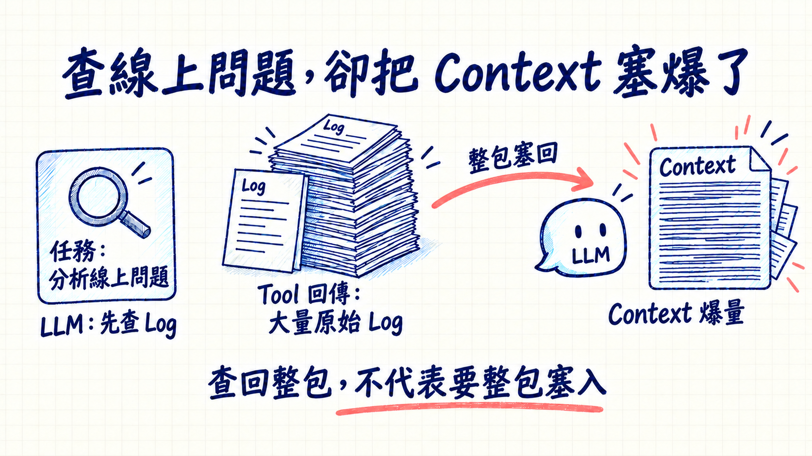

### 核心訊息

工具查回完整Log不是問題；把大量原始Log原封不動塞回Context，才是這次踩坑的原因。

### 搭配講稿

前面說的是工具之間怎麼搬資料。現在回到我實際遇到的任務：我想分析某個線上問題，LLM判斷要先取得Log，就呼叫工具去查。Tool查回來的是一大包原始Log。我當時直接把這整包結果塞回Context，結果Context就爆量了。問題不是工具查到了完整資料，而是我沒有先判斷：這次分析真正需要哪些內容，就把原始資料全部交回模型。這裡先談資料怎麼進Context，不是在談模型捏造結論。

### 接下一頁

所以我需要改的，是Log交回模型之前的處理：先依這次線上問題篩選，再放進Context。

### 本頁重點

- 任務是分析線上問題；LLM判斷先查Log，Tool回傳大量原始紀錄。
- 整包原封不動塞回Context，造成Context爆量；取得完整資料不等於模型必須讀完整包。

## 11｜Log 先篩選，再放進 Context

章節：Context：什麼資訊給模型看？

### 核心訊息

依這次線上問題挑選相關Log，再準備給模型的Context；不是把工具查回的完整結果原封不動回塞。

### 搭配講稿

延續剛剛分析線上問題的任務：Log查回來之後，先挑出這次分析需要的內容，再放進Context。問題涉及哪段時間，就縮小時間範圍；只需要部分欄位，就挑必要欄位；重複內容很多，可以分類、取代表片段；必要時再做摘要。這些是按問題選用的方法，不是每次都要做完四步，也不是把某幾個關鍵字一篩就當作找到根因。原始完整Log仍保留在系統，需要更多細節時可以再取。模型需要讀相關內容，但不需要每次都讀一大包未整理的原始資料。

### 接下一頁

先篩選Log能避免盲目塞爆Context，但控制Context不只是省Token；即使還沒超過上限，也會影響模型同時顧資料與流程的負擔。

### 本頁重點

- 先依這次線上問題篩選相關Log，再放進本輪分析用Context。
- 時間範圍、必要欄位、分類片段與摘要按需選用；原始資料保留，需要時再取。

## 12｜控制 Context，不只是為了省 Token

章節：Context：什麼資訊給模型看？

### 核心訊息

傳 Ref 與按需整理 Log，都是控制模型需要處理的資訊；目的不只是省 Token，也要減少模型同時顧資料與流程的負擔。

### 搭配講稿

前面看了兩種情況：下一個工具要用完整資料時，模型只傳 Ref；模型要分析 Log 時，就準備這次需要閱讀的內容。它們都不是單純追求 Token 越少越好。模型不只要讀資料，還要顧到必要規則、判斷下一步，把整個流程走完。同一個模型要同時處理的資料、工具結果與流程狀態越多，就可能越難顧到這些要求。即使 Context 還沒有超過上限，原本能完成任務的模型，也可能開始漏步驟或提早停止。所以我們按下一步需要準備 Context，但保留完成任務所需的資訊與規則。圖的下排表達的是減少負擔的設計目的，不代表整理後就一定成功；下一頁看我實際遇到的例子。

### 接下一頁

除了內容多少，資訊放在 Context 的哪個位置，也可能影響模型能不能有效利用。

### 本頁重點

- Ref 與資料整理不只是省 Token，也是在減少模型同時處理的負擔。
- 模型還要顧到規則、判斷下一步；Context 沒滿也可能漏步驟。
- 按需提供資訊並保留必要規則；是否有效仍要用同一任務實測，不保證整理後一定成功。

## 13｜資訊放在中間，也容易被 LLM 忽略

章節：Context：給模型哪些資訊

### 核心訊息

研究在特定任務觀察到位置效應，不能把長視窗當成等量有效利用。

### 搭配講稿

Lost in the Middle 在多文件問答及鍵值檢索任務中，觀察到重要資訊位於開頭或結尾時表現往往較好，位於中間時可能下降。這張是研究趨勢示意，不是注意力權重圖，也不是我的實測曲線，更不是所有模型必然如此。它提醒我：容量與有效使用是不同問題。來源：https://arxiv.org/abs/2307.03172

### 接下一頁

這也呼應我的實務經驗：Context 還沒有滿，模型就可能無法正確走完流程。

### 本頁重點

- 關鍵資訊的位置，可能影響模型對它的有效利用。
- 圖表是Lost in the Middle研究的趨勢示意，不是所有模型的通用表現曲線。

## 14｜30k Context，迫使我換成更大的模型

章節：Context：什麼資訊給模型看？

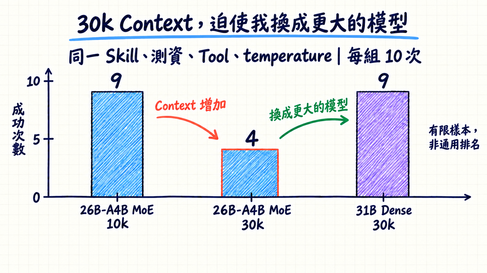

### 核心訊息

同一個 Workflow 在 Context 變重後，26B-A4B MoE 的完成率下降；換成 31B Dense 才恢復。這組觀察呈現的是 Context 負載如何推高模型需求，不是模型排行榜。

### 搭配講稿

在同一Skill、測資、Tool與temperature下，gemma-4-26b-a4b-it-mlx在10k Context成功九次，增加到30k後只成功四次；同樣是30k，換成gemma-4-31b-it後又成功九次。失敗時會漏必要步驟、漏必要內容，或者提早停止。我要說的不是31B永遠比較好，而是模型需要同時處理的內容增加後，原本模型可能無法完成同一套Workflow，最後我換成更大的模型。這是每組十次的有限觀察，不作通用排名，也不能把所有失敗都單獨歸因於長度。

### 接下一頁

這讓我回頭思考：下一步真的需要模型讀完這麼多內容嗎？不能每次遇到問題，都只用更大的模型補上。

### 本頁重點

- 同一組測試：26B-A4B MoE 在 10k 成功 9/10，30k 降為 4/10。
- 30k 換成 31B Dense 後成功 9/10，呈現 Context 負載推高模型需求的觀察。
- 每組只有十次，不是通用模型排名，也不能把所有失敗都歸因於長度。

## 15｜Context 管理會影響需要多大的模型

章節：Context：什麼資訊給模型看？

### 核心訊息

有效控制Context，是控制完成任務所需模型能力與推論負擔的一個重要設計選擇；不要不加區分地把所有資料交給模型，或只靠升級模型處理問題。

### 搭配講稿

這個經驗讓我更重視Context管理。我要的不是一味把Context壓到最短，而是把完整資料留在系統，只交給模型下一步需要的內容、狀態和必要規則。如果我們有效控制Workflow執行過程中的資訊負擔，就可能不必一開始選用更大的模型；是否能完成仍要依任務與執行結果判斷，這組數據沒有直接證明整理後一定成功。更大的模型也往往帶來更高推論負擔，實際速度還受到硬體、量化與框架影響。這一段的重點是：先管理模型要處理什麼，不要所有東西都塞進去，再只靠模型升級。

### 接下一頁

前面我們處理的是，Log要怎麼交給模型。接下來回到任務的交付目標：模型分析完之後，還要交付什麼？

### 本頁重點

- Context負載會影響完成任務所需的模型能力與推論負擔。
- 先判斷下一步需要什麼；完整資料留在系統，必要資訊和規則交給模型。
- 減少不必要負擔不保證成功，但不應每次都只靠升級模型。

## 16｜分析完 Log，任務就完成了嗎？

章節：Skill：流程真的會照做嗎？

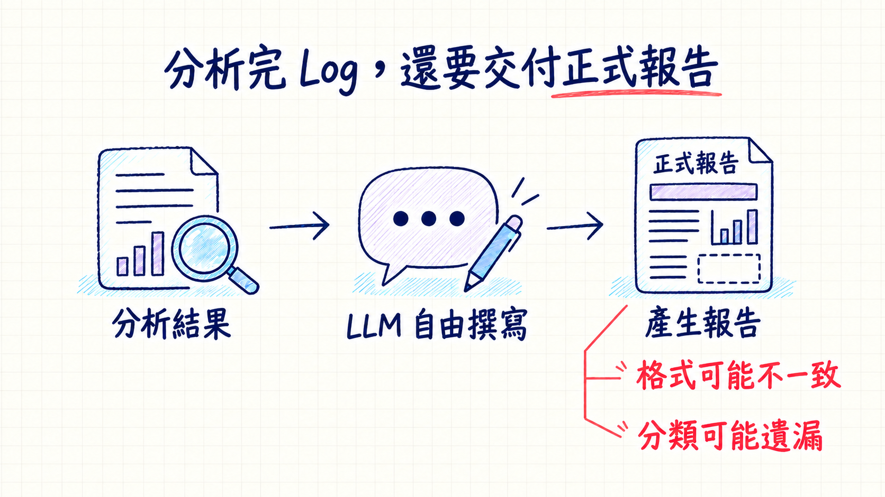

### 核心訊息

以Log分析場景建立後續流程章的交付目標：取得分析結果還不夠，任務另要求交付正式報告。這裡先建立需求，不提前宣告模型漏步驟。

### 搭配講稿

前面用Log分析說明模型需要哪些資訊。接下來繼續用這個容易理解的場景，帶入另一個問題：分析完Log，就算任務完成了嗎？在我們接下來討論的報告交付要求中，使用者不只要一段分析文字，還要一份符合規格的正式報告。這是將主稿的分析差異與Summary Builder案例放進Log分析場景的教學串接，不是說前面的API、模型測試與這次報告全都是同一個實際Run。先把要交付的成果說清楚，才知道後面哪些操作不能省略。

### 接下一頁

正式報告有固定格式與必要內容，因此我準備了專門的Builder來產生它。

### 本頁重點

- 回到Log分析場景，先建立後續的報告交付需求。
- 分析結果與正式報告是不同的交付；這個任務不只要一段分析文字。

## 17｜正式報告，需要由 Builder 產生

章節：Skill：流程真的會照做嗎？

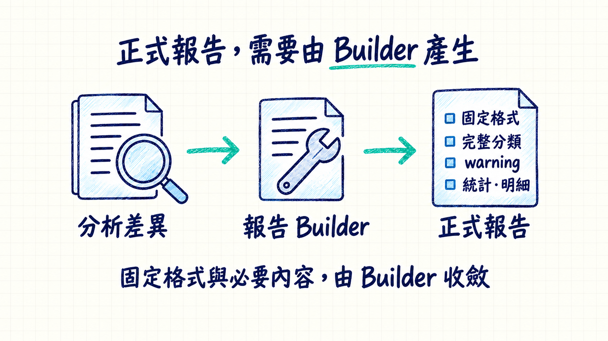

### 核心訊息

承接第15頁的正式報告交付需求，說明為什麼需要Builder，而不是任意一段LLM摘要。這是本案例的交付規格，不是所有Agent任務都必須用Builder。

### 搭配講稿

前面說這個任務不只要分析結果，還要正式報告。正式報告有固定格式，必須帶上完整分類、必要warning、統計與明細，所以我準備了專門的Builder。模型負責分析、判斷下一步並呼叫工具；Builder則把交付格式和必要內容收斂成報告。不是任何一段流暢摘要，都能替代這份指定交付。這是這個任務的需求，並不是所有Agent都只能使用這種流程。

### 接下一頁

工具已經準備好了，我也把分析後要呼叫Builder的要求，寫進Skill。

### 本頁重點

- 這個任務要交付固定格式、完整分類、warning、統計與明細。
- 分析結果交給報告Builder，指定格式與必要內容由程式收斂。

## 18｜我已在 Skill 寫明：分析後呼叫 Builder

章節：Skill：流程真的會照做嗎？

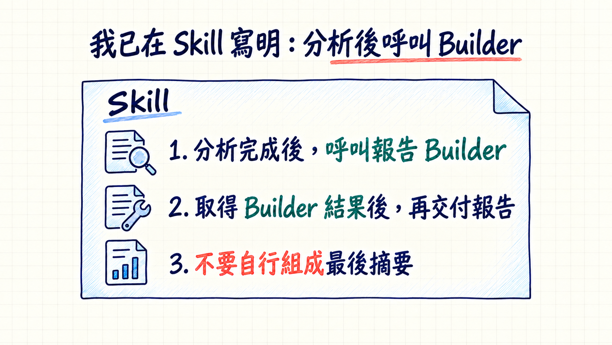

### 核心訊息

必要工具與交付步驟已用自然語言寫明。以具體Skill說明建立期待，下一頁立刻對照實際漏Builder的失敗，不再多放一張抽象疑問。

### 搭配講稿

我不只是心裡希望模型呼叫Builder，也已經把要求寫進Skill。把主稿案例濃縮成大家看得懂的示意，就是分析後呼叫報告Builder，取得Builder結果再交付，不要自行組成最後摘要。這不是逐字貼上正式Skill，而是呈現已經寫明的指示。我的實務仍然是用自然語言說下一步要做什麼，讓LLM讀完後推論並呼叫工具，不是把流程改寫成硬編碼狀態機。我當時以為，寫清楚了應該就會照做。

### 接下一頁

但實際執行時，它卻跳過了Builder，直接交出自己寫的摘要。

### 本頁重點

- Skill以自然語言說明分析後呼叫Builder、取回結果再交付。
- 這些是模型收到的指示，不是程式強制執行的狀態機。

## 19｜模型卻跳過 Builder，自己寫了摘要

章節：Skill：流程真的會照做嗎？

### 核心訊息

Skill已寫明分析後呼叫Builder，模型仍跳過它而自行摘要；格式不符與分類漏掉，是必要步驟未完成造成的交付缺失。

### 搭配講稿

主稿的實際案例已要求先analyze_discrepancies，再呼叫build_execution_summary。但某些Run沒有呼叫Builder，而是LLM自己組出摘要。有答案、沒有exception，看起來像完成了，必要工具卻根本沒有執行。這正好對照上一頁：Skill已經寫明，模型仍不一定照做。跳過Builder的後果也很具體：格式不符合規格，有些分類結果被漏掉。問題不是換了一條合法路徑，而是指定交付沒有完成；也不是要再讓LLM審查Builder本身。前面的Log場景是幫大家理解報告交付的教學串接，不是宣稱API、模型實測與這次報告都是同一個實際Run。

### 接下一頁

所以不能只看它有沒有回答；有回答，不代表流程正確完成。

### 本頁重點

- Skill已要求分析後呼叫Builder，但有些Run仍跳過它，自行交出摘要。
- 自行摘要導致格式不符、分類漏掉；指定交付沒有完成。
- 有答案、沒有exception，不等於必要步驟都已執行。

## 20｜有回答，不代表流程正確完成。

章節：Skill：流程真的會照做嗎？

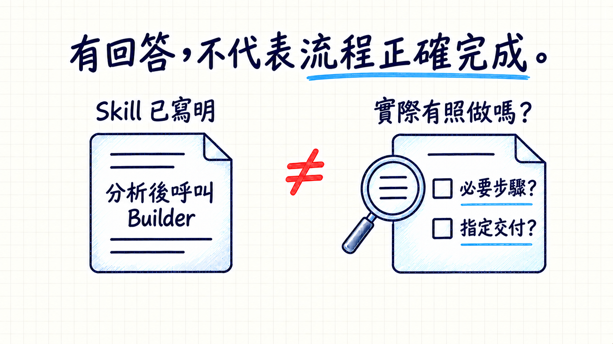

### 核心訊息

從漏Builder及交付缺失，收束成為什麼需要測試：Skill說明要求，不等於模型執行時一定達成；必須實際執行並檢查必要步驟與指定交付。這頁不介紹Trace診斷。

### 搭配講稿

有回答，不代表流程正確完成。剛才的案例，Skill已寫明分析後要呼叫Builder，模型卻跳過它，最後格式不符、分類也漏掉了。所以我不能只看它有沒有交出一段摘要，就認定任務完成。要把任務交給它實際執行，再檢查必要步驟有沒有做、指定成果有沒有交付。Skill說明要求是一件事，測試模型能不能做到是另一件事。

### 接下一頁

既然有回答不代表流程正確完成，那我們要怎麼知道Agent真的完成了任務？

### 本頁重點

- Skill寫明要求，不等於模型實際執行時一定照做。
- 實際跑任務，檢查必要步驟與指定交付；這就是接下來要介紹測試的原因。

## 21｜怎麼知道 Agent 真的完成任務？

章節：Skill 與 Evaluation：說明如何變成測試

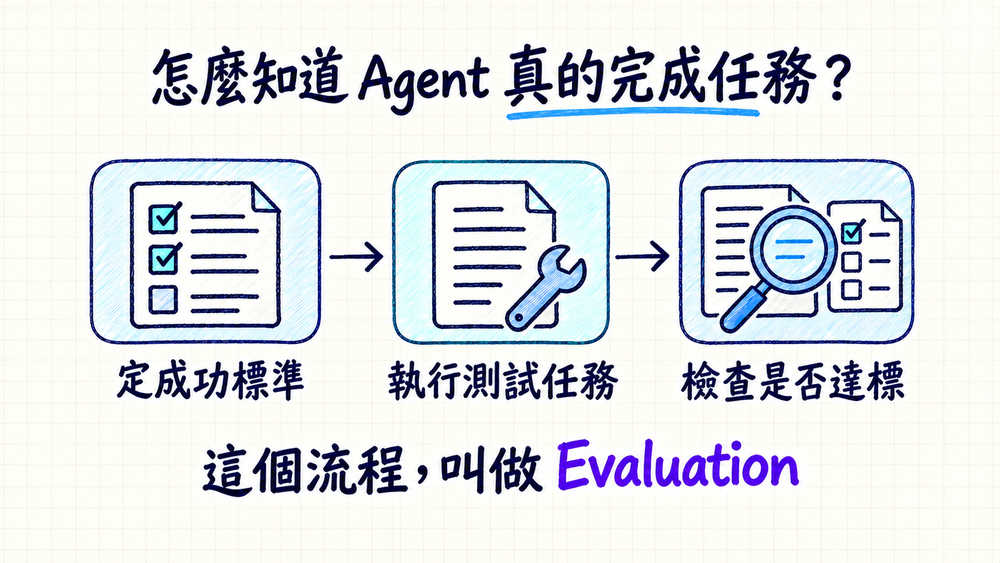

### 核心訊息

先說清楚怎樣才算完成，讓任務有可對照的成功標準。

### 搭配講稿

要知道Agent有沒有完成，第一步是先說清楚：這個任務做到什麼才算完成。以剛才的報告任務為例，我要求兩件事：必要操作是確實呼叫Builder；交付成果則是交出Builder產生的正式報告。只呼叫工具卻沒有交出報告，不算完成；自己寫一份摘要卻跳過Builder，也不符合要求。這張驗收卡是在定義要求，不是在宣告測試已通過，也不是再次驗證Builder底層程式是否正確。

### 接下一頁

有了明確標準，接著讓模型實際跑一次，再檢查有沒有做到。這就是Evaluation。

### 本頁重點

- 必要操作：確實呼叫Builder。
- 交付成果：交出Builder產生的正式報告。
- 先定義成功標準，才有依據判斷是否完成。

## 22｜Evaluation：實際測試 LLM 的表現

章節：Skill 與 Evaluation：說明如何變成測試

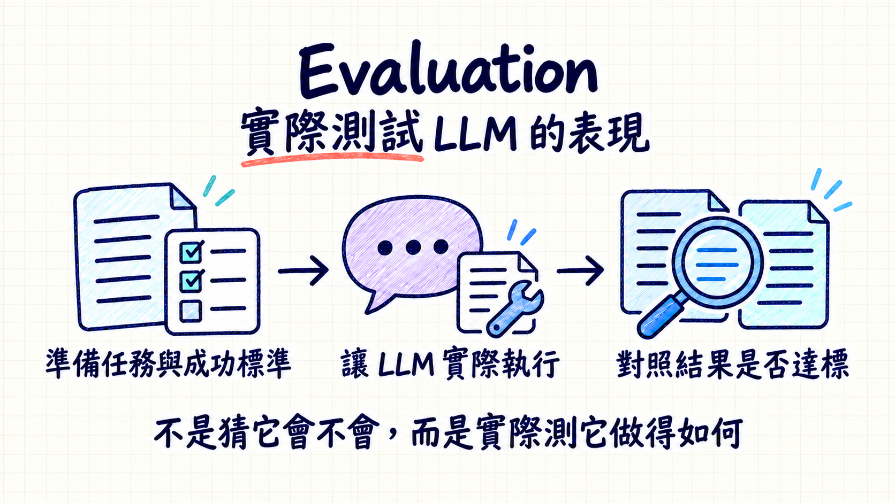

### 核心訊息

Evaluation的目的，是實際測試LLM在任務中的表現，而不是只相信它的回答或能力描述。

### 搭配講稿

剛才已經說清楚怎樣才算完成，現在要實際測試它做不做得到。這就是Evaluation：準備任務與成功標準，讓LLM實際執行，再對照結果是否達標。在Agent情境中，實際執行也包含工具操作，所以除了最後答案，還能檢查它有沒有完成要求的步驟。不是只問模型自己覺得做得好不好，而是看它實際做了什麼。測試可以在受控環境進行，不一定要直接操作正式系統。不是猜它會不會，而是實際測它做得如何。

### 接下一頁

沿用剛才報告任務的驗收卡，跑完一次後，我們要到哪裡找達標的依據？

### 本頁重點

- 用真實執行產生的結果對照任務要求，不只看回答是否流暢。
- 測試可以在受控環境進行；不等於直接操作正式系統。

## 23｜用報告任務，實際測一次

章節：Skill 與 Evaluation：說明如何變成測試

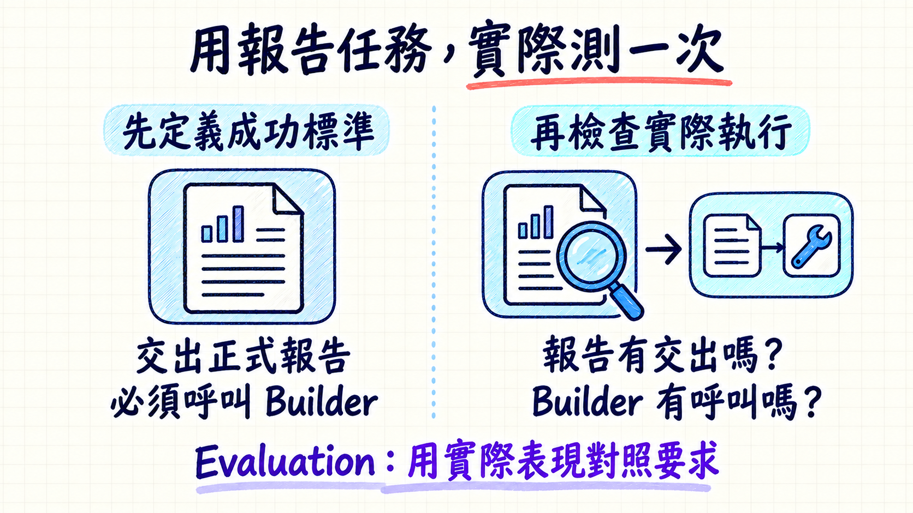

### 核心訊息

用既有報告任務示範事前要求與事後檢查，先建立直覺，再介紹術語。

### 搭配講稿

沿用剛才報告任務的驗收卡，讓Agent真的跑一次。現在聚焦在跑完後如何找依據：從交付成果確認是不是指定Builder產生的正式報告，從操作紀錄確認Builder有沒有實際被呼叫。不能只問模型有沒有完成，就把它的回答當成通過。圖上的問題是檢查清單，不代表這次已經全部通過。下一頁再把這兩個檢查對象介紹成正式的評估名稱。

### 接下一頁

報告與工具操作，是兩個不同的檢查對象。它們分別叫結果評估與執行軌跡評估。

### 本頁重點

- 從實際交付確認指定報告；從操作紀錄確認Builder呼叫。
- 用執行產生的依據驗收，不採信模型自行宣告。

## 24｜結果完成了，流程也做對了嗎？

章節：Skill 與 Evaluation：說明如何變成測試

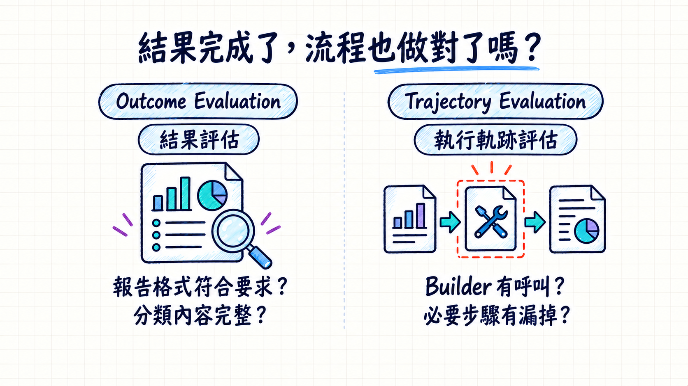

### 核心訊息

Outcome Evaluation檢查交付結果是否符合任務要求；Trajectory Evaluation檢查實際執行的訊息與操作，包括必要工具、順序與參數。兩者是評估對象，不是評分者或必須二選一的方案。

### 搭配講稿

剛才用白話檢查兩件事：報告有交出嗎、Builder有呼叫嗎。現在才介紹它們的名稱。Outcome Evaluation，也就是結果評估，看最後的交付是否符合要求；Trajectory Evaluation，也就是執行軌跡評估，看實際發生的工具操作、順序與參數。這不是讀取模型內心的推理，而是檢查可觀察的訊息與操作。兩者是評估對象，可以一起看，不是兩種只能選一個的測試。

### 接下一頁

結果和軌跡是要檢查的對象；下一頁介紹判斷的方法：程式檢查，以及LLM-as-a-Judge。

### 本頁重點

- Outcome Evaluation：看最後的交付是否符合要求。
- Trajectory Evaluation：看實際執行的必要步驟、工具與參數。
- 結果與軌跡可一起評估；不是二選一，也不是讀取隱藏思考。

## 25｜這些要求，要怎麼評估？

章節：Skill 與 Evaluation：說明如何變成測試

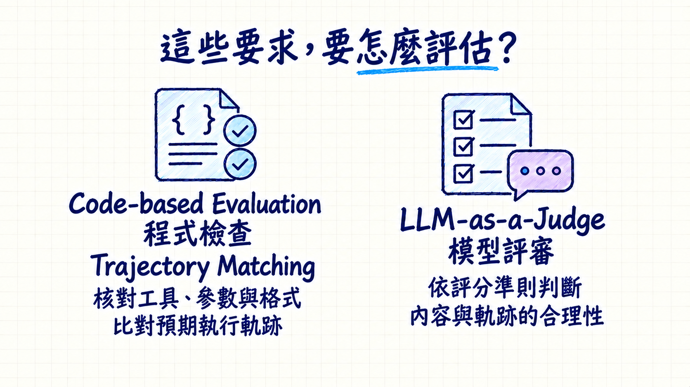

### 核心訊息

Code-based Evaluation與LLM-as-a-Judge是評估方法，均不固定綁定某一對象。Trajectory Matching是程式化比對預期軌跡的一種方式；Judge可評內容，也可評執行軌跡。評估不是執行時Guard，也不保證未來每次正確。

### 搭配講稿

上一頁的Outcome和Trajectory，是我們要評估什麼；這一頁是怎麼評估。Code-based Evaluation，是把明確的條件寫成程式檢查，例如Builder有沒有呼叫、參數是否正確、輸出格式是否符合規格。若把實際工具步驟與預期軌跡比對，常用名稱是Trajectory Matching；哪些步驟必須做、順序是否重要，要依任務要求決定，不是所有合法執行都必須完全一樣。LLM-as-a-Judge，則是請模型依照評分準則擔任評審，判斷內容或執行方式是否合理。它不是只看結果或只給分數，也能評軌跡。兩種方法可以搭配；Judge的判定仍需用人工樣本校準。這裡講的是測試與評估，不是靠另一個模型保證執行一定正確。接著回到Builder案例，將任務要求變成實際檢查項目。

### 接下一頁

現在知道要檢查什麼，也知道怎麼判斷。回到同一份報告，把這些名稱與方法對到實際檢查項目。

### 本頁重點

- Code-based Evaluation：以程式核對明確條件；Trajectory Matching可比對預期步驟。
- LLM-as-a-Judge：依評分準則評內容或軌跡，不等同於只看分數。
- 評估對象與方法是兩個維度，能搭配使用；測試通過不等於未來零風險。

## 26｜回到案例：報告交了，Builder 也做了嗎？

章節：Skill 與 Evaluation：說明如何變成測試

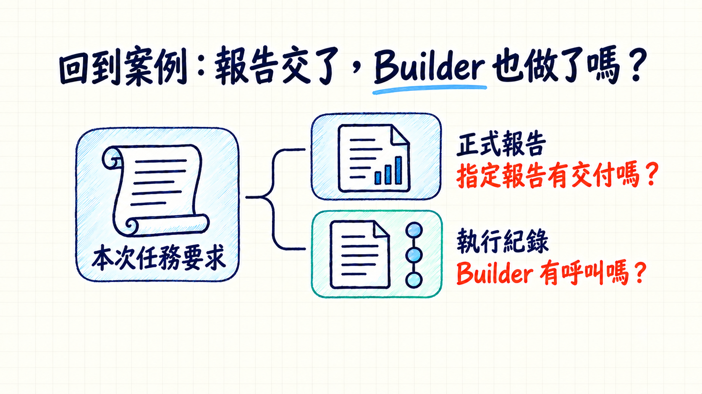

### 核心訊息

把報告案例對應到評估對象與檢查方法，建立後續重跑的共同檢查項目。

### 搭配講稿

這次不再重講Evaluation是什麼，而是把剛才的兩個問題變成實際檢查項目。指定的Builder報告有沒有被交付，是Outcome；build_execution_summary有沒有真的被呼叫，是Trajectory。這些有明確依據的條件，可以用程式對照輸出來源和工具紀錄，不必每項都請另一個LLM評分。Builder是指定交付工具；這裡不是再請模型判定Builder底層程式是否正確。這樣我們得到一組可以重複使用的檢查，下一步就能比較多次執行是否穩定。

### 接下一頁

檢查項目固定後，一次通過還不夠；下一步要看同樣條件下多跑幾次是否穩定。

### 本頁重點

- 指定報告交付對應Outcome；必要Builder呼叫對應Trajectory。
- 對明確條件使用程式檢查，建立重跑時一致的驗收項目。

## 27｜固定條件重跑，觀察流程是否穩定

章節：Skill：流程真的會照做嗎？

### 核心訊息

接續已介紹的Evaluation，說明怎麼觀察穩定度：固定條件、多次執行、按相同標準檢查。與下一頁的未來保證限制分工清楚。

### 搭配講稿

上一頁把這個案例的檢查訂清楚了：指定報告與必要Builder。一次照著Skill做，只能說這次成功。我固定同一版Skill、測資、Tool與模型設定，重跑同一個任務，每次都用同一套標準檢查。這樣才能觀察相同條件下是否仍會漏步驟。圖上的紀錄是方法示意，沒有新增通過率；不同情境的回歸與接受門檻，後面驗收修改時再談。

### 接下一頁

即使調整到目前這一批測試全部通過，能不能保證下一次也一定照做？

### 本頁重點

- 固定Skill、測資、Tool與模型設定，重跑同一任務。
- 每次都用相同交付要求檢查必要操作與結果，不以一次成功判定穩定。
- 示意圖不新增成功率；有限觀察不是未來保證。

## 28｜這批測試全過，不代表下次一定照做

章節：Skill：流程真的會照做嗎？

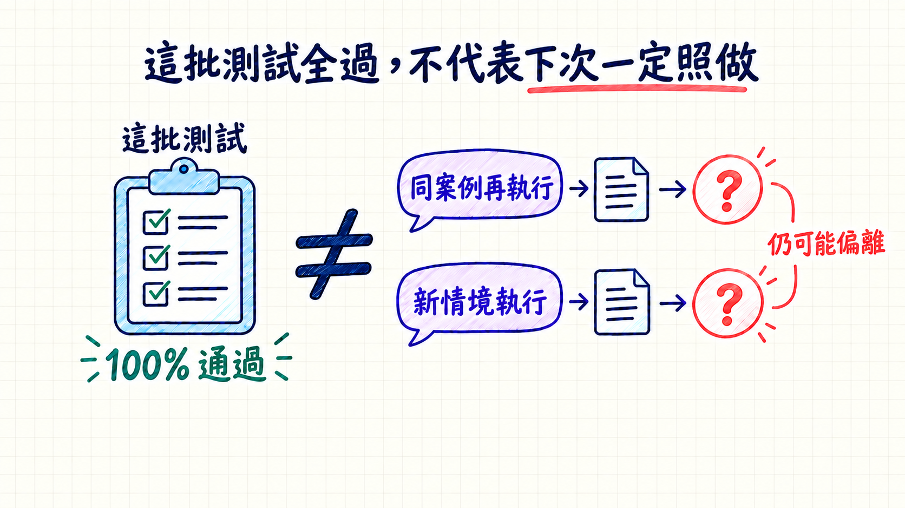

### 核心訊息

將上一頁的多次測試接到其限制：有限觀察提高信心，卻不保證下次執行。以風險容忍度轉入Guard，而不是跳入新名詞或流程硬鎖。

### 搭配講稿

假設剛才那一批測試全部通過，我們也不能把它當成下一次一定照做的保證。這裡的100%是有限測試全過的概念示意，不是新增一組實測。Skill仍是自然語言說明，LLM仍有機率性；同一案例再執行，也可能偏離，新情境更不能直接推論。Evaluation提供改善依據與這批測試的觀察，不等於每次執行的承諾。這就帶出下一個問題：某種錯偶爾發生一次，我能不能接受？

### 接下一頁

能接受偶發錯誤，就持續用Skill與測試改善；一次都不能接受的條件，就不能只靠模型遵守。

### 本頁重點

- 全部通過描述的是目前有限測試，不是未來每次執行的承諾。
- Skill仍是自然語言說明，同案例再執行與新情境都可能偏離。
- 因此要回頭判斷哪些錯可以接受，哪些條件必須由系統守住。

## 29｜不能接受的錯，就不能只靠模型遵守

章節：Guard、Evidence 與人工確認

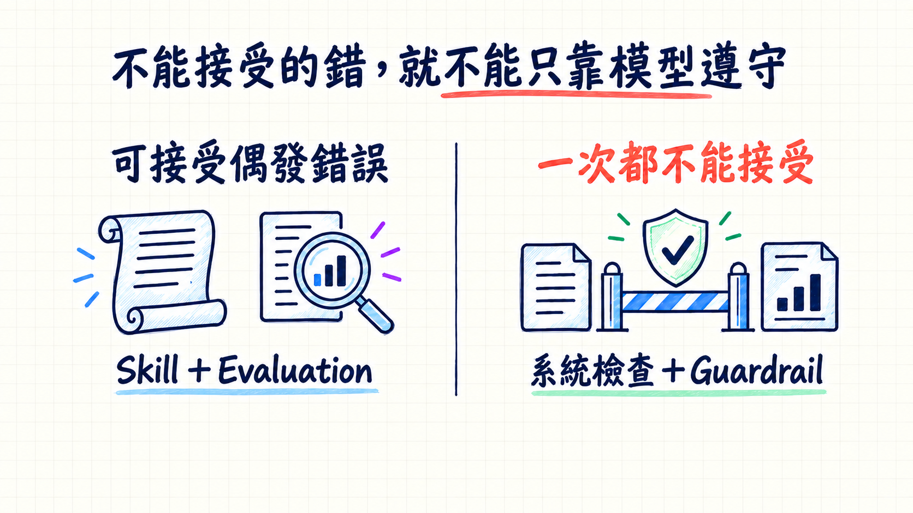

### 核心訊息

用風險容忍度劃分責任：自然語言與測試改善表現，系統承接不可只靠LLM遵守的條件。不是一個Guard就保證所有未知錯誤消失。

### 搭配講稿

我會先問這項錯誤偶爾發生，業務能不能接受。如果能接受，就用Skill引導並透過Evaluation持續改善；如果某項條件一次都不能違反，就不能只期待LLM每次遵守。這時責任要落到系統能檢查的位置。後面仍會用同一個Log報告任務，但從流程是否照做，轉到報告結論是否有證據；同時以日期結果與修改權限說明其他系統檢查。這不是拿漏Builder的案例硬鎖整套流程。Guardrail守的是明確定義與實作的條件，不是消除所有未知風險。

### 接下一頁

用日期、報告證據和修改權限這三個例子，看看哪些責任要交給系統。

### 本頁重點

- 可接受偶發錯誤的行為，用Skill引導、Evaluation改善。
- 不可接受的條件，需要系統落實檢查與限制。
- 同一個Log報告任務，分開檢查流程遵循與結論依據。

## 30｜把不可接受的錯，變成可檢查的條件

章節：Guard、Evidence 與人工確認

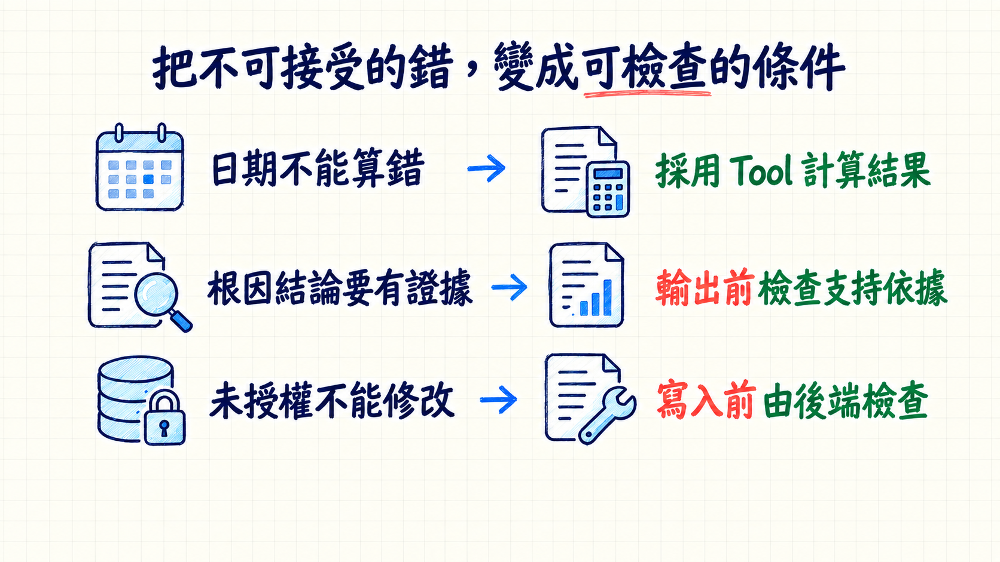

### 核心訊息

不可接受的條件需要落到系統：採用工具日期結果、輸出前對照報告證據、寫入前檢查權限。Evidence這裡守報告是否新增工具沒有回傳的內容，不改成重新判定工具資料本身真假。

### 搭配講稿

日期不能算錯，就由工具依明確的日期、時區與日曆規則計算，正式結果採用工具輸出，而不是只請模型用工具，最後還接受自行心算的值。報告結論需要證據，就在正式輸出前對回相關工具結果；圖中的根因結論只是報告結論的一種例子，接下來的重點不是另上一堂因果判定課。未授權不能修改，就在寫入前由後端依使用者、資源與動作檢查，不讓LLM自行宣告有權。這三例不是必經順序，共同點是系統真的承接檢查責任。

### 接下一頁

剛才檢查的是「有沒有照流程做」。但流程做了，模型寫出的結論就一定有依據嗎？接著仍用同一個Log報告任務，看工具結果沒有回傳的內容怎麼混進報告。

### 本頁重點

- 日期由確定性工具計算，正式結果採用工具輸出。
- 報告中的結論在正式輸出前，要有對應且相關的工具結果支持。
- 資料修改前由後端檢查權限，不採信LLM自行宣告已授權。

## 31｜同一份 Log 報告，還可能多出沒有依據的內容

章節：Guard、Evidence 與人工確認

### 核心訊息

承接同一個Log報告任務，從流程檢查轉到結論依據：有查回資料，LLM仍可能在報告補出Tool Result沒有的內容。

### 搭配講稿

仍然是前面的Log分析與報告任務，但現在換一個檢查問題：報告中的結論是否都有工具結果支持。有沒有呼叫指定Builder，是前面的流程檢查；模型提出的結論有沒有Tool Result支持，是這裡的內容檢查。這不是說Builder本身在編造內容，而是不能讓LLM沒有依據的分析混進正式輸出。我在實務上遇過，LLM把工具結果裡沒有的內容寫進report。圖上用逾時紀錄和錯誤訊息做教學示意，工具只回這兩項，報告卻多寫服務已重啟；這句不是實際報告的逐字引文。我要擋的是模型自己補出的事實，不是再讓它判斷Tool Result本身是不是正確。所以正式報告的結論，每一項都要找得到相關工具結果的支持。

### 接下一頁

因此不是整份報告附一個引用就好，而是每一項結論，都要逐項對回Tool Result。

### 本頁重點

- 同一個Log報告任務，流程是否照做與結論是否有依據，是兩種檢查。
- 這次守的是輸出結論的工具依據，不是Context選材或重新驗證來源真假。
- 圖中的服務已重啟是教學示意，不是實際報告的逐字引文。

## 32｜每一項結論，都要對回 Tool Result

章節：Guard、Evidence 與人工確認

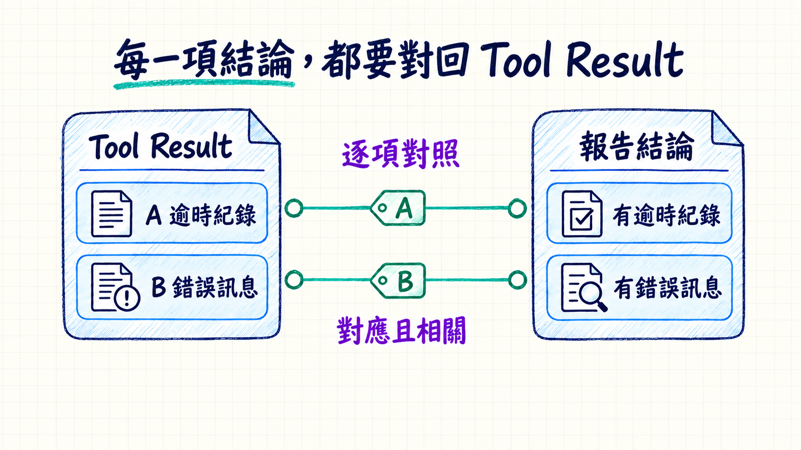

### 核心訊息

Evidence是報告結論與相關工具結果之間的支持關係。逐項對照來源與內容，不能只檢查有無Ref欄位，也不能把模型自行生成的敘述當工具證據。

### 搭配講稿

以剛才的教學示意來看，報告說有逾時紀錄，就要對回工具實際回傳的相關片段；說有錯誤訊息，也要有另一項對應結果。Ref讓我們找到來源，但有Ref還不夠：不能指到不相關資料，或者把來源沒有說的事塞進結論。我要驗證的是正式輸出有沒有對應且相關的Tool Result支持，不是重新判斷Tool Result本身真假，也不是LLM自己寫一段話再稱它為證據。系統具體怎麼對照與拒絕，仍需依工具回傳和輸出規格定義。

### 接下一頁

找不到對應支持的項目，就不能被當成已有證據的結論，放進正式報告。

### 本頁重點

- 每項結論都要有可對應的真實工具結果，而不是LLM自行編造的來源。
- Ref必須有效，對到的結果片段也要和結論相關、內容相符。
- 不是Ref存在就算支持，也不是重新驗證Tool Result本身真假。

## 33｜沒有對應證據的結論，不能進正式報告

章節：Guard、Evidence 與人工確認

### 核心訊息

把Evidence要求落到正式輸出：不讓未被工具結果支持的新增結論混進報告。允許說明缺資料，不把缺少證據誤當來源事實已被證偽。

### 搭配講稿

正式輸出前，這些結論要有對應且相關的Tool Result支持。圖上的前兩項能對回結果，所以進正式報告；服務已重啟沒有工具支持，就不能混成已確認的結果。這不代表我們證明服務一定沒有重啟，而是目前沒有這個依據。可以清楚說缺了哪份資料，或再安排查詢，不能由LLM自行補造。這裡守的是報告有沒有依據，不是重新審判Tool Result真假；Guardrail也不是只因掛了名字，就自動能辨識所有語意錯誤。

### 接下一頁

證據有沒有支持，是系統要檢查的責任。另一種問題是任務是不是使用者真正要的、操作是否允許，有些決定要交回給人；不是請人批准無證據的內容成為事實。

### 本頁重點

- 有對應且相關Tool Result支持的結論，才進正式報告。
- 工具沒有回傳的內容，不讓LLM自行補成已確認結果。
- 缺資料可以說明限制或補查，不是讓人替無證據結論蓋章。

## 34｜有些決定，不能讓 Agent 自己確認

章節：Guard、Evidence 與人工確認

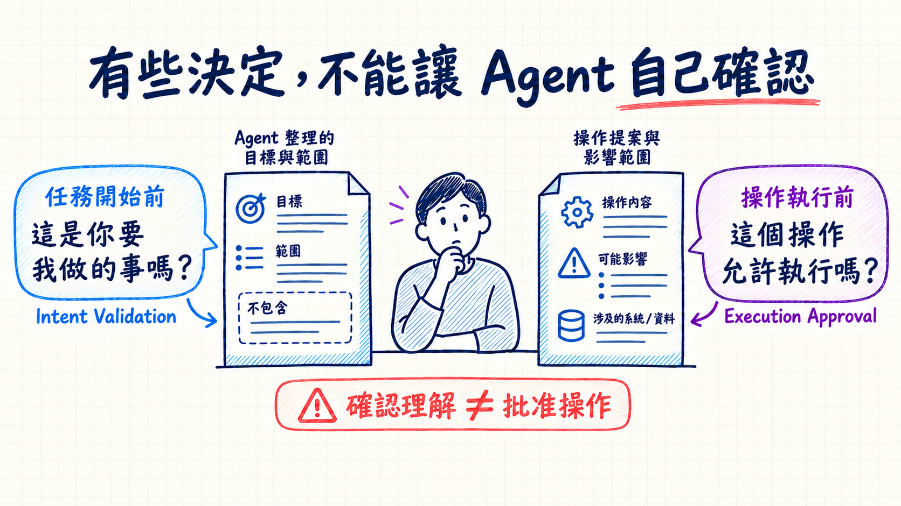

### 核心訊息

把系統檢查轉接到人的意圖確認與操作批准；不是請人把不足的證據蓋章變成事實。

### 搭配講稿

前面談系統如何檢查規則和證據，但任務是不是使用者真正要的、某次操作是否允許，有些情況需要把決定交回給人。確認理解和批准操作是兩種不同責任，不是讓人為缺乏證據的結論背書。

### 接下一頁

先看任務開始前：讓使用者確認 Agent 理解的目標與範圍。

### 本頁重點

- 系統查規則與證據；有些決定需要人確認意圖或批准操作。
- 兩種人工責任不同，也不是請人替缺乏證據的結論背書。

## 35｜先確認理解，避免做完錯誤的任務

章節：Guard、Evidence 與人工確認

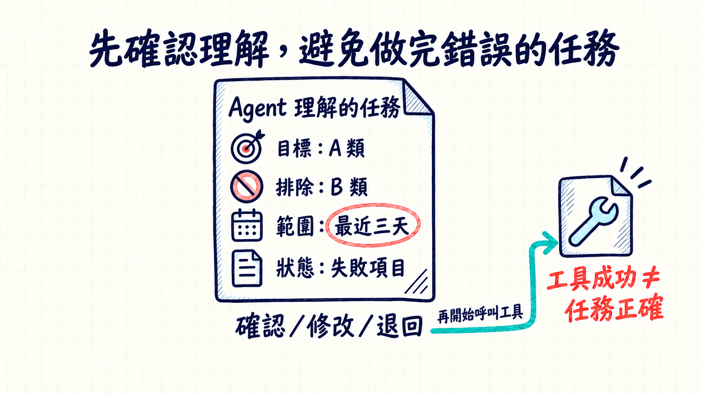

### 核心訊息

先讓使用者確認 Agent 理解的目標、排除、範圍與狀態；工具全部成功仍可能執行錯誤任務。

### 搭配講稿

像「找 A 類、排除 B，只處理最近三天失敗項目」，同時包含目標、排除條件、時間範圍與狀態。先把 Agent 理解的內容整理成可閱讀的確認摘要，讓使用者確認、修改或退回，再依確認後版本開始。這裡是在確認有沒有理解對，不是在批准扣款或寫入。如果範圍一開始錯了，後面每個 Tool Call 都成功，仍可能完成錯誤任務。

### 接下一頁

確認理解以外，寫入、扣款或對外通知還需要另一種確認：批准這次操作。

### 本頁重點

- 執行前先確認目標、排除與範圍，避免後面成功完成錯任務。
- 意圖確認不是操作批准；兩者解決不同問題。

## 36｜寫入、扣款或對外通知，執行前要先批准

章節：Guard、Evidence 與人工確認

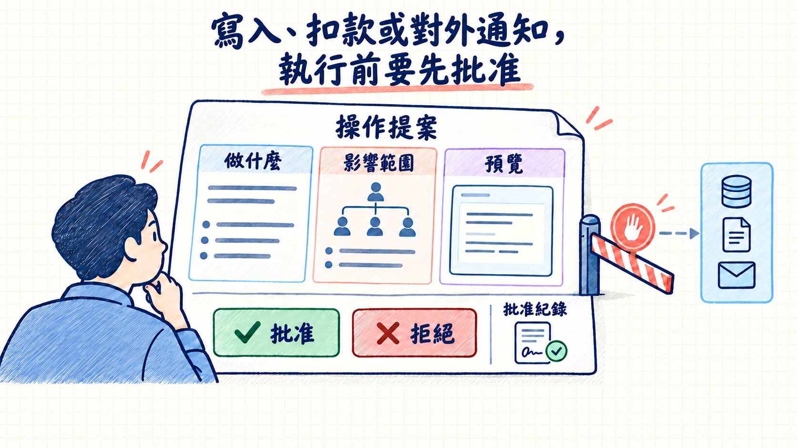

### 核心訊息

Execution Approval 必須讓人先看懂要做什麼、影響範圍與預覽結果，再決定是否允許執行。

### 搭配講稿

寫入、開單、扣款或對外通知等高風險操作，不能只靠 Skill 裡一句「請先取得批准」。系統要停在人工 Gate 前，讓人看懂提案與影響範圍，再批准或拒絕。紀錄還要保留誰批准、何時批准，以及當時看到哪一份預覽。

### 接下一頁

即使人已經批准，真正執行前仍然不能直接沿用舊狀態。

### 本頁重點

- 寫入、扣款、開單或對外通知，系統要在執行前停下等批准。
- 讓人先看懂提案、影響範圍與預覽，留下批准者、時間和批准版本。

## 37｜批准後，執行前仍要重新檢查條件

章節：Guard、Evidence 與人工確認

### 核心訊息

批准與執行之間可能出現狀態變化；Runtime 必須在真正執行前重新檢查前置條件。

### 搭配講稿

Approval會把一次Agent Run切成提案與執行兩段，中間可能隔幾分鐘或幾小時。資料可能已被別人處理，任務可能已關閉，帳務或權限狀態也可能改變。因此批准不是永久通行證。Runtime在真正執行前仍要重新檢查Precondition，並留下批准內容與檢查結果。系統與人各自承接特定條件的檢查；但有了批准與重新檢查，並不代表整次任務永遠不會出錯。

### 接下一頁

人已經介入審核，任務仍然可能出錯；如果真的出了問題，我們該怎麼處理？

### 本頁重點

- 批准到執行可能相隔一段時間，資料、任務或權限狀態可能已變。
- 執行前重新檢查 Precondition，將批准內容與檢查結果留在 Trace。

## 38｜有人審核，任務仍可能出錯

章節：從人工審核，轉向出錯後的追查

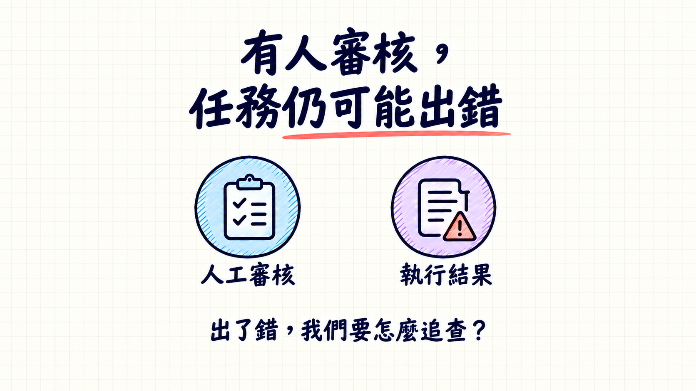

### 核心訊息

人工審核不是整次任務零錯誤的保證；從防錯自然轉向出錯後的追查需求。

### 搭配講稿

前面透過系統檢查、意圖確認與操作批准，守住不同責任。但人工審核的是特定內容或操作，不是替整次Agent執行保證零錯誤。任務仍可能沒有完成要求，或後續出現執行問題。此時除了當下依情境處理，還要能追查：當時交給模型什麼、它做了哪些操作、怎麼結束任務。接下來用前面漏Builder的既有案例示範追查方法；這不是新增一個經過人工批准後仍失敗的實測案例。

### 接下一頁

接著回到前面漏Builder的案例，看看發現問題之後，如何回頭追查當時的執行。

### 本頁重點

- 人工審核確認特定事項，不等於整次任務永遠不出錯。
- 發現問題後，需要保存並回看當時執行，而不是只看最後結果。

## 39｜發現漏了 Builder，還要查它怎麼發生

章節：Trace：從發現錯誤，到找到修改線索

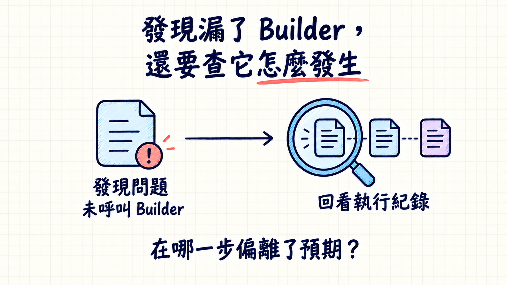

### 核心訊息

發現漏了Builder只是起點，還要對照當時的實際執行紀錄。

### 搭配講稿

不論是在開發測試、實際使用或Evaluation中，發現報告沒有經過Builder，都只告訴我們結果有缺漏，還不知道缺在哪裡。接下來要回看當時模型收到什麼、回了什麼，以及工具有沒有真的執行。不能只憑最後報告就斷定是Skill、模型或工具出了問題。

### 接下一頁

要讓這件事可以追查，必須先把這幾類資訊留下來。

### 本頁重點

- 缺漏可能在測試或實際使用中發現，不限於Evaluation。
- 最後結果指出問題，當時紀錄才提供追查線索。

## 40｜先留下 AI 能協助追查的資訊

章節：Trace：從發現錯誤，到找到修改線索

### 核心訊息

留下同一次任務的實際輸入、回應、工具呼叫與設定，才能協助追查。

### 搭配講稿

最重要的是四類資料：當輪實際送出的Context、模型回應、Tool的呼叫參數與結果或錯誤，以及模型、Skill與相關版本設定。這些資訊必須能對回同一次任務與相應呼叫。版本標記也要能找回實際Skill內容。保存時遮蔽敏感資料或限制存取；回看當時紀錄，不等於保證重新執行會得到相同結果。

### 接下一頁

把這些紀錄放回漏Builder的案例，就能逐步對照。

### 本頁重點

- Context與模型回應：確認實際收到與輸出了什麼。
- Tool呼叫與結果：确认要求、參數、結果或錯誤。
- 版本與設定：保留當時使用的模型及Skill等資訊。

## 41｜漏了 Builder，要對照哪些紀錄？

章節：Trace：從發現錯誤，到找到修改線索

### 核心訊息

用Context、模型回應與Tool執行紀錄，逐段檢查Builder缺在哪裡。

### 搭配講稿

先看當輪Context有沒有送入Builder的指示，再看模型回應有沒有提出Builder呼叫，最後看Tool執行紀錄裡呼叫有沒有真的執行。這三個都是待確認問題，不是假設我們已知道答案。若紀錄不完整，查不到也不能直接當作沒有發生。

### 接下一頁

這些紀錄的交叉比對，也可以讓AI幫忙整理。

### 本頁重點

- Context：有送入Builder指示嗎？
- 模型回應：有提出Builder呼叫嗎？
- Tool執行：呼叫有實際執行嗎？

## 42｜把執行紀錄交給 AI，協助找線索

章節：Trace：從發現錯誤，到找到修改線索

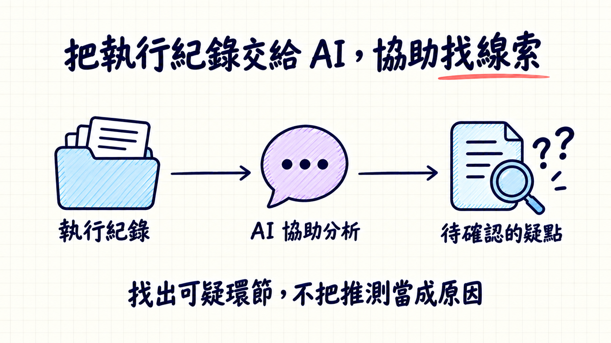

### 核心訊息

讓AI依執行紀錄提出待確認疑點，而不是替缺漏編造原因。

### 搭配講稿

我可以把對得起來的執行紀錄交給AI，讓它協助找出可疑環節、指出依據，以及還需要查什麼。這不代表AI能讀出模型的內部思考，也不能把它事後說得通的解釋當成已確認原因。紀錄不足就要承認尚未確認，再補查。

### 接下一頁

找到值得修改的方向之後，還要實際驗證修改是否改善。

### 本頁重點

- 把相關執行紀錄交給AI，協助交叉比對。
- 疑點要附紀錄依據；推測仍然需要確認。

## 43｜提出修改，再用 Evaluation 驗證

章節：Trace：從發現錯誤，到找到修改線索

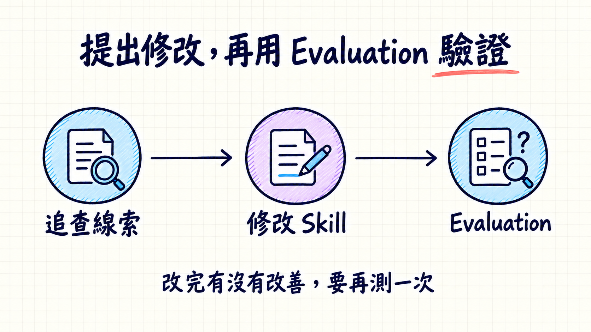

### 核心訊息

追查提供修改方向，Evaluation用實際執行檢查修改效果。

### 搭配講稿

如果追查指向Skill的說明需要修正，可以先提出候選修改，再用Evaluation跑任務，檢查流程與交付是否改善。圖上的再測一次是重新執行評估，不是只跑一個案例就證明可靠。接下來會把整次任務、輸出、步驟與其他情境一起放進驗收。

### 接下一頁

所以改完Skill，不能只測改動的那一句，而要把整次任務重跑。

### 本頁重點

- 先根據追查線索提出候選修改，不預設一定是Skill的錯。
- 修改後重新評估實際流程與結果，不只看文字改得如何。

## 44｜改完 Skill，整次任務都要重新測

章節：Evaluation：修改如何驗證？

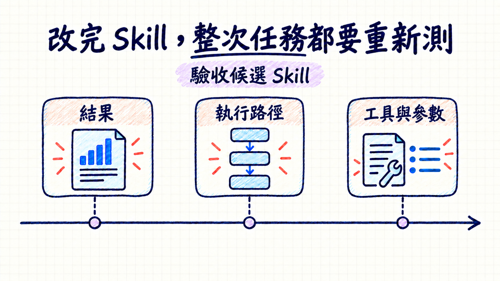

### 核心訊息

從Trace提出候選修改，轉入修改驗收；用整次任務的結果、路徑與工具參數判定是否符合既定成功標準。

### 搭配講稿

剛才我們用Trace回看漏Builder那次的事件、當時可見資料與Skill版本，提出了候選修改。現在換成驗收視角：這版Skill改完後，在原本的要求和測試條件下，整次任務是否真的改善？不能只確認新加的句子存在，也不能只測那一句；還要看最後交付、必要操作，以及工具使用。接下來沿用報告案例，一項一項檢查。

### 接下一頁

先看使用者拿到的成果：改完之後，報告符合原本要求了嗎？

### 本頁重點

- 承接追查後的候選修改，這裡開始驗收新版Skill，不重新介紹Evaluation。
- 結果、路徑、工具參數都要檢查，不能只看改動的那句說明。

## 45｜改完之後，報告符合要求了嗎？

章節：Evaluation：修改如何驗證？

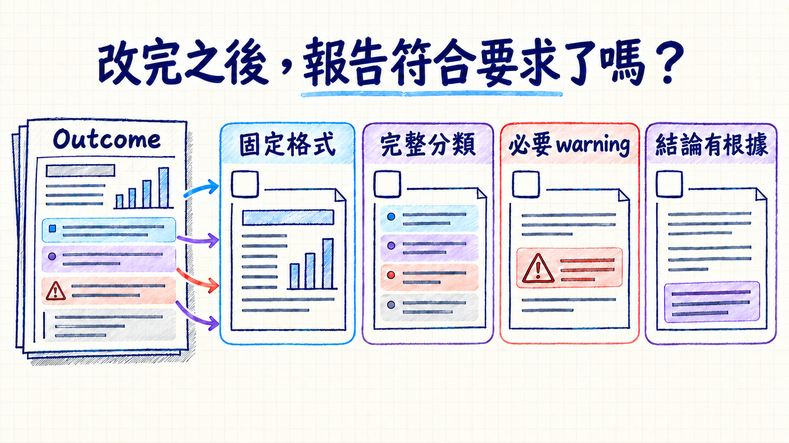

### 核心訊息

將Outcome Eval落到新版Skill的報告驗收，不重複一般定義，也不為讓修改通過而放寬既定標準。

### 搭配講稿

前面缺漏的報告，問題是格式不符與分類不完整。修改後先用同一套交付要求重查：固定格式、完整分類與必要warning有沒有交出來；結論是否有工具結果支持。不能因為新版看起來比較順，就說修改有效，也不能為了讓它通過而放寬標準。這是對正式交付的測試，不是請LLM重新判定Builder底層程式的正確性。

### 接下一頁

報告符合要求了，必要的Builder這次也真的執行了嗎？

### 本頁重點

- 修改後仍用既定交付要求，檢查格式、分類與必要warning。
- 檢查報告結論是否有對應支持，不以文字流暢代替交付驗收。

## 46｜漏掉的 Builder，這次有呼叫嗎？

章節：Evaluation：修改如何驗證？

### 核心訊息

用Trajectory Eval驗收已知漏Builder問題是否仍發生，不再重講看答案不夠的一般概念。

### 搭配講稿

這次修改是為了改善漏Builder，就要回看修改後的實際工具紀錄，確認build_execution_summary確實出現，而且在這個情境要求的位置發生。圖是驗收方法示意，沒有宣稱某個候選版本已通過。不同情境可以有合法分支，我們檢查的是各自的必要操作、順序與停止條件，不是把每一個Run硬套成完全一樣的路徑。

### 接下一頁

即使這次有呼叫Builder，傳給它的Ref和參數也可能不對。

### 本頁重點

- 驗收這次候選修改，確認本情境要求的Builder確實被呼叫。
- 各情境可以有合法分支，但必要步驟、順序與停止條件仍要符合要求。

## 47｜呼叫了 Builder，傳入的資料也對嗎？

章節：Evaluation：修改如何驗證？

### 核心訊息

延續同一摘要案例，必要工具被呼叫不代表參數與資料引用正確。

### 搭配講稿

上一頁驗收必要Builder是否被呼叫，這一頁再看這版Skill如何使用它。傳入的Ref要對應本次分析結果，必要參數不能漏，也不能把Tool error當成正常資料繼續處理。工具名稱正確只是第一步。修改後用實際的工具輸入紀錄核對，才能知道Agent有沒有正確把資料交給Builder。

### 接下一頁

這些驗收項目該怎麼判斷？前面介紹過程式與Judge，現在選用適合各項目的方法。

### 本頁重點

- 叫對 Builder 還不夠，要檢查參數和資料引用。
- Ref 是否對應本次分析結果？必要參數與使用條件是否正確？

## 48｜驗收修改：哪些用程式，哪些用 Judge？

章節：Evaluation：修改如何驗證？

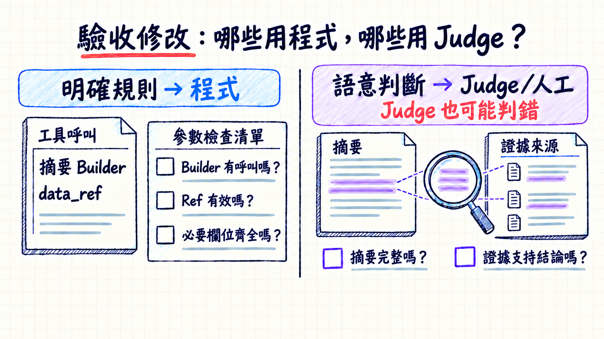

### 核心訊息

將入門頁介紹的評分方式落到這次修改的具體驗收項目；不要重複LLM Judge名詞定義，不把Judge當保證器。

### 搭配講稿

前面介紹程式、LLM Judge與人工，現在把方法對應到這份驗收清單。Builder有沒有呼叫、Ref是否有效、必要欄位是否齊全，能明確判定就寫程式檢查。摘要是否完整、引用內容是否支持結論等語意，再依明確評分規則由Judge或人工輔助。Judge也可能判錯，要用人工判定的樣本核對與校準，不能只相信它給出的通過分數。這些是在測試時評估候選修改，不是取代執行時的Guard。

### 接下一頁

有了驗收方式，還要把真的踩過的坑留下來，讓每次修改都能重新檢查。

### 本頁重點

- Builder呼叫、有效Ref、必要欄位等明確條件，驗收時用程式檢查。
- 摘要完整或證據支持程度等語意，依明確判準由Judge／人工輔助，並核對Judge是否可靠。

## 49｜踩過的坑，留進回歸測試

章節：Evaluation：修改如何驗證？

### 核心訊息

測試集由需求、真實失敗與補充邊界情境持續累積。

### 搭配講稿

回歸測試就是修改後重查原本的能力。第一版情境可從需求與 SOP 拆出來；遇到真實失敗就補進去，也可讓 AI 找未測分支。昨天踩過的坑，明天應該能自動檢查。

### 接下一頁

回歸測試也要有接受標準：同一情境要通過幾次，我們才接受這版修改？

### 本頁重點

- 測試集從需求與 SOP 起步，持續加入真實失敗和邊界情境。
- 昨天踩過的坑要留在回歸測試，讓後續修改能自動檢查。

## 50｜通過幾次，才接受這版修改？

章節：Evaluation：修改如何驗證？

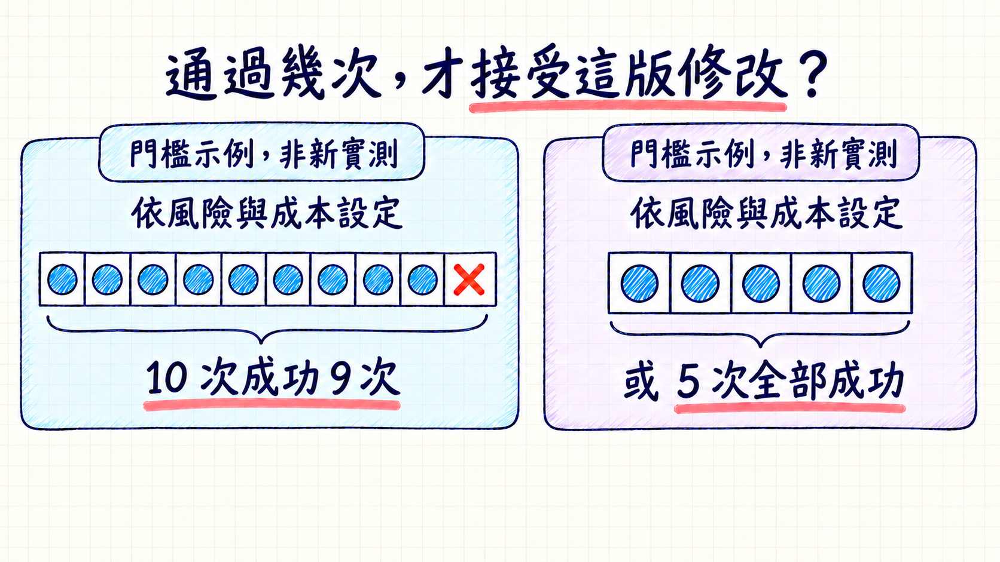

### 核心訊息

前段已理解重跑的必要；這頁專講如何為候選Skill設定可接受門檻，並權衡風險與測試成本。

### 搭配講稿

前面已說過不能只跑一次；現在是要訂接受這版修改的門檻。例如某個情境要求十次成功九次，或者另一種要求五次全部通過。這些是主稿的門檻示例，不是新增實測，也不能直接比較五次全過一定比十次九次可靠。實際門檻要看這個情境的風險、成本與可接受錯誤程度。高風險不能只靠加大測試次數來保證安全，仍要有相應Guard。

### 接下一頁

這個失敗案例達到門檻了，其他原本會過的情境有沒有退步？

### 本頁重點

- 這裡進一步訂驗收門檻，不重複前段為什麼要重跑。
- 10次成功9次或5次全過只是不同示例，需依風險、情境與成本訂定；不能直接拿不同次數排名可靠性。
- 有限測試門檻不是執行保證，也不取代Guard。

## 51｜修好一個問題，也可能弄壞其他情境。

章節：Evaluation：修改如何驗證？

### 核心訊息

Skill 修改可能影響原本通過的情境，接受修改不能只看原本的失敗是否修好。

### 搭配講稿

修好一個問題，也可能弄壞其他情境。這張圖用兩個情境說明同一次Skill修改的影響：A原本失敗，修改後修好了；B原本通過，卻可能因此退步。這不是實測統計，而是為什麼要重跑其他情境的示意。接受修改不能只看這一次有沒有修好，還要回歸測試。既然我們能驗證修改是否值得接受，Skill還需要全部由人逐句手寫嗎？

### 接下一頁

有了驗證標準，就可以讓 AI 產生 Skill，再用測試判斷差距。

### 本頁重點

- 修好一個失敗，其他原本通過的場景可能退步，要重跑回歸。
- 既然能驗證修改是否有效，就可以考慮讓 AI 協助寫與改 Skill。

## 52｜從第一版 Skill 到功能完成，我沒有手寫過一行 Prompt。

章節：AI 協助撰寫與修正 Skill

### 核心訊息

人不必逐句手寫；開發用 AI 依需求產生候選 Skill，再依既定目標測試。

### 搭配講稿

在我的系統裡，從第一版Skill到功能完成，我沒有手寫過一行Prompt。我讓協助開發的AI讀PRD、SOP和程式碼，產生第一版Skill，再跑Evaluation找出實際行為和目標的差距。這不是沒有人的要求，也不是AI自行定義成功；人仍然負責需求與接受標準。這裡的AI是協助開發的角色，不是正式執行任務的Agent。

### 接下一頁

測試沒有符合預期時，把執行紀錄交給 AI 分析並修改。

### 本頁重點

- 讓開發用 AI 讀 PRD、SOP 與程式碼，產生第一版 Skill。
- 用 Evaluation 找出實際行為與目標的差距；這個 AI 不是正式執行任務的 Agent。

## 53｜Eval 的價值不是分數，而是讓 Skill 能被持續修正。

章節：AI 協助撰寫與修正 Skill

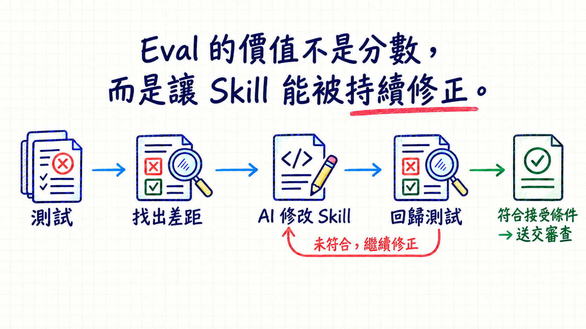

### 核心訊息

Evaluation 與執行紀錄提供可檢查回饋，驅動 AI 分析、修改 Skill、再驗證的循環。

### 搭配講稿

Eval的價值不是分數，而是讓Skill能被持續修正。Evaluation指出實際行為與目標的差距，Log和Trace提供追查材料；AI據此分析並提出Skill修改，再跑回歸。尚未符合就繼續修正，符合接受條件才送審。重點不是追高分，也不是原封不動一直重跑，而是让回饋真正推動下一版修改。

### 接下一頁

人不再逐句撰寫，但仍然要定義成功與接受標準。

### 本頁重點

- Evaluation 指出差距，Log 與 Trace 提供材料，讓 AI 分析並修改 Skill。
- 修完再跑回歸，符合接受條件才送審；不是無限盲目重試或只追分數。

## 54｜人定義成功標準，修改用測試結果驗收

章節：AI 協助撰寫與修正 Skill

### 核心訊息

人掌握目標、情境與接受標準，AI 產生修改；候選版本用測試及紀錄驗收。

### 搭配講稿

人的重心轉為定義什麼算成功、該測哪些情境與哪些風險不能接受。AI 可以產生與修改 Skill，但不能為了過關任意放寬標準。接受候選修改時，要看修改差異、測試結果和對應紀錄。

### 接下一頁

這個循環會反覆進行，因此成本也要一起被觀察。

### 本頁重點

- 人定義成功標準、要測的場景與不可接受的風險；AI 產生候選修改。
- 不能為過關放寬標準，驗收要看修改差異、測試結果與對應紀錄。

## 55｜每輪產生、測試與修正，都要留下成本紀錄

章節：每輪迭代的成本

### 核心訊息

成本觀測涵蓋開發改進循環與正式執行，不是暗示 AI 寫 Skill 一定省錢。

### 搭配講稿

這個循環不是免費的。AI 讀紀錄和修 Skill、測試和回歸都需要資源。重點不是先問付不付得起，而是記錄每輪 Tokens、工具次數、重試和延遲，知道成本在哪裡，才能比較修改的效果與代價。

### 接下一頁

回到一開始的 Tool Loop：讓它跑起來不難，讓它正確完成任務，才是我們一路處理的工程問題。

### 本頁重點

- 成本包含 AI 讀紀錄、改 Skill、測試與回歸，也包含正式執行。
- 每輪記錄 Tokens、工具次數、重試與延遲，才能比較效果與代價。

## 56｜寫出一個 Loop 很簡單，讓一個 Loop 能夠正確地完成任務，才是困難的工程問題。

章節：收尾：把任務做對與資源限制

### 核心訊息

回扣開場：工程難點不是啟動Tool Loop，而是讓它正確完成任務。

### 搭配講稿

回到一開始，我們幾行程式碼就能讓這個Loop跑起來。但真的交給它任務後，才會遇到Context塞太多、Skill沒有照做、報告出現工具沒回傳的內容，以及出錯後難以追查。前面這些工程工作，不是為了堆模組，而是為了讓它在實際條件下把任務做對。寫出一個Loop很簡單，讓一個Loop能夠正確地完成任務，才是困難的工程問題。

### 接下一頁

模型會進步，也能幫忙解決其中一些問題；但能不能只等下一個更強的模型？

### 本頁重點

- 循環能運作，與任務能正確完成，是不同的事。
- Context、Skill、Evaluation、Guard與Trace，都是為了把任務做對。

## 57｜解決這個問題，不能只靠最新的模型。

章節：收尾：把任務做對與資源限制

### 核心訊息

改善Agent不能只靠換模型；模型能力、任務設計與驗證需要一起考慮。

### 搭配講稿

更強的模型的確可能讓某些步驟更穩、讓原本難處理的任務做得更好。我不是說模型不重要，而是不能把所有問題都交給下一版模型。Context怎麼給、Skill寫了以後有多常照做、哪些結論需要Tool Result支持、出錯時能不能回看，都還是我們需要處理的事。圖中的模型名稱只是沿用選定示例，不代表性能比較或最新版本排名。解決這個問題，不能只靠最新的模型。

### 接下一頁

而且每次遇到問題都換更大的模型、塞更多Context、做更多重試，資源代價也會跟著增加。

### 本頁重點

- 更好的模型能幫忙，但不是省略工程工作的理由。
- 模型選擇仍要放回任務、驗證與成本的條件一起考慮。

## 58｜模型會越來越聰明，但是你的口袋沒有越來越深。

章節：收尾：把任務做對與資源限制

### 核心訊息

以口袋金句結尾：工程工作的理由，是在有限資源內把任務做對，而非一味增加模型與重試成本。

### 搭配講稿

所以我們才要管理Context、用Evaluation了解表現、守住不能接受的錯、留下Trace，並且觀察Tokens、工具呼叫、重試與延遲。不是為了把系統做得更複雜，而是在有限資源裡讓Agent把任務做對。模型會越來越聰明，但是你的口袋沒有越來越深。

### 接下一頁

分享結束，進入Q&A；不再追加另一句收尾金句。

### 本頁重點

- 模型會持續進步，但工程仍要面對有限的資源。
- 前面的工作，是為了在資源限制下讓Agent正確完成任務。
