# 58頁分頁稿 v41｜追查章節去重

v41共58頁：原39頁泛用追查轉場不再列入播放，內容由新38頁承接；新38、39頁重畫，分別說明看見錯誤不等於知道原因、重跑不能取代出錯那次的紀錄。37頁保留；原41、42、43頁依序成為新40、41、42頁，說明四類資訊、Builder逐段對照與AI協助找線索。2026-10-14第16頁換為文字字重修正版，內容不改；相較v40共55張圖像依來源SHA逐位元保留，無內嵌頁碼；舊版完整保留，歷史PDF未更新。2026-10-14交換原v41第50、51頁：新50為接受門檻、新51為回歸測試累積，49～51轉場同步，圖片內容不變。

2026-10-14講者提示已精簡為主旨、重點與轉場；原搭配講稿保留於此文件，站台不顯示長講稿。

## 01｜自己刻 Agent 框架，最難的不是呼叫 LLM

章節：開場：Tool Loop 與六個問題

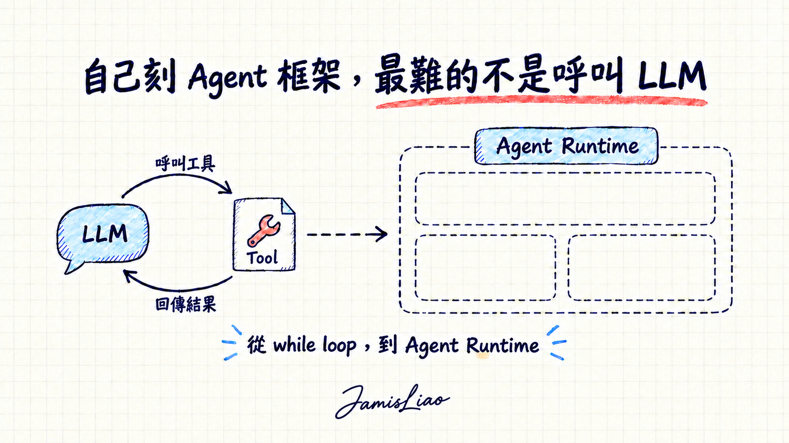

### 核心訊息

從能跑的Tool Loop，走到能正確交付的Agent。

### 搭配講稿

我一開始只想讓模型反覆呼叫工具。真的接上企業流程後，才陸續遇到漏步驟、錯誤結論與難以追查的問題。今天用這些經驗，說明循環之外需要哪些執行責任。

### 接下一頁

先看最初那個幾行程式碼的循環。

### 本頁重點

- 會呼叫工具，還不等於能完成真實任務。
- 今天分享的是實作中遇到的問題與修正。

## 02｜這個 Tool Loop，幾行程式碼就能跑起來

章節：開場：Tool Loop 與六個問題

### 核心訊息

模型選動作，工具執行，結果交回模型。

### 搭配講稿

LLM 是理解文字、判斷下一步的模型；Tool 是查資料或執行操作的程式。我最初的做法很簡單：呼叫模型，模型要求工具就執行，把結果 append 回 Context，再問一次；模型交出答案就結束。這幾行概念碼真的可以跑起來，所以當時我以為主要工作完成了。但這只是最小循環，還沒處理真實任務需要的可靠性。

### 接下一頁

工具會動、模型會答，就能交付了嗎？

### 本頁重點

- 有工具請求才執行，再把結果放回Context。
- 循環能運作，不代表任務已經完成。

## 03｜你以為這樣就結束了嗎？

章節：開場：Tool Loop 與六個問題

### 核心訊息

Demo跑得動，真實任務卻可能交錯結果。

### 搭配講稿

工具會動、模型會回答，很快就能看到。但一進企業流程，我開始遇到那些不會直接報 exception，卻會交出錯誤結果的問題。

### 接下一頁

實作下去，六個問題就逐一出現。

### 本頁重點

- 沒有exception，不等於結果正確。
- 真實任務還要滿足流程、交付與風險要求。

## 04｜會動之後，六個問題攤開了

章節：開場：Tool Loop 與六個問題

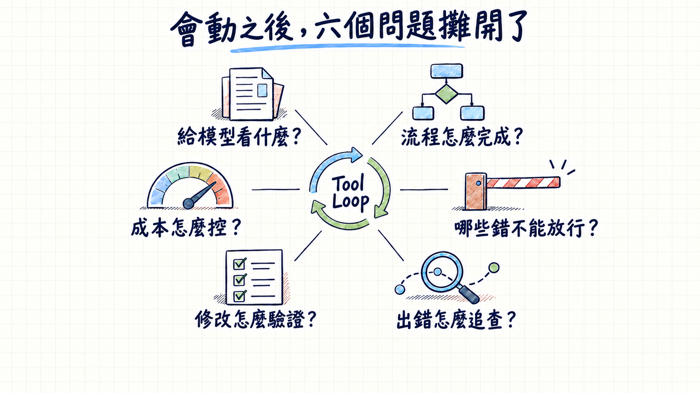

### 核心訊息

真正要處理的，是資訊、流程、風險、追查、驗證與成本。

### 搭配講稿

從資訊與流程開始，接著是哪些錯不能通過。出了問題，要能追查、驗證修改，也要付得起反覆測試的成本。等一下會依這些問題一路往下走。

### 接下一頁

先交代，為什麼我選擇自己刻。

### 本頁重點

- 給什麼資訊？怎麼完成流程？哪些錯不能放行？
- 出錯怎麼追查？修改怎麼驗證？成本怎麼掌握？

## 05｜為什麼選擇自己刻？

章節：開場：Tool Loop 與六個問題

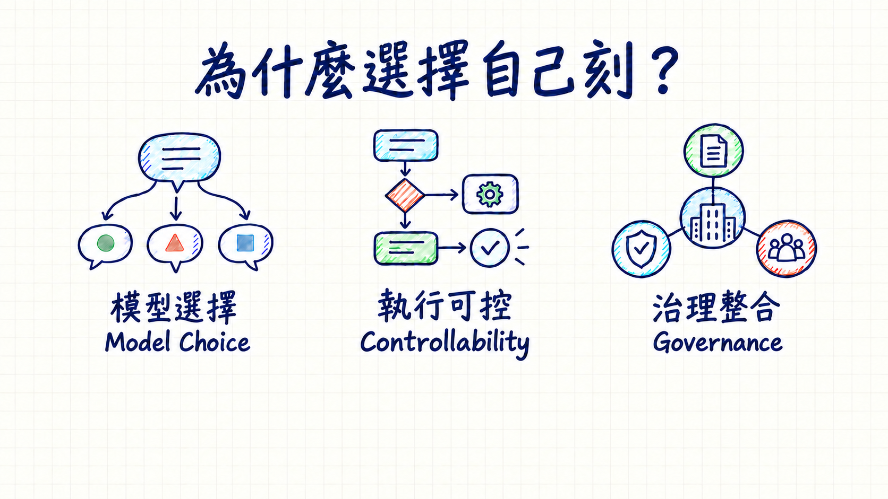

### 核心訊息

我要掌握模型選擇、執行可控與治理整合。

### 搭配講稿

現成框架與平台有價值，也能提供多模型與治理能力。我選擇自己刻，主要希望掌握三件事：模型選擇，讓模型可以依任務替換；執行可控，讓我能決定Context怎麼組、工具怎麼接，以及何時介入或停止；治理整合，把公司既有的權限、審核與稽核接進Runtime。不是只有自己刻才能做到，而是我希望掌握這些設計與整合的方式。今天集中在單次任務怎麼執行與驗證，模型介接細節和跨Session記憶另外再談。

### 接下一頁

回到最初的循環：工具結果要怎麼交回模型？

### 本頁重點

- 依任務選模型，而不是被單一模型綁住。
- 掌握執行方式，接上既有企業治理。

## 06｜第一個問題：工具結果，怎麼交回模型？

章節：Context：什麼資訊給模型看？

### 核心訊息

Context，就是這一輪模型實際看到的內容。

### 搭配講稿

先停在這個位置：工具已經執行完，現在要把結果交回模型。這一輪交給模型看的內容，就是 Context；裡面也包含使用者要求與任務規則。那工具回來的一大包資料，要怎麼放進去？

### 接下一頁

最直覺的做法，就是工具回什麼都加進去。

### 本頁重點

- 包含任務要求、規則，以及工具回來的資料。
- 工具執行完後，要決定哪些結果交給模型。

## 07｜每輪都 append，Context 越堆越多

章節：Context：什麼資訊給模型看？

### 核心訊息

每輪都塞整包結果，Context就會一直累積。

### 搭配講稿

第一版的做法很直覺：工具回什麼，我就整包append進Context。一輪看起來沒問題，幾輪之後，舊結果還在，新結果又加進來，Context就越堆越多。但這時我回頭問：下一步，模型真的需要重新讀完這些資料嗎？有時它只需要知道工具成功了，再決定把資料交給哪個工具；完整內容是下一個工具要用的，不一定是模型要讀的。即使需要模型分析，也應先判斷這次任務需要哪些內容。所以接下來要分開兩件事：完整資料怎麼保留，以及這一輪模型需要看到什麼。

### 接下一頁

所以要把「保存資料」和「給模型看」分開。

### 本頁重點

- 舊結果和新結果都append，內容越堆越多。
- 下一步需要完整資料，不等於模型必須讀完整包。

## 08｜工具結果留完整，給模型的內容按需準備

章節：Context：什麼資訊給模型看？

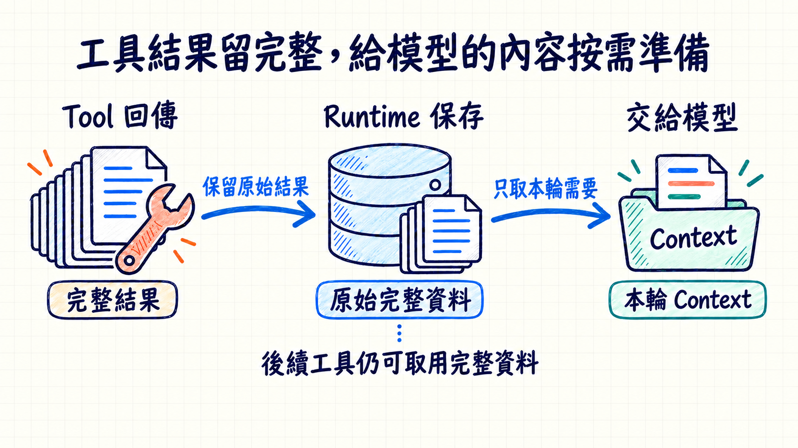

### 核心訊息

完整資料留在系統，本輪輸入按下一步需要準備。

### 搭配講稿

既然下一個工具可能還要用完整資料，我不能只為了縮小Context，就把原始結果丟掉。我把工具回傳的完整結果留在Runtime；再依模型這一輪要做什麼，準備它需要看到的內容。資料不是一開始就在資料庫裡，是工具回傳後，由Runtime刻意保存下來的。如果下一步只是交給另一個工具處理，模型可以只拿狀態與取件參照；如果要模型分析，就給它相關內容。這樣完整資料仍可取用，Context也不必跟著所有原始結果一路累積。

### 接下一頁

模型不讀整包時，下一個工具怎麼找到完整資料？

### 本頁重點

- 先保存工具的原始完整結果，後續仍可取用。
- 只把本輪需要的資訊交給模型，不必整包回塞。

## 09｜模型傳 Ref，工具取完整資料

章節：Context：什麼資訊給模型看？

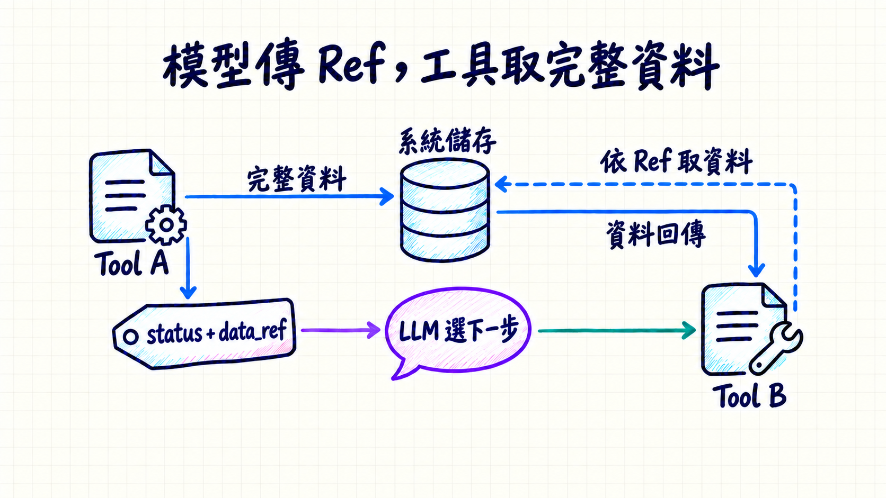

### 核心訊息

模型傳data_ref，工具到系統取完整資料。

### 搭配講稿

接著剛剛保存完整工具結果的設計：如果下一步只需要判斷成功與否，再把資料交給另一個工具，Tool A 就把完整結果存進系統，交給模型的是 status 和 data_ref。模型選好下一步，把 Ref 傳給 Tool B；Tool B 在服務端依 Ref 取回完整資料。模型負責判斷，工具與系統負責搬運。Ref 是取件參照，不是權限，能不能讀、允許做什麼，仍由系統檢查。工具之間需要完整資料，不代表模型也需要讀完整資料。

### 接下一頁

但要模型分析Log時，仍要給它相關內容。該給多少？

### 本頁重點

- 模型拿到status與Ref，用來判斷下一步。
- 資料搬運與Ref權限檢查，交給工具與系統。

## 10｜查線上問題，卻把 Context 塞爆了

章節：Context：什麼資訊給模型看？

### 核心訊息

查回完整Log沒問題；整包塞進Context才踩到坑。

### 搭配講稿

前面說的是工具之間怎麼搬資料。現在回到我實際遇到的任務：我想分析某個線上問題，LLM判斷要先取得Log，就呼叫工具去查。Tool查回來的是一大包原始Log。我當時直接把這整包結果塞回Context，結果Context就爆量了。問題不是工具查到了完整資料，而是我沒有先判斷：這次分析真正需要哪些內容，就把原始資料全部交回模型。這裡先談資料怎麼進Context，不是在談模型捏造結論。

### 接下一頁

要改的是回塞之前的處理：先篩選，再交給模型。

### 本頁重點

- 分析線上問題，模型先要求工具查Log。
- 工具回來大量原始Log，我原封不動塞回Context。

## 11｜Log 先篩選，再放進 Context

章節：Context：什麼資訊給模型看？

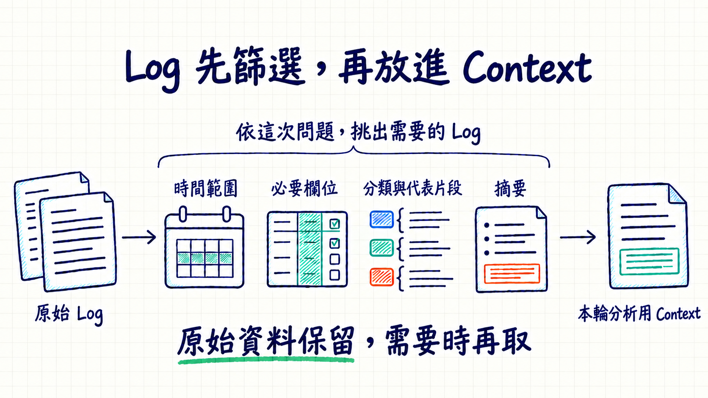

### 核心訊息

依這次問題挑相關Log，不把整包原始資料交回模型。

### 搭配講稿

延續剛剛分析線上問題的任務：Log查回來之後，先挑出這次分析需要的內容，再放進Context。問題涉及哪段時間，就縮小時間範圍；只需要部分欄位，就挑必要欄位；重複內容很多，可以分類、取代表片段；必要時再做摘要。這些是按問題選用的方法，不是每次都要做完四步，也不是把某幾個關鍵字一篩就當作找到根因。原始完整Log仍保留在系統，需要更多細節時可以再取。模型需要讀相關內容，但不需要每次都讀一大包未整理的原始資料。

### 接下一頁

控制Context，不只是為了省Token。

### 本頁重點

- 按需選時間範圍、欄位、分類片段或摘要。
- 原始Log仍保留，需要更多資訊時再取。

## 12｜控制 Context，不只是為了省 Token

章節：Context：什麼資訊給模型看？

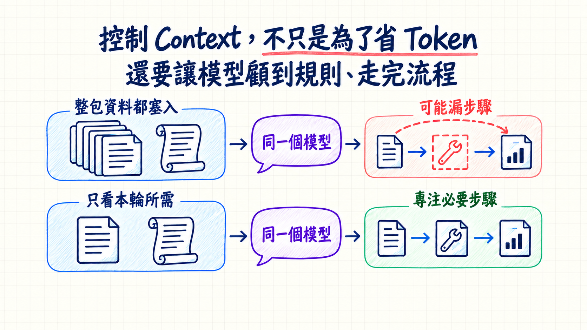

### 核心訊息

模型還要顧規則與流程，不只是讀資料。

### 搭配講稿

前面看了兩種情況：下一個工具要用完整資料時，模型只傳 Ref；模型要分析 Log 時，就準備這次需要閱讀的內容。它們都不是單純追求 Token 越少越好。模型不只要讀資料，還要顧到必要規則、判斷下一步，把整個流程走完。同一個模型要同時處理的資料、工具結果與流程狀態越多，就可能越難顧到這些要求。即使 Context 還沒有超過上限，原本能完成任務的模型，也可能開始漏步驟或提早停止。所以我們按下一步需要準備 Context，但保留完成任務所需的資訊與規則。圖的下排表達的是減少負擔的設計目的，不代表整理後就一定成功；下一頁看我實際遇到的例子。

### 接下一頁

除了資訊多少，放在什麼位置也可能有影響。

### 本頁重點

- 不必要資料越多，模型要同時處理的負擔越大。
- Context沒滿，也可能漏步驟；整理後仍要實測。

## 13｜資訊放在中間，也容易被 LLM 忽略

章節：Context：給模型哪些資訊

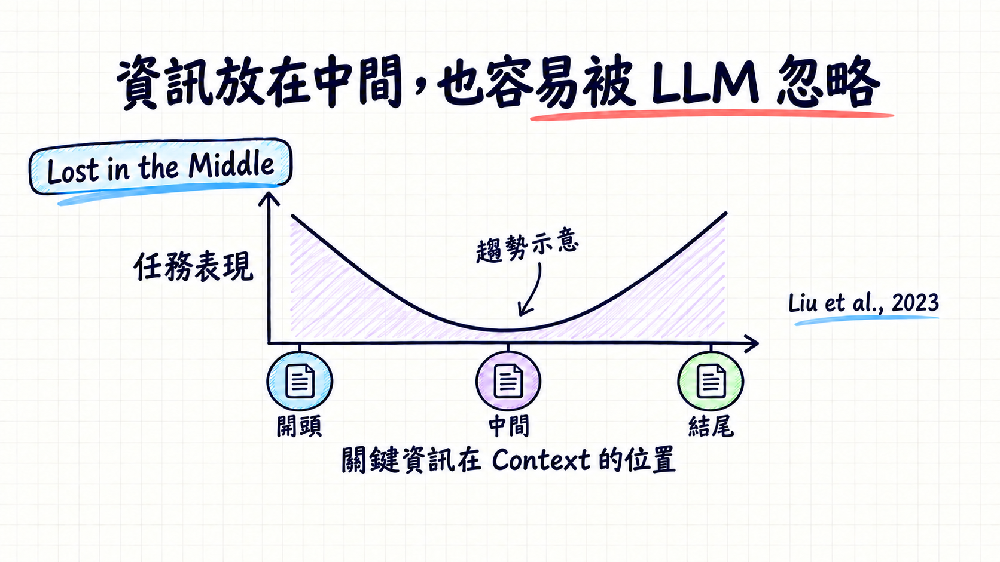

### 核心訊息

同一段關鍵資訊，位置不同可能影響模型利用。

### 搭配講稿

Lost in the Middle 在多文件問答及鍵值檢索任務中，觀察到重要資訊位於開頭或結尾時表現往往較好，位於中間時可能下降。這張是研究趨勢示意，不是注意力權重圖，也不是我的實測曲線，更不是所有模型必然如此。它提醒我：容量與有效使用是不同問題。來源：https://arxiv.org/abs/2307.03172

### 接下一頁

我也遇過Context還沒滿，模型就走不完流程。

### 本頁重點

- Lost in the Middle研究觀察到中間位置表現下降。
- 圖是特定任務的趨勢示意，不是所有模型的通用曲線。

## 14｜30k Context，迫使我換成更大的模型

章節：Context：什麼資訊給模型看？

### 核心訊息

我的測試中，Context增加後，需要換模型才能恢復表現。

### 搭配講稿

在同一Skill、測資、Tool與temperature下，gemma-4-26b-a4b-it-mlx在10k Context成功九次，增加到30k後只成功四次；同樣是30k，換成gemma-4-31b-it後又成功九次。失敗時會漏必要步驟、漏必要內容，或者提早停止。我要說的不是31B永遠比較好，而是模型需要同時處理的內容增加後，原本模型可能無法完成同一套Workflow，最後我換成更大的模型。這是每組十次的有限觀察，不作通用排名，也不能把所有失敗都單獨歸因於長度。

### 接下一頁

所以不能遇到問題，就一直用更大的模型補上。

### 本頁重點

- 26B-A4B MoE：10k時9/10成功，30k時4/10。
- 30k換31B Dense後為9/10；每組僅十次，不是模型排名。

## 15｜Context 管理會影響需要多大的模型

章節：Context：什麼資訊給模型看？

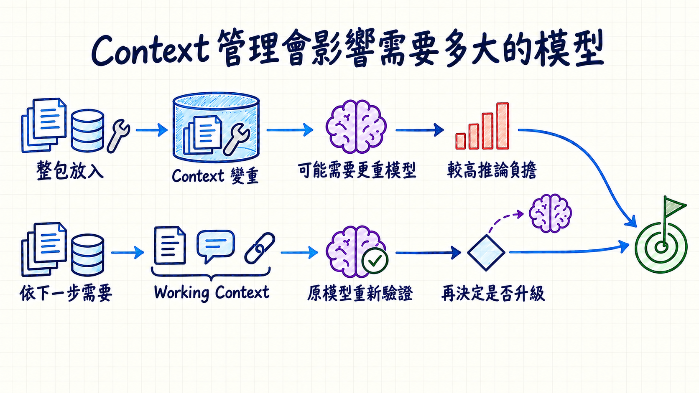

### 核心訊息

先減少不必要的Context負擔，再考慮模型需求。

### 搭配講稿

這個經驗讓我更重視Context管理。我要的不是一味把Context壓到最短，而是把完整資料留在系統，只交給模型下一步需要的內容、狀態和必要規則。如果我們有效控制Workflow執行過程中的資訊負擔，就可能不必一開始選用更大的模型；是否能完成仍要依任務與執行結果判斷，這組數據沒有直接證明整理後一定成功。更大的模型也往往帶來更高推論負擔，實際速度還受到硬體、量化與框架影響。這一段的重點是：先管理模型要處理什麼，不要所有東西都塞進去，再只靠模型升級。

### 接下一頁

Log交給模型分析之後，任務還要交付什麼？

### 本頁重點

- 完整資料留在系統，必要資訊與規則交給模型。
- 有效管理可能降低模型需求，但不保證任務一定成功。

## 16｜分析完 Log，還要交付正式報告

章節：Skill：流程真的會照做嗎？

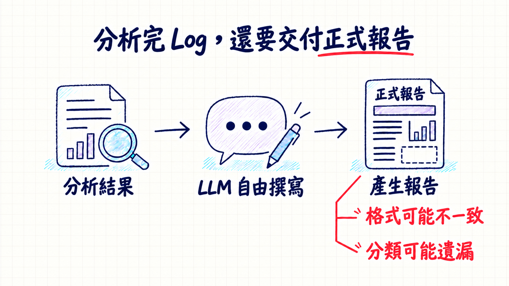

### 核心訊息

分析結果還要整理成正式報告，才完成這個任務。

### 搭配講稿

前面處理的是Log要怎麼交給模型，以及Context帶來的負擔。現在模型取得了分析結果，這個任務還需要交付一份正式報告。最直覺的做法，是讓LLM把分析結果整理成報告。但讓它自由撰寫，格式可能每次不一樣，必要分類或欄位也可能被漏掉。文字看起來流暢，不代表這份報告符合交付規格。我希望正式報告有固定格式，也能保留必要內容，所以需要把報告產生這一步安排清楚。這裡沿用Log場景來說明主稿的分析與報告交付案例。

### 接下一頁

我的做法，是準備專門的報告Builder。

### 本頁重點

- 自由撰寫可能造成格式不一致、分類或欄位遺漏。
- 正式報告有交付規格，需要明確的產生步驟。

## 17｜正式報告，需要由 Builder 產生

章節：Skill：流程真的會照做嗎？

### 核心訊息

由Builder收斂報告格式、分類與必要內容。

### 搭配講稿

為了處理剛才的報告格式與內容要求，我準備了專門的Builder。正式報告必須有固定格式，帶上完整分類、必要warning、統計與明細。模型負責分析、判斷下一步並呼叫工具；Builder負責把分析結果整理成指定格式與必要內容。這是我這個任務的交付設計，並不是所有Agent任務都必須使用Builder。接下來，工具準備好了，我也要讓模型知道分析之後應該呼叫它。

### 接下一頁

工具準備好了，我把呼叫要求寫進Skill。

### 本頁重點

- 報告要求包含分類、warning、統計與明細。
- 模型提供分析結果，Builder負責產生正式報告。

## 18｜我已在 Skill 寫明：分析後呼叫 Builder

章節：Skill：流程真的會照做嗎？

### 核心訊息

Skill用自然語言寫明：分析後呼叫Builder。

### 搭配講稿

我不只是心裡希望模型呼叫Builder，也已經把要求寫進Skill。把主稿案例濃縮成大家看得懂的示意，就是分析後呼叫報告Builder，取得Builder結果再交付，不要自行組成最後摘要。這不是逐字貼上正式Skill，而是呈現已經寫明的指示。我的實務仍然是用自然語言說下一步要做什麼，讓LLM讀完後推論並呼叫工具，不是把流程改寫成硬編碼狀態機。我當時以為，寫清楚了應該就會照做。

### 接下一頁

但實際執行時，它還是可能跳過Builder。

### 本頁重點

- 呼叫Builder、取得結果，再交付正式報告。
- 這是給模型的指示，不是程式強制的執行流程。

## 19｜模型卻跳過 Builder，自己寫了摘要

章節：Skill：流程真的會照做嗎？

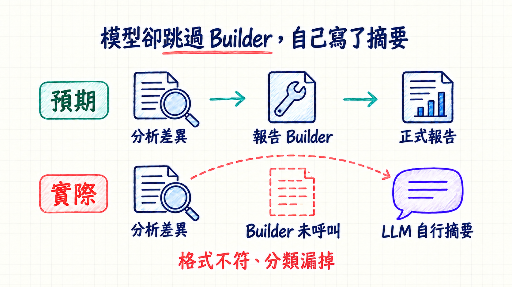

### 核心訊息

模型跳過Builder，直接交出自己寫的摘要。

### 搭配講稿

主稿的實際案例已要求先analyze_discrepancies，再呼叫build_execution_summary。但某些Run沒有呼叫Builder，而是LLM自己組出摘要。有答案、沒有exception，看起來像完成了，必要工具卻根本沒有執行。這正好對照上一頁：Skill已經寫明，模型仍不一定照做。跳過Builder的後果也很具體：格式不符合規格，有些分類結果被漏掉。問題不是換了一條合法路徑，而是指定交付沒有完成；也不是要再讓LLM審查Builder本身。前面的Log場景是幫大家理解報告交付的教學串接，不是宣稱API、模型實測與這次報告都是同一個實際Run。

### 接下一頁

所以有回答，和流程正確完成，是不同的事。

### 本頁重點

- 有些執行沒有完成指定步驟，格式與分類也不符。
- 有回答、沒有exception，不能當作任務成功。

## 20｜有回答，不代表流程正確完成。

章節：Skill：流程真的會照做嗎？

### 核心訊息

不能只看回答，要檢查必要操作與指定交付。

### 搭配講稿

有回答，不代表流程正確完成。剛才的案例，Skill已寫明分析後要呼叫Builder，模型卻跳過它，最後格式不符、分類也漏掉了。所以我不能只看它有沒有交出一段摘要，就認定任務完成。要把任務交給它實際執行，再檢查必要步驟有沒有做、指定成果有沒有交付。Skill說明要求是一件事，測試模型能不能做到是另一件事。

### 接下一頁

那要怎麼知道Agent真的完成了任務？

### 本頁重點

- Skill寫清楚，不代表模型實際執行就一定照做。
- 必須讓它實際跑任務，再核對有沒有達成要求。

## 21｜怎麼知道 Agent 真的完成任務？

章節：Skill 與 Evaluation：說明如何變成測試

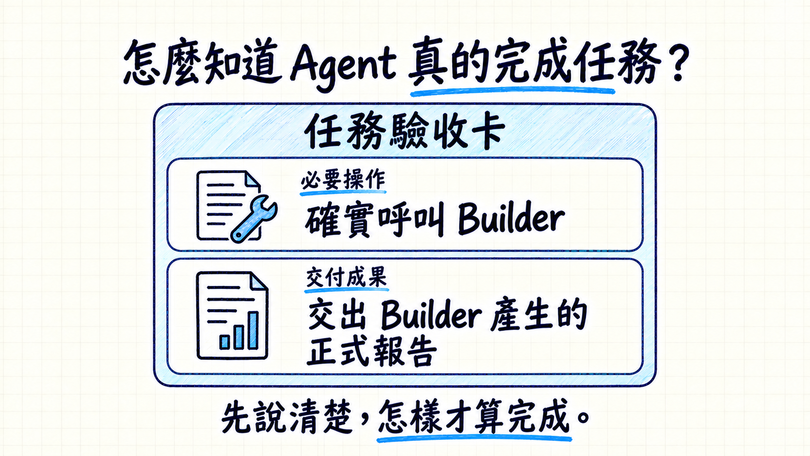

### 核心訊息

先說清楚，怎樣才算完成這個任務。

### 搭配講稿

要知道Agent有沒有完成，第一步是先說清楚：這個任務做到什麼才算完成。以剛才的報告任務為例，我要求兩件事：必要操作是確實呼叫Builder；交付成果則是交出Builder產生的正式報告。只呼叫工具卻沒有交出報告，不算完成；自己寫一份摘要卻跳過Builder，也不符合要求。這張驗收卡是在定義要求，不是在宣告測試已通過，也不是再次驗證Builder底層程式是否正確。

### 接下一頁

有了成功標準，就讓模型實際執行，再核對結果。

### 本頁重點

- 必要操作：確實呼叫Builder。
- 指定交付：交出對應Builder結果的正式報告。

## 22｜Evaluation：實際測試 LLM 的表現

章節：Skill 與 Evaluation：說明如何變成測試

### 核心訊息

Evaluation：實際執行，再對照成功標準。

### 搭配講稿

剛才已經說清楚怎樣才算完成，現在要實際測試它做不做得到。這就是Evaluation：準備任務與成功標準，讓LLM實際執行，再對照結果是否達標。在Agent情境中，實際執行也包含工具操作，所以除了最後答案，還能檢查它有沒有完成要求的步驟。不是只問模型自己覺得做得好不好，而是看它實際做了什麼。測試可以在受控環境進行，不一定要直接操作正式系統。不是猜它會不會，而是實際測它做得如何。

### 接下一頁

跑完之後，要從哪些資料找出達標的依據？

### 本頁重點

- 準備任務與標準，讓模型執行，檢查是否達標。
- 可在受控測試環境進行，不等於直接操作正式系統。

## 23｜把實際執行，對回任務要求

章節：Skill 與 Evaluation：說明如何變成測試

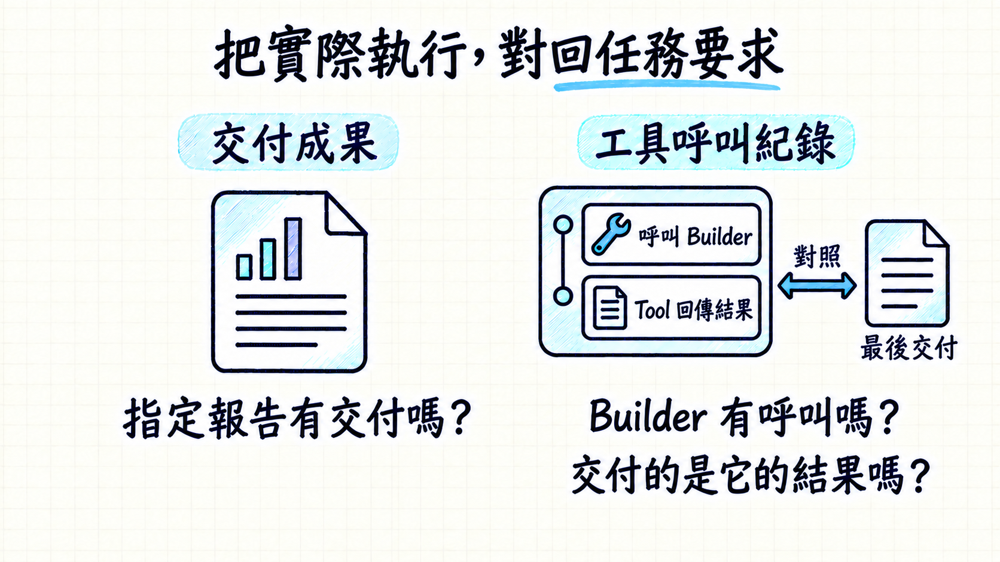

### 核心訊息

拿交付成果與實際工具紀錄，核對任務要求。

### 搭配講稿

上一頁介紹實際執行與對照成功標準，現在用Builder案例核對一次。Skill要求呼叫Builder，並交付它產生的正式報告。我先看指定報告有沒有交付，但不能憑報告外觀判斷它來自Builder。接著查看工具呼叫紀錄，確認Builder有沒有被呼叫、回傳了什麼，再把Tool結果與最後交付的報告或引用對照。只有呼叫過Builder，也不代表最後交付用了它的輸出。這一頁就是把實際執行留下的依據，對回任務要求。圖中的問題是核對項目，不是新增實測結果。

### 接下一頁

這些核對，可以分成結果與執行過程兩個面向。

### 本頁重點

- 指定報告有沒有交出？Builder有沒有呼叫？
- 把Tool回傳結果與最後交付對照，確認交付來源。

## 24｜Evaluation 要看結果，也要看執行過程

章節：Skill 與 Evaluation：說明如何變成測試

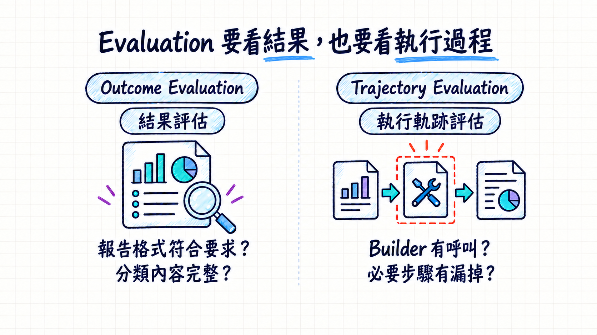

### 核心訊息

評估結果是否正確，也評估過程是否符合要求。

### 搭配講稿

上一頁我們找了兩類依據：交付成果，以及工具呼叫與回傳紀錄。現在介紹要評估的對象。Outcome Evaluation，也就是結果評估，看最後的交付是否符合任務要求；若要求交付Builder產生的報告，確認來源時也需要對照工具回傳結果。Trajectory Evaluation，也就是執行軌跡評估，看實際發生的工具操作、順序與參數，例如Builder有沒有真的被呼叫。這些名稱指的是評估什麼，不是限定只能使用哪一份紀錄；同一份工具紀錄也可以支援結果來源的檢查。兩者可以一起評估。

### 接下一頁

評估什麼釐清了，接著看要用什麼方法判斷。

### 本頁重點

- Outcome Evaluation：看最後交付。
- Trajectory Evaluation：看必要步驟、工具與參數。
- 兩者可以一起評估，不是讀取模型的隱藏思考。

## 25｜這些要求，要怎麼評估？

章節：Skill 與 Evaluation：說明如何變成測試

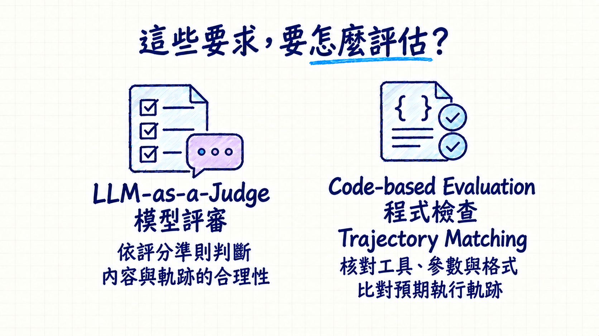

### 核心訊息

程式檢查與模型評審，是可以搭配的評估方法。

### 搭配講稿

上一頁的Outcome和Trajectory，是要評估什麼；這一頁是怎麼評估。先看左邊：需要語意判斷時，可以讓模型依準則評審，這就是LLM-as-a-Judge。再看右邊：Code-based Evaluation，是把明確條件寫成程式檢查，例如Builder有沒有呼叫、參數是否正確、交付是否對應工具回傳的結果。把實際工具步驟與預期軌跡比對，可以用Trajectory Matching；哪些步驟必須做、順序是否重要，要依任務要求決定。左右排列方便接續上一頁，但不代表Outcome只能用Judge、Trajectory只能用程式；兩種方法能搭配，也不固定綁定結果或軌跡。Judge也可能判錯。這裡的Builder案例有明確條件，用程式核對即可，接著就看這個做法。

### 接下一頁

Builder有沒有呼叫、交付來源對不對，就能用程式核對。

### 本頁重點

- LLM-as-a-Judge：依準則評審內容或執行軌跡。
- Code-based Evaluation：核對明確條件；Trajectory Matching比對預期步驟。

## 26｜把明確要求，做成程式檢查

章節：Skill 與 Evaluation：說明如何變成測試

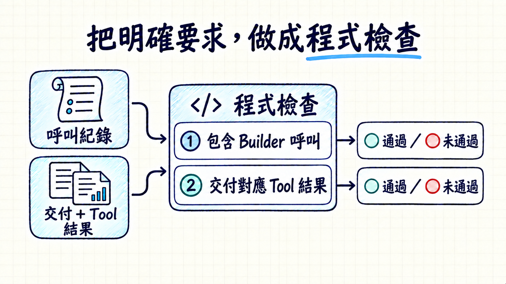

### 核心訊息

把Builder的必要操作與交付來源，寫成明確檢查。

### 搭配講稿

這個案例有兩項明確條件，可以交給程式核對。第一，從實際工具呼叫紀錄確認build_execution_summary有被呼叫。第二，把最後交付與這次Builder回傳的報告或引用對照，確認交付對應的是它的結果。報告的外觀不能證明來源；只有呼叫成功，也不能證明最後交付用了它的輸出。這個檢查需要保留Tool回傳結果及可核對的交付資料，並依報告的交付形式實作對照。這裡是在測試執行後判斷有沒有達標，沒有再驗證Builder底層分析內容是否正確。每次都用同一套標準，才有辦法比較後續多次測試。

### 接下一頁

檢查標準固定後，還要重跑看看是否穩定。

### 本頁重點

- 核對工具紀錄，是否真的呼叫指定Builder。
- 比對Builder回傳結果與最後交付，逐項記錄通過或失敗。

## 27｜固定條件重跑，觀察流程是否穩定

章節：Skill：流程真的會照做嗎？

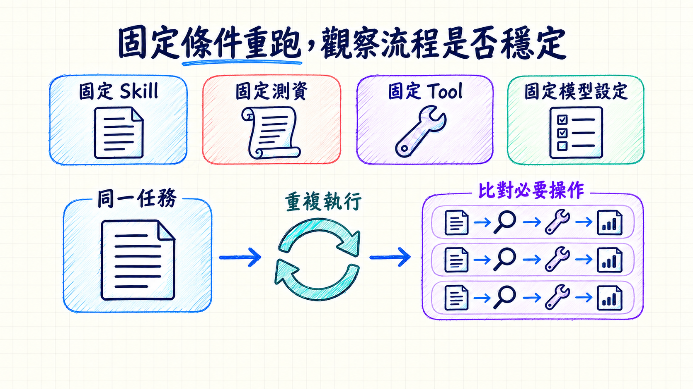

### 核心訊息

固定條件，多跑幾次，觀察是否穩定達標。

### 搭配講稿

上一頁把這個案例的檢查訂清楚了：指定報告與必要Builder。一次照著Skill做，只能說這次成功。我固定同一版Skill、測資、Tool與模型設定，重跑同一個任務，每次都用同一套標準檢查。這樣才能觀察相同條件下是否仍會漏步驟。圖上的紀錄是方法示意，沒有新增通過率；不同情境的回歸與接受門檻，後面驗收修改時再談。

### 接下一頁

即使測試全過，能保證下一次也一定照做嗎？

### 本頁重點

- 固定Skill、測資、工具與模型設定。
- 每次都用同一套標準，不能只看一次成功。

## 28｜測試全過，不代表下次一定照做

章節：Skill：流程真的會照做嗎？

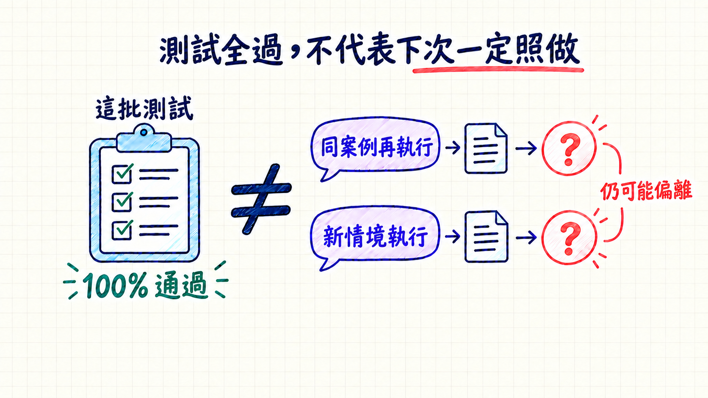

### 核心訊息

測試提高信心，但不是未來每次執行的保證。

### 搭配講稿

假設剛才那一批測試全部通過，我們也不能把它當成下一次一定照做的保證。這裡的100%是有限測試全過的概念示意，不是新增一組實測。Skill仍是自然語言說明，LLM仍有機率性；同一案例再執行，也可能偏離，新情境更不能直接推論。Evaluation提供改善依據與這批測試的觀察，不等於每次執行的承諾。這就帶出下一個問題：某種錯偶爾發生一次，我能不能接受？

### 接下一頁

一次都不能接受的錯，就需要系統承接。

### 本頁重點

- Skill仍是自然語言，模型仍可能偏離要求。
- 要區分：哪些錯能接受，哪些條件不能只靠模型守住。

## 29｜不能接受的錯，就不能只靠模型遵守

章節：Guard、Evidence 與人工確認

### 核心訊息

能容忍的行為持續改善；不能放行的條件由系統守住。

### 搭配講稿

我會先問這項錯誤偶爾發生，業務能不能接受。如果能接受，就用Skill引導並透過Evaluation持續改善；如果某項條件一次都不能違反，就不能只期待LLM每次遵守。這時責任要落到系統能檢查的位置。後面仍會用同一個Log報告任務，但從流程是否照做，轉到報告結論是否有證據；同時以日期結果與修改權限說明其他系統檢查。這不是拿漏Builder的案例硬鎖整套流程。Guardrail守的是明確定義與實作的條件，不是消除所有未知風險。

### 接下一頁

用日期、報告證據與修改權限，看看系統怎麼承接。

### 本頁重點

- 用Skill引導、Evaluation衡量與改善表現。
- 不可接受的條件，需要實際的檢查與限制。

## 30｜把不可接受的錯，變成可檢查的條件

章節：Guard、Evidence 與人工確認

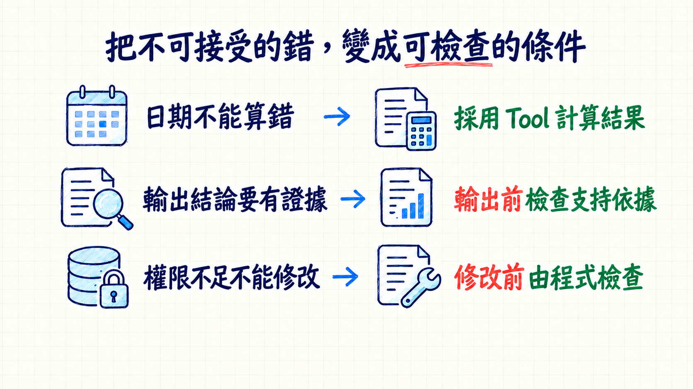

### 核心訊息

把不可接受的錯，落成系統能檢查的條件。

### 搭配講稿

日期不能算錯，就由工具依明確的日期、時區與日曆規則計算，正式結果採用工具輸出，而不是只請模型用工具，最後還接受自行心算的值。輸出結論要有證據，就在正式輸出前對回相關工具結果，確認每項結論都有支持依據。權限不足不能修改，就在修改前由程式依使用者、資源與動作核對權限；權限不足就阻擋修改，不讓LLM自行宣告有權。這三例不是必經順序，共同點是系統真的承接檢查責任。

### 接下一頁

回到Log報告：查到了資料，結論就一定有依據嗎？

### 本頁重點

- 日期採用工具輸出；報告結論要有相關工具結果支持。
- 修改前由程式檢查權限，權限不足就阻擋。

## 31｜同一份 Log 報告，還可能多出沒有依據的內容

章節：Guard、Evidence 與人工確認

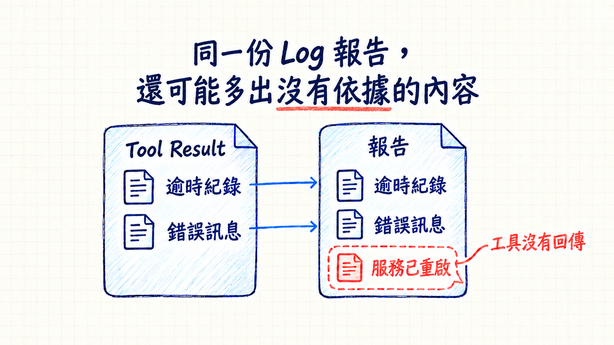

### 核心訊息

查回Log後，報告仍可能多出工具沒有回傳的內容。

### 搭配講稿

仍然是前面的Log分析與報告任務，但現在換一個檢查問題：報告中的結論是否都有工具結果支持。有沒有呼叫指定Builder，是前面的流程檢查；模型提出的結論有沒有Tool Result支持，是這裡的內容檢查。這不是說Builder本身在編造內容，而是不能讓LLM沒有依據的分析混進正式輸出。我在實務上遇過，LLM把工具結果裡沒有的內容寫進report。圖上用逾時紀錄和錯誤訊息做教學示意，工具只回這兩項，報告卻多寫服務已重啟；這句不是實際報告的逐字引文。我要擋的是模型自己補出的事實，不是再讓它判斷Tool Result本身是不是正確。所以正式報告的結論，每一項都要找得到相關工具結果的支持。

### 接下一頁

不是整份報告有引用就好，每項結論都要對回資料。

### 本頁重點

- 流程照做，與結論有依據，是兩種不同檢查。
- 圖中的「服務已重啟」只是示意，不能由模型自行補成事實。

## 32｜每一項結論，都要對回 Tool Result

章節：Guard、Evidence 與人工確認

### 核心訊息

證據要真的對得上結論，不是有Ref就算數。

### 搭配講稿

以剛才的教學示意來看，報告說有逾時紀錄，就要對回工具實際回傳的相關片段；說有錯誤訊息，也要有另一項對應結果。Ref讓我們找到來源，但有Ref還不夠：不能指到不相關資料，或者把來源沒有說的事塞進結論。我要驗證的是正式輸出有沒有對應且相關的Tool Result支持，不是重新判斷Tool Result本身真假，也不是LLM自己寫一段話再稱它為證據。系統具體怎麼對照與拒絕，仍需依工具回傳和輸出規格定義。

### 接下一頁

對不到支持的結論，就不能放進正式報告。

### 本頁重點

- Ref有效，對應片段也要與結論相關、內容相符。
- 核對支持關係，不是重新驗證工具資料本身真假。

## 33｜沒有對應證據的結論，不能進正式報告

章節：Guard、Evidence 與人工確認

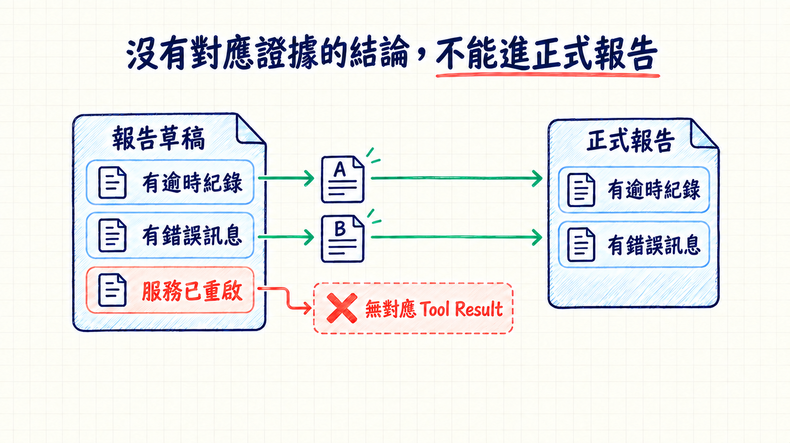

### 核心訊息

只交付有工具結果支持的結論。

### 搭配講稿

正式輸出前，這些結論要有對應且相關的Tool Result支持。圖上的前兩項能對回結果，所以進正式報告；服務已重啟沒有工具支持，就不能混成已確認的結果。這不代表我們證明服務一定沒有重啟，而是目前沒有這個依據。可以清楚說缺了哪份資料，或再安排查詢，不能由LLM自行補造。這裡守的是報告有沒有依據，不是重新審判Tool Result真假；Guardrail也不是只因掛了名字，就自動能辨識所有語意錯誤。

### 接下一頁

除了它說了什麼，接著看它要做什麼、我是否允許。

### 本頁重點

- 沒有回傳的內容，不讓模型補成已確認結果。
- 缺資料可以說明限制或補查，不能靠人替無證據結論蓋章。

## 34｜Agent 要做什麼，有時需要人先確認

章節：Guard、Evidence 與人工確認

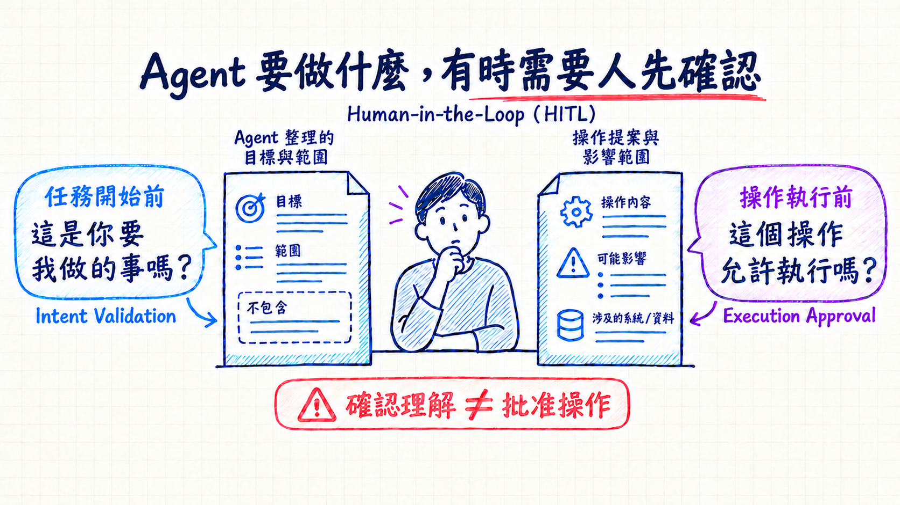

### 核心訊息

人可以確認任務理解，也可以批准接下來的操作。

### 搭配講稿

前面檢查的是Agent說了什麼、有沒有依據。接下來換一個問題：它準備做什麼，是不是我要它做的，以及我是否允許這個操作？報告有依據，不能回答這兩個問題。Human-in-the-Loop是在需要的時機把人的確認放進執行流程：任務開始前，先呈現理解的目標與範圍，由使用者確認或修正；特定操作執行前，先呈現操作與影響，由人批准或拒絕。這是在介紹兩種確認時機，不是在報告交付後才補做確認，也不是讓人替無證據的結論蓋章。每個任務不一定需要兩種確認；依需求與風險選擇。

### 接下一頁

先看第一種：確認理解的目標與範圍。

### 本頁重點

- 理解確認：Agent準備做的是不是我要的？
- 操作批准：這次行動是否允許執行？

## 35｜先確認目標與範圍，再開始任務

章節：Guard、Evidence 與人工確認

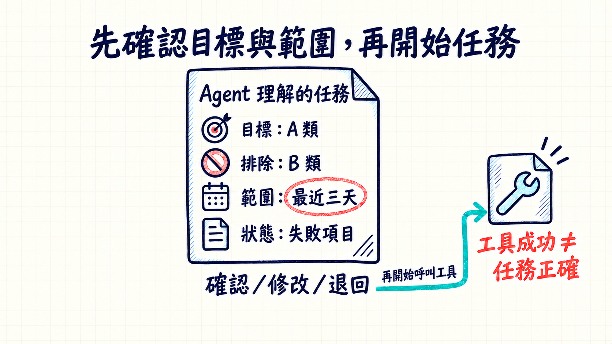

### 核心訊息

先確認目標與範圍，避免成功完成錯任務。

### 搭配講稿

先看第一種：確認它理解的目標與範圍，再開始任務。像「找 A 類、排除 B，只處理最近三天失敗項目」，同時包含目標、排除條件、時間範圍與狀態。先把 Agent 理解的內容整理成可閱讀的確認摘要，讓使用者確認、修改或退回，再依確認後版本開始。這裡是在確認有沒有理解對，不是在批准扣款或寫入。如果範圍一開始錯了，後面每個 Tool Call 都成功，仍可能完成錯誤任務。

### 接下一頁

理解確認後，寫入、扣款或通知仍可能需要批准。

### 本頁重點

- 確認要做什麼、不做什麼，以及處理範圍。
- 意圖確認和操作批准，解決的是不同問題。

## 36｜寫入、扣款或通知前，先取得批准

章節：Guard、Evidence 與人工確認

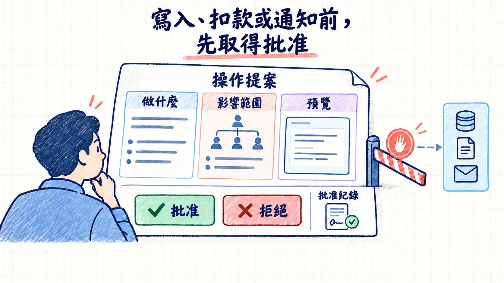

### 核心訊息

有影響的操作，先讓人看懂再決定是否執行。

### 搭配講稿

另一種是批准操作：理解對了，也不代表可以直接寫入、扣款或通知。寫入、開單、扣款或對外通知等高風險操作，不能只靠 Skill 裡一句「請先取得批准」。系統要停在人工 Gate 前，讓人看懂提案與影響範圍，再批准或拒絕。紀錄還要保留誰批准、何時批准，以及當時看到哪一份預覽。

### 接下一頁

批准了，也不代表執行時的狀態還跟當時一樣。

### 本頁重點

- 顯示提案、影響範圍與預覽，再取得批准。
- 留下批准者、時間，以及批准的是哪個版本。

## 37｜批准後，執行前仍要重新檢查條件

章節：Guard、Evidence 與人工確認

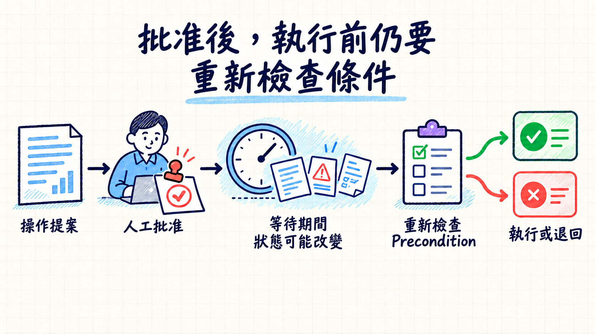

### 核心訊息

批准到執行之間，資料或權限可能已經改變。

### 搭配講稿

Approval會把一次Agent Run切成提案與執行兩段，中間可能隔幾分鐘或幾小時。資料可能已被別人處理，任務可能已關閉，帳務或權限狀態也可能改變。因此批准不是永久通行證。Runtime在真正執行前仍要重新檢查Precondition，並留下批准內容與檢查結果。到這裡談的是執行前的確認與防錯。接下來換到另一個議題：出了問題，我們如何回看當時的執行、追查原因。

### 接下一頁

前面談防錯；但任務仍出錯時，要怎麼追查？

### 本頁重點

- 真正執行前，再檢查必要條件。
- 留下批准內容與檢查結果，不能直接沿用舊狀態。

## 38｜除了防錯，也要能追查出錯原因

章節：從防錯，轉向出錯後的追查

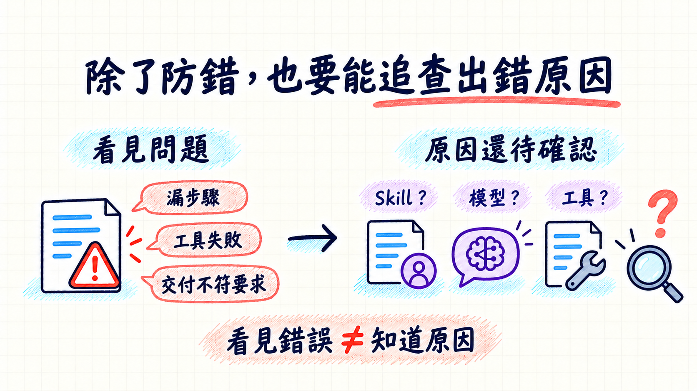

### 核心訊息

看到錯誤現象，還不等於知道原因。

### 搭配講稿

前面談怎麼在執行前防錯，現在換到出了問題要怎麼追查。漏步驟、工具失敗、交付不符要求，都是我們可能看見的問題；但看見這些現象，還不能直接說是Skill沒說清楚、模型沒照做，還是工具的問題。右側三個問號代表待確認方向，不是已查明原因。這頁只帶出追查需求，不再重講批准，也不先展開四類紀錄。接著回到漏Builder那次，說明為什麼必須留下出錯當時的資料。

### 接下一頁

回到漏Builder那次：重新跑一次，就能解釋原本的失敗嗎？

### 本頁重點

- 漏步驟、工具失敗、交付不符要求，是看見的問題。
- 要用當時資料判斷，不先認定是Skill、模型或工具的錯。

## 39｜再跑一次，不能代替回看出錯那次

章節：Trace：從發現錯誤，到找到修改線索

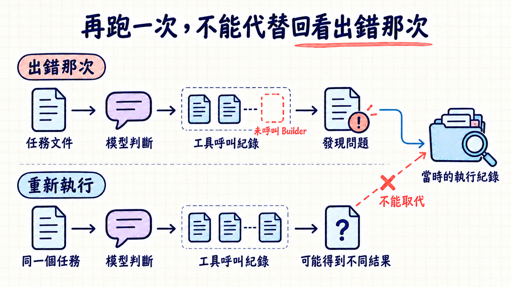

### 核心訊息

重新執行是另一輪，不能代替出錯那次的資料。

### 搭配講稿

回到前面漏Builder的案例。為了找問題，我們可能會再跑一次；但同一個任務的新執行，可能產生不同模型回應、工具呼叫或結果。這次有沒有呼叫Builder，不能直接解釋上次為什麼漏了它。圖中兩條執行是方法示意，不是新增實測；下方仍是同一個任務，不是刻意換題。重跑可以作為後續測試或比較，但追查原本那次，仍要看那次實際收到什麼、模型回了什麼、工具做了什麼。缺少紀錄，不能拿另一輪的資料補成當時事實。

### 接下一頁

所以執行時，要留下能對回同一任務的四類資訊。

### 本頁重點

- 同一任務重跑，模型回應與工具操作可能不同。
- 追查原本那次，要看它當時實際收到與做了什麼。

## 40｜先留下 AI 能協助追查的資訊

章節：Trace：從發現錯誤，到找到修改線索

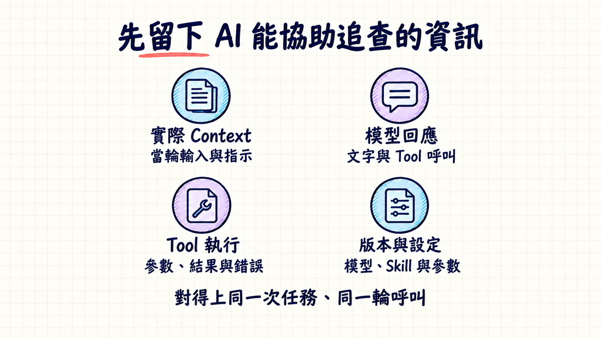

### 核心訊息

保留實際輸入、回應、工具操作與版本設定。

### 搭配講稿

上一頁說要回看出錯那次，這裡具體列出需要留下的四類資料：當輪實際送出的Context、模型回應、Tool的呼叫參數與結果或錯誤，以及模型、Skill與相關版本設定。資訊必須能對回同一次任務與相應呼叫，版本標記也要能找回實際Skill內容。保存時遮蔽敏感資料或限制存取。這些是追查依據，不是保證重新執行會得到相同結果。

### 接下一頁

把這些紀錄放回Builder案例，就能逐段對照。

### 本頁重點

- 當輪Context與模型回應。
- Tool呼叫參數、結果或錯誤。
- 模型、Skill版本與設定；資料要能對回同一次任務。

## 41｜漏了 Builder，要對照哪些紀錄？

章節：Trace：從發現錯誤，到找到修改線索

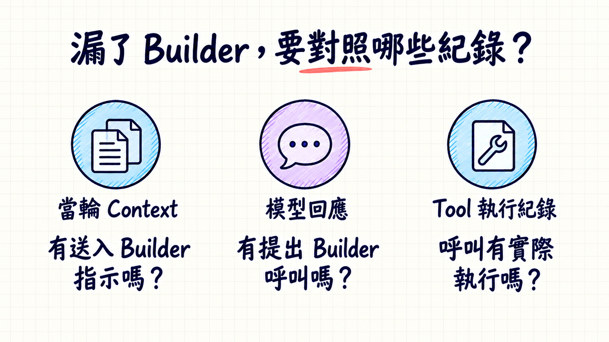

### 核心訊息

沿著實際紀錄，定位Builder在哪個環節缺漏。

### 搭配講稿

有了上一頁的四類資訊，再沿用漏Builder案例逐段核對。先看當輪Context有沒有送入Builder指示，再看模型回應有沒有提出Builder呼叫，最後看Tool執行紀錄中呼叫有沒有實際執行、是否回傳錯誤。這是查出在哪個環節發生缺漏，不是只憑其中一項就確認根本原因。三個問題都待紀錄確認；若紀錄不完整，查不到也不能直接當作沒有發生。

### 接下一頁

這些交叉比對，也能讓AI協助整理。

### 本頁重點

- Context有送入指示？模型有提出呼叫？
- Tool有實際執行或報錯？缺紀錄不能直接當作沒發生。

## 42｜把執行紀錄交給 AI，協助找線索

章節：Trace：從發現錯誤，到找到修改線索

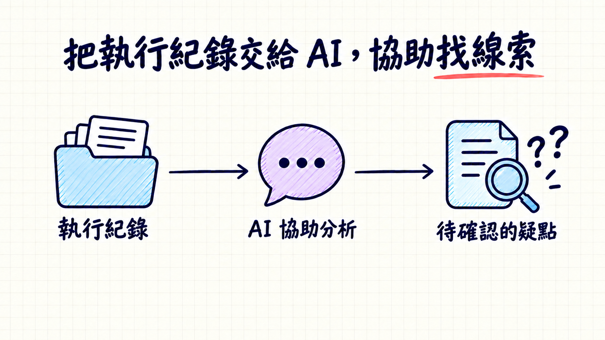

### 核心訊息

讓AI依紀錄找線索，不替缺漏編造原因。

### 搭配講稿

我可以把對得起來的執行紀錄交給AI，讓它協助找出可疑環節、指出依據，以及還需要查什麼。這不代表AI能讀出模型的內部思考，也不能把它事後說得通的解釋當成已確認原因。紀錄不足就要承認尚未確認，再補查。

### 接下一頁

有了修改方向，接著要驗證是否真的改善。

### 本頁重點

- 疑點要附上對應紀錄，讓人能回查。
- 推測仍待確認，線索不等於已證明的原因。

## 43｜提出修改，再用 Evaluation 驗證

章節：Trace：從發現錯誤，到找到修改線索

### 核心訊息

提出候選修改，再以實際執行驗證效果。

### 搭配講稿

如果追查指向Skill的說明需要修正，可以先提出候選修改，再用Evaluation跑任務，檢查流程與交付是否改善。圖上的再測一次是重新執行評估，不是只跑一個案例就證明可靠。接下來會把整次任務、輸出、步驟與其他情境一起放進驗收。

### 接下一頁

修好這個問題，會不會弄壞其他原本通過的情境？

### 本頁重點

- 依追查線索修改，不預設一定要改Skill。
- 驗證流程與交付，而不是只看文字改得好不好。

## 44｜修好一個問題，也可能弄壞其他情境。

章節：Evaluation：修改如何驗證？

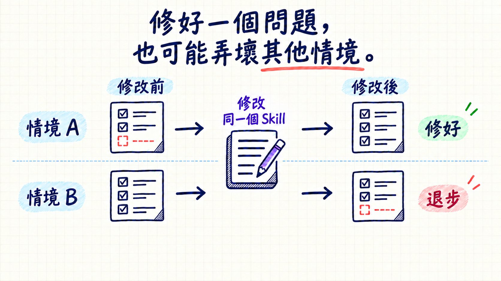

### 核心訊息

修好一個失敗，不代表其他能力沒有退步。

### 搭配講稿

修好一個問題，也可能弄壞其他情境。我曾為了修一個failure case修改Skill，原本失敗的情境過了，重跑其他情境卻發現原本會過的流程壞掉。圖中A修好、B退步是影響的示意，不是新增實測統計。Skill的說明會影響模型在整次任務中的判斷，不一定只影響我們想修改的那一步。因此接受修改不能只看原本的失敗是否修好。

### 接下一頁

因此完整任務和其他情境，都需要重測。

### 本頁重點

- Skill修改可能影響原本通過的情境。
- 驗收不能只看原失敗，要避免修A壞B。

## 45｜改完 Skill，完整流程與其他情境都要重測

章節：Evaluation：修改如何驗證？

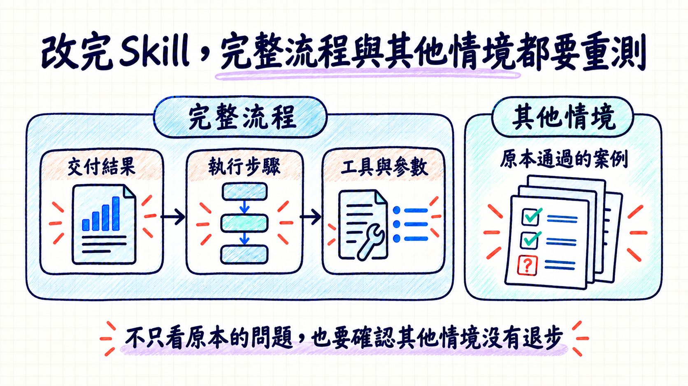

### 核心訊息

驗收修改，要同時看完整任務與其他情境。

### 搭配講稿

上一頁的修A壞B，說明為什麼不能只重測原本那個錯。這裡要測兩個範圍：第一是完整任務，核對交付結果、必要執行步驟與工具參數；第二是其他原本通過的情境，確認修改沒有造成退步。左側三張卡是同一任務的檢查面向，不是新的操作順序；右側是其他測試情境。沿用既定成功標準與測試條件，不因修改而放寬要求。接下來先用漏Builder的報告任務，示範完整流程如何核對。

### 接下一頁

先回到原本的失敗：Builder這次有呼叫嗎？

### 本頁重點

- 核對交付、步驟、工具與參數。
- 重跑原本通過的案例，確認有沒有退步。

## 46｜漏掉的 Builder，這次有呼叫嗎？

章節：Evaluation：修改如何驗證？

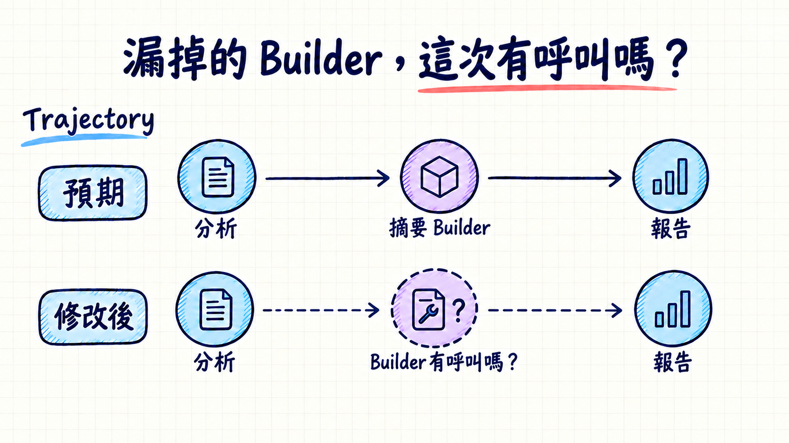

### 核心訊息

驗收這版修改，先確認必要Builder沒有再漏掉。

### 搭配講稿

這次修改是為了改善漏Builder，就要回看修改後的實際工具紀錄，確認build_execution_summary確實出現，而且在這個情境要求的位置發生。圖是驗收方法示意，沒有宣稱某個候選版本已通過。不同情境可以有合法分支，我們檢查的是各自的必要操作、順序與停止條件，不是把每一個Run硬套成完全一樣的路徑。

### 接下一頁

有呼叫，還要看傳給它的資料是不是正確。

### 本頁重點

- 從實際呼叫紀錄，核對必要步驟有沒有執行。
- 允許合法分支，但仍要符合該情境的要求。

## 47｜呼叫了 Builder，傳入的資料也對嗎？

章節：Evaluation：修改如何驗證？

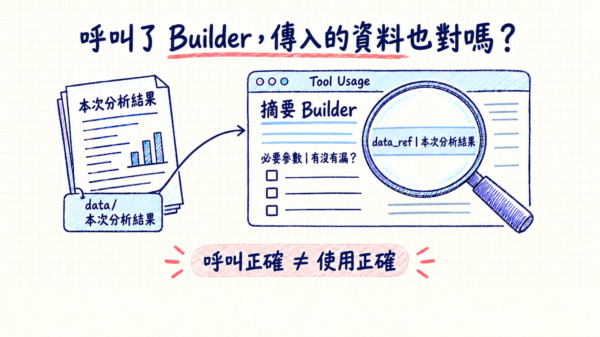

### 核心訊息

工具叫對了，參數與資料引用也要對。

### 搭配講稿

上一頁驗收必要Builder是否被呼叫，這一頁再看這版Skill如何使用它。傳入的Ref要對應本次分析結果，必要參數不能漏，也不能把Tool error當成正常資料繼續處理。工具名稱正確只是第一步。修改後用實際的工具輸入紀錄核對，才能知道Agent有沒有正確把資料交給Builder。

### 接下一頁

操作和資料核對後，再看正式交付的報告。

### 本頁重點

- Ref是否對應本次分析結果？
- 必要參數與使用條件，是否符合任務要求？

## 48｜輸出報告，格式與內容也要符合要求

章節：Evaluation：修改如何驗證？

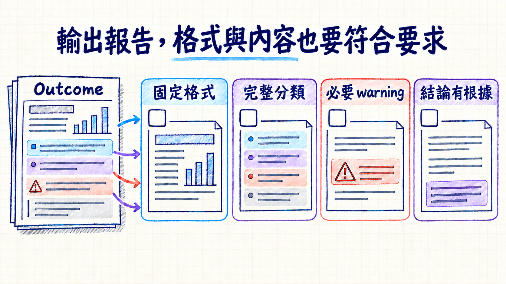

### 核心訊息

實際交付的報告，也要符合格式與內容要求。

### 搭配講稿

前面核對Builder有沒有呼叫，以及傳入的Ref和參數是否正確。接著驗收使用者實際拿到的報告：固定格式、完整分類與必要warning有沒有交出來；結論是否有工具結果支持。呼叫與傳入資料符合要求，還要把最後交付對回這次工具回傳的報告或引用，並用既定交付標準核對。不能因為新版看起來比較順，就說修改有效，也不能為了讓它通過而放寬標準。這是對正式交付的測試，不是請LLM重新判定Builder底層程式的正確性。

### 接下一頁

這些驗收項目，哪些用程式、哪些用Judge？

### 本頁重點

- 核對分類、必要欄位與warning，不只看文字流暢。
- 結論要有對應資料支持，不能把新增敘述當既定事實。

## 49｜驗收修改：哪些用程式，哪些用 Judge？

章節：Evaluation：修改如何驗證？

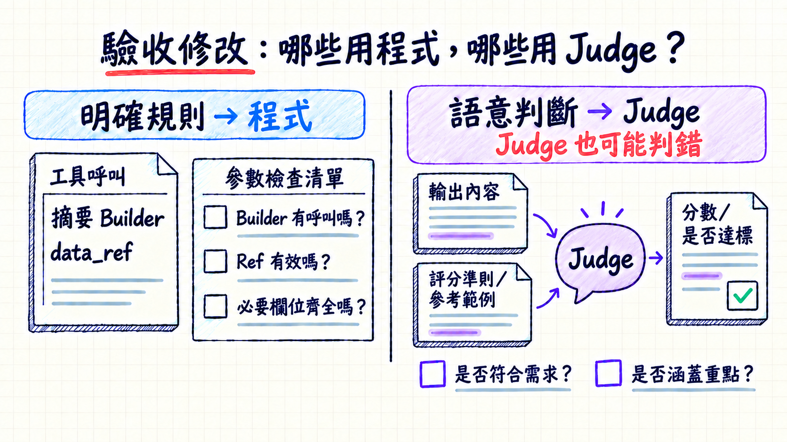

### 核心訊息

明確條件用程式；語意品質依準則交給Judge評審。

### 搭配講稿

前面核對了Builder呼叫、傳入資料與報告交付，現在對應適合的驗收方法。Builder有沒有呼叫、Ref是否有效、必要欄位是否齊全，能明確判定就用程式。若要評估是否回應需求、語意上是否涵蓋重點等輸出品質，可以把輸出內容、評分準則與參考範例交給Judge，得到分數或是否達標的判定。固定格式本身不需要再請Judge判斷；這裡是選用方法，不是在Builder案例上硬加一道模型評審。Judge也可能判錯，需用人工判定樣本核對與校準。它不會自動驗證來源真偽；若特別提供來源與groundedness準則，才可另外輔助評估支持程度，這不是本頁重點。測試評審仍不是執行保證。

### 接下一頁

檢查方法有了，通過幾次才接受這版修改？

### 本頁重點

- Builder呼叫、有效Ref與必要欄位，可用程式檢查。
- Judge讀輸出、準則與範例；仍需校準，不會自動驗證來源真偽。

## 50｜通過幾次，才接受這版修改？

章節：Evaluation：修改如何驗證？

### 核心訊息

依風險與成本，先訂接受候選修改的門檻。

### 搭配講稿

前面已說過不能只跑一次；現在是要訂接受這版修改的門檻。例如某個情境要求十次成功九次，或者另一種要求五次全部通過。這些是主稿的門檻示例，不是新增實測，也不能直接比較五次全過一定比十次九次可靠。實際門檻要看這個情境的風險、成本與可接受錯誤程度。高風險不能只靠加大測試次數來保證安全，仍要有相應Guard。

### 接下一頁

門檻訂好，還要把踩過的坑留進測試集。

### 本頁重點

- 十次過九次、五次全過是門檻示例，不是新增實測或可靠性排名。
- 有限測試不保證下次成功，也不能取代Guard。

## 51｜踩過的坑，留進回歸測試

章節：Evaluation：修改如何驗證？

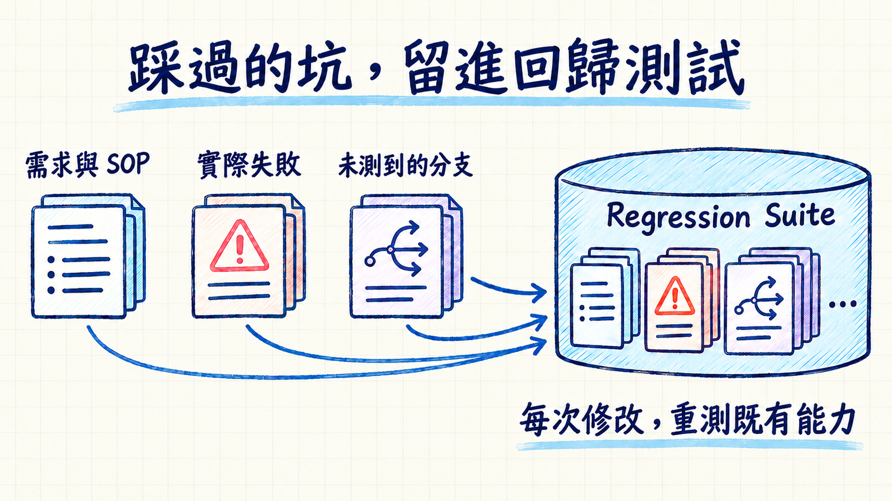

### 核心訊息

需求與真實失敗持續累積，變成後續修改的回歸測試。

### 搭配講稿

回歸測試就是修改後重查原本的能力。第一版情境可從需求與 SOP 拆出來；遇到真實失敗就補進去，也可讓 AI 找未測分支。昨天踩過的坑，明天應該能自動檢查。

### 接下一頁

有了測試集與接受標準，就能讓AI協助撰寫Skill。

### 本頁重點

- 從需求與SOP起步，補進失敗與未測分支。
- 每次修改都重測，讓昨天踩過的坑明天能自動檢查。

## 52｜從第一版 Skill 到功能完成，我沒有手寫過一行 Prompt。

章節：AI 協助撰寫與修正 Skill

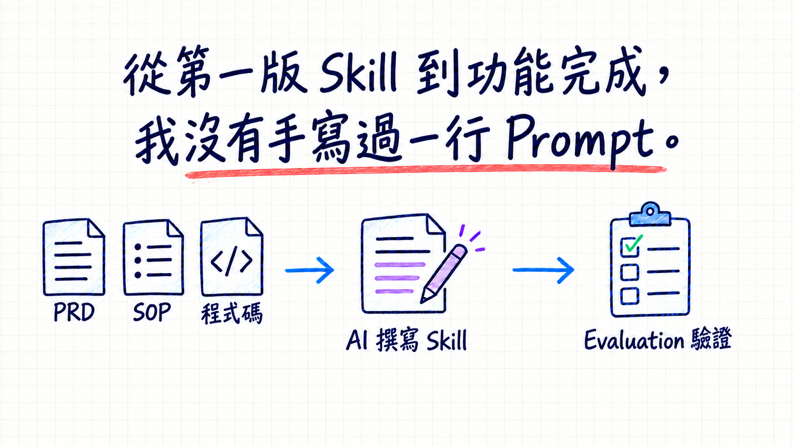

### 核心訊息

AI產生候選Skill，人用測試結果驗收。

### 搭配講稿

有了前面的測試與接受標準，就可以把Skill撰寫也交給AI協助。在我的系統裡，從第一版Skill到功能完成，我沒有手寫過一行Prompt。我讓協助開發的AI讀PRD、SOP和程式碼，產生第一版Skill，再跑Evaluation找出實際行為和目標的差距。這不是沒有人的要求，也不是AI自行定義成功；人仍然負責需求與接受標準。這裡的AI是協助開發的角色，不是正式執行任務的Agent。

### 接下一頁

測試沒達標，就把紀錄交給AI分析與修正。

### 本頁重點

- 開發用AI讀PRD、SOP與程式碼，產生第一版Skill。
- 這不是執行任務的Agent；人仍定義需求與成功標準。

## 53｜Eval 的價值不是分數，而是讓 Skill 能被持續修正。

章節：AI 協助撰寫與修正 Skill

### 核心訊息

用測試差距與執行紀錄，推動Skill持續修正。

### 搭配講稿

Eval的價值不是分數，而是讓Skill能被持續修正。Evaluation指出實際行為與目標的差距，Log和Trace提供追查材料；AI據此分析並提出Skill修改，再跑回歸。尚未符合就繼續修正，符合接受條件才送審。重點不是追高分，也不是原封不動一直重跑，而是让回饋真正推動下一版修改。

### 接下一頁

AI可以修改，但成功與接受標準仍由人負責。

### 本頁重點

- AI讀失敗紀錄、分析原因、提出候選修改。
- 修完再跑回歸，達到接受條件才送審，不是無限盲目重試。

## 54｜人定義成功標準，修改用測試結果驗收

章節：AI 協助撰寫與修正 Skill

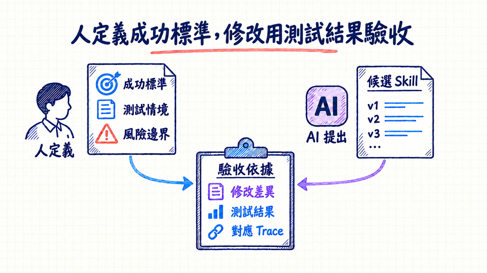

### 核心訊息

人掌握目標與標準，AI提出修改。

### 搭配講稿

人的重心轉為定義什麼算成功、該測哪些情境與哪些風險不能接受。AI 可以產生與修改 Skill，但不能為了過關任意放寬標準。接受候選修改時，要看修改差異、測試結果和對應紀錄。

### 接下一頁

這個循環反覆進行，成本也要一起掌握。

### 本頁重點

- 人定義測試場景、成功要求與不可接受的風險。
- 驗收看差異、測試與紀錄，不能為了過關放寬標準。

## 55｜每輪產生、測試與修正，都要留下成本紀錄

章節：每輪迭代的成本

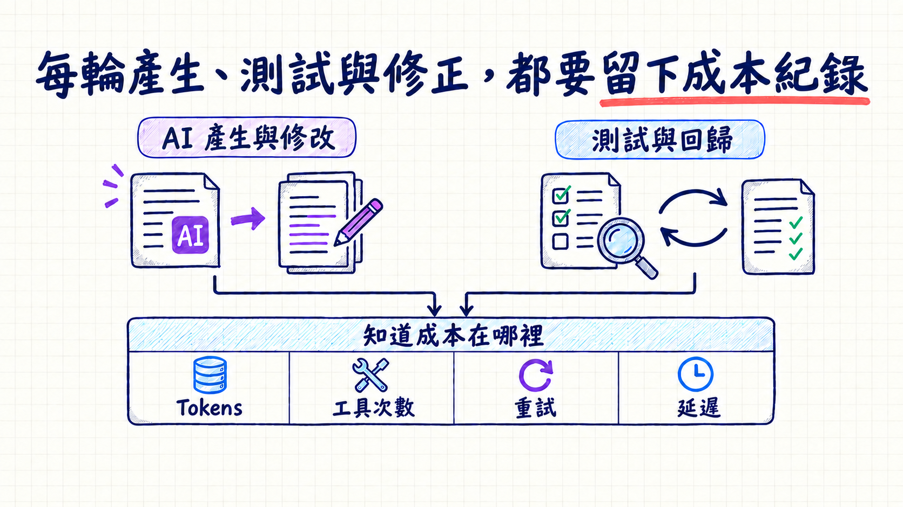

### 核心訊息

改進循環與正式執行，都有資源代價。

### 搭配講稿

這個循環不是免費的。AI 讀紀錄和修 Skill、測試和回歸都需要資源。重點不是先問付不付得起，而是記錄每輪 Tokens、工具次數、重試和延遲，知道成本在哪裡，才能比較修改的效果與代價。

### 接下一頁

回到開場：讓Loop跑起來，和正確完成任務，是不同的事。

### 本頁重點

- AI讀紀錄、改Skill、測試與回歸，都要記錄成本。
- 看Tokens、工具次數、重試與延遲，才能比較效果與代價。

## 56｜寫出一個 Loop 很簡單，讓一個 Loop 能夠正確地完成任務，才是困難的工程問題。

章節：收尾：把任務做對與資源限制

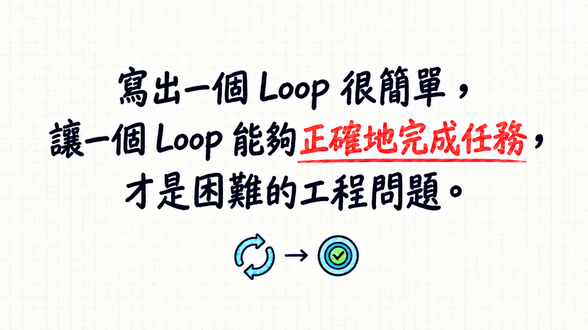

### 核心訊息

真正困難的，是讓循環正確完成任務。

### 搭配講稿

回到一開始，我們幾行程式碼就能讓這個Loop跑起來。但真的交給它任務後，才會遇到Context塞太多、Skill沒有照做、報告出現工具沒回傳的內容，以及出錯後難以追查。前面這些工程工作，不是為了堆模組，而是為了讓它在實際條件下把任務做對。寫出一個Loop很簡單，讓一個Loop能夠正確地完成任務，才是困難的工程問題。

### 接下一頁

模型會進步，但能不能只等下一個更強的模型？

### 本頁重點

- 能運作，不等於能正確交付。
- Context、Skill、Evaluation、Guard與執行紀錄，都在處理這件事。

## 57｜解決這個問題，不能只靠最新的模型。

章節：收尾：把任務做對與資源限制

### 核心訊息

模型能力、任務設計與驗證，需要一起考慮。

### 搭配講稿

更強的模型的確可能讓某些步驟更穩、讓原本難處理的任務做得更好。我不是說模型不重要，而是不能把所有問題都交給下一版模型。Context怎麼給、Skill寫了以後有多常照做、哪些結論需要Tool Result支持、出錯時能不能回看，都還是我們需要處理的事。圖中的模型名稱只是沿用選定示例，不代表性能比較或最新版本排名。解決這個問題，不能只靠最新的模型。

### 接下一頁

所以，我想用最後這句話收尾。

### 本頁重點

- 更好的模型有幫助，卻不是省略工程工作的理由。
- 換大模型、塞更多Context、增加重試，也會增加代價。

## 58｜模型會越來越聰明，但是你的口袋沒有越來越深。

章節：收尾：把任務做對與資源限制

### 核心訊息

在有限資源內，把任務做對。

### 搭配講稿

所以我們才要管理Context、用Evaluation了解表現、守住不能接受的錯、留下Trace，並且觀察Tokens、工具呼叫、重試與延遲。不是為了把系統做得更複雜，而是在有限資源裡讓Agent把任務做對。模型會越來越聰明，但是你的口袋沒有越來越深。

### 接下一頁

謝謝大家，接下來開放Q&A。

### 本頁重點

- 模型會持續進步，但可用資源仍有限。
- 前面的工程工作，都是為了讓Agent可靠交付，而不是一味增加成本。
